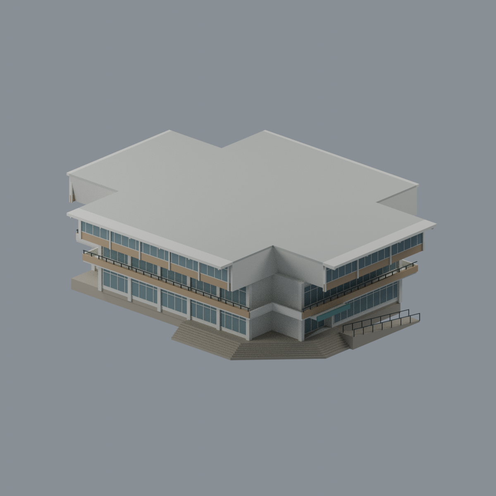
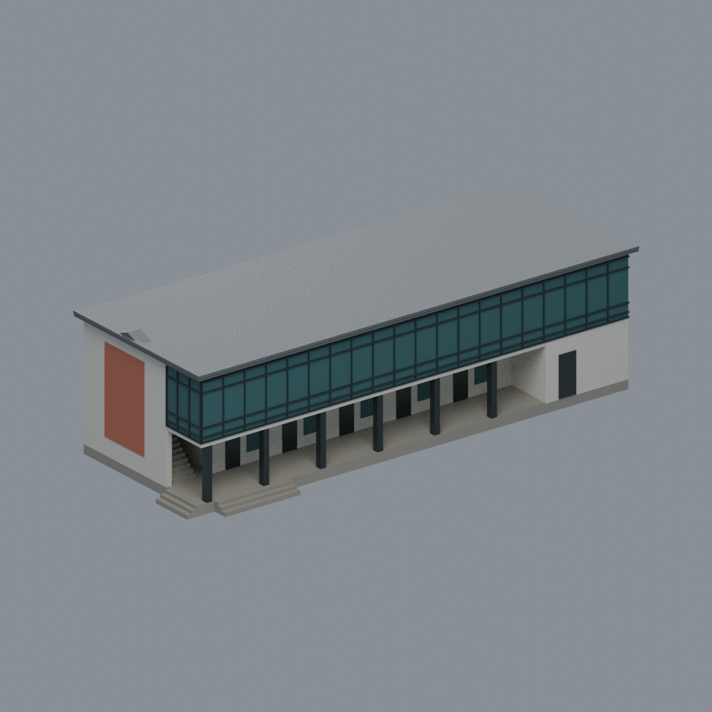
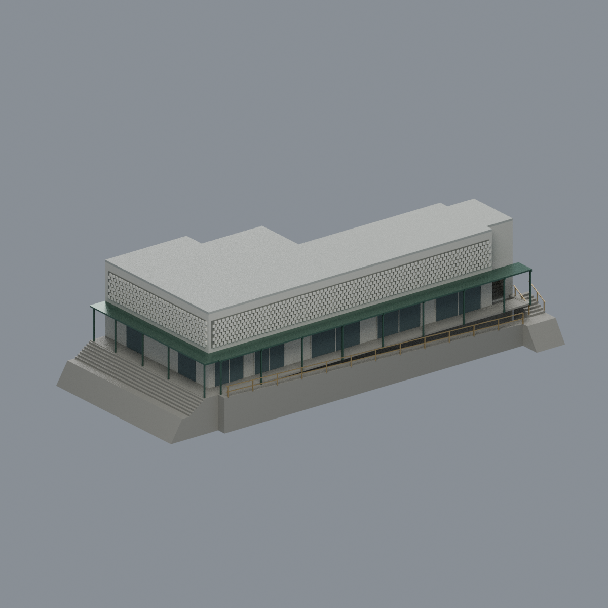

# 山下校區

本區17套建築外觀近似，並非全區完成；各件獨立比例與尺寸見模型說明。

| 建築模型 | 建築模型 | 建築模型 |
| :---: | :---: | :---: |
|  **[果夫樓](buildings/nccu-guofu/README.md)** [兩個可見瓦坡限域配色](buildings/nccu-guofu/appearance/) |  **[志希樓](buildings/nccu-zhixi/README.md)** |  **[四維堂（修復前外觀近似）](buildings/nccu-siwei/README.md)** |
|  **[井塘樓](buildings/nccu-jingtang/README.md)** |  **[中正圖書館](buildings/nccu-zhongzheng-library/README.md)** |  **[行政大樓](buildings/nccu-administration/README.md)** |
|  **[逸仙樓](buildings/nccu-yixian/README.md)** |  **[風雩樓](buildings/nccu-fengyu/README.md)** |  **[健康中心大樓](buildings/nccu-health/README.md)** |
|  **[研究大樓 — 官方PDF記錄之修繕前瓷磚外觀版，非2026修繕後現況](buildings/nccu-research-building/README.md)** |  **[資訊大樓（含電算中心）](buildings/nccu-information-complex/README.md)** |  **[學思樓](buildings/nccu-xuesi-hall/README.md)** |
|  **[新聞館](buildings/nccu-journalism-hall/README.md)** |  **[集英樓](buildings/nccu-jiying-hall/README.md)** |  **[第八教室／校友服務中心](buildings/nccu-eighth-classroom/README.md)** |
|  **[樂活小舖](buildings/nccu-lohas-shop/README.md)** |  **[大智樓](buildings/nccu-dazhi-hall/README.md)** |  |

每件具STL、可編輯Blend、參數來源、實際STL正背俯視預覽與可重跑QA。數位QA不等於切片軟體驗證或實體試印。

[井塘樓前庭有限白牆／雨棚配色與五視角](buildings/nccu-jingtang/appearance/README.md)（1404完整原面，其餘4772面中性；拍攝年代未知，非整樓現況全彩復原）。

逸仙樓、風雩樓、健康中心大樓與研究大樓的版本、來源與製造限制見各模型README；研究大樓保留官方PDF記錄之修繕前瓷磚外觀版，非2026修繕後現況。未實印，非全校區完成。

資訊大樓（含電算中心）是同一完整L形連體外觀參考模型；山下分組依官方PDF第9–10頁圖文及A15/A16同列建物(14)。低翼四層、開放頂框與局部端房，高翼五樓露台及六樓屋頂分別保留；包含退凹入口、柱階及曲核旁完整寬階，遠端外場通路不納。消防簡圖非建築竣工圖，細窗、高程及局部核心為近似；攝年未知，非已核2026現況。Blend／3MF／STL、五張實網格預覽及原byte重建來源ZIP齊備；薄框、切層警示與有限壁厚抽樣見QA，未實印。原照片和平面像素不入模型包，來源權利見SOURCES與LICENSE。

學思樓為完整四層九跨主樓及兩端突出教室翼的彩色外觀近似模型；山下分組依官方PDF第9–10頁溪流界文字及A5「學思樓(04)」圖文聯讀。保留中央與西端梯核、真開放柱廊、背牆、分別接地的外階及二樓貼樓平台，通往逸仙樓的獨立跨橋不納。屋頂簡圖六跨只作局部約束，不縮掉四樓實房；攝年未知、消防簡圖非測量竣工圖，精高、背面細窗及地形近似，非已核2026現況。Blend／3MF／STL、五張實網格預覽及可執行來源ZIP齊備；保留18層薄件警告，未實體試印。原照片和平面像素不入模型包，來源權利見SOURCES與LICENSE。

新聞館為完整兩層長條雙翼、中央三層房群及側小房、僅一層後凸門廳的彩色外觀近似模型；山下分組依官方PDF第9–10頁溪流分界及A23圖文聯讀。保留雙翼露平台、白色豎框、紅色實腹、青綠遮陽板，以及真凹入門廳、入口雨簷與接地階梯。669樹遮照片只作局部側角候選，不宣稱完整背面或唯一端頭。照片攝年未知，消防簡圖非測繪竣工圖，層高細窗色值及簷邊近似，非已核2026現況。Blend／3MF／STL、五張實網格預覽及可執行來源ZIP齊備；單正殼、253截面含14層薄件警告，未實體試印，細框欄杆及簷底支撐須另評估。原照片和平面像素不入模型包，實際來源與授權狀態見SOURCES與LICENSE。

集英樓為完整十字式三層主樓與局部B1外露基腳的彩色外觀近似模型；山下分組依官方PDF第9–10頁溪流分界與A22圖文聯讀。保留退縮窗背、開放陽台、真入口凹廊、上層厚外挑與斜肩、北西較深屋簷、兩處折階及有限接地坡道。照片較強為西北／西南同側雙角候選，但東側180度替代尚未唯一排除，未看見立面為規整代理；屋面僅有限平頂，細小構件精位用途未知未添加。攝年未知、簡圖非測繪竣工圖，樓高細窗色值近似，非已核2026現況。Blend／3MF／STL、五張實網格預覽及可執行來源ZIP齊備；單正殼、256截面含56層薄件警告，未實體試印，細框欄杆、外挑簷底及底下空間支撐須另評估。來源像素不入模型包，實際來源與重用權利狀態見SOURCES與LICENSE。

第八教室／校友服務中心為同一棟完整兩層長矩形主樓（60-9／A11），山下分組依官方PDF第9–10頁溪流分界與A11圖文。保留首層真柱廊及背牆、右遠端展示室封廊、左短端與前長側兩個正交短階，上層玻璃只覆前廊及可見廊深短角，其餘白牆及橘色飾面保留。共梯及有限寬上層回廊保持真空間。屋面僅低閉合包絡及可見灰簷／局部短折線，未證完整雙坡四坡、全脊長與背坡；沒有高塔或額外樓層。官方消防簡圖非竣工測繪，照片攝年未知、尺寸細窗色值近似，非已核2026現況。6色Blend／3MF／STL、五張實網格預覽及重建來源ZIP齊備；182截面有2層薄警，細框玻璃及屋脊尖端與柱廊頂板須評估尺度和支撐，未實體試印、不保免支撐。實際來源與權利狀態見SOURCES及LICENSE。

樂活小舖為完整兩層L形主樓（60-13），含同高右梯間與右兩bay局部B1及小凸角；A12是照片相鄰樂活館60-12，不是本舖自身校圖標號。山下分組為官方校圖與照片鄰接綜合判讀。保留上層不透明粗鏤空磚代理、下層店舖牆面及綠棚長廊，左寬階、長坡、右外階、B1內梯與內凹小階分立。有限局部地坪與斜切面只處理階坡接地，非實測地形或滿L地下室；右上梯為有限厚階板，保B1路徑空間。平頂有界近似，不加新塔及未知設備；消防簡圖非竣工測繪，攝年未知、尺寸細窗色值近似，非已核2026現況。8色Blend／3MF／STL、五張實網格預覽及重建來源ZIP齊備；205總截面含近頂部、85層薄警，細磚欄杆棚柱與懸挑須評估尺度和支撐，未實體試印、不保免支撐。來源與權利狀態見SOURCES及LICENSE。

大智樓為完整四層窄長主樓（60-19／A24），山下分組依官方PDF第9–10頁圖文。共同兩端梯、柱線、長廊與左單右雙衛生間區固定平面手性；二樓右端保有限平台、完整外直階及接地，不擴成四層新翼。長教室窗面及補強斜撐有界近似，未見廊側以中性實牆有限開口處理，不鏡射已見窗面；低平屋頂包絡不加塔或額外樓層。108內階及18外階、全級與中平台及出口有限寬地板／頭空共4320筆獨立測試通過，非測繪或法規淨高認證。消防簡圖非竣工圖、照片攝年未知，尺寸細窗與色值近似，非已核2026現況。6色Blend／3MF／STL、五張實網格預覽與重建源ZIP齊備；175切層152層薄警，獨立390/768樣本低於0.8mm、最小約0.17324mm，非全域壁厚保證；薄階板、窗框及多層空腔需支撐和困料評估，未實體試印、不保免支撐。實際來源與權利狀態見SOURCES及LICENSE。
