# 山下校區

本區12套建築外觀近似，並非全區完成；各件獨立比例與尺寸見模型說明。

| 建築模型 | 建築模型 | 建築模型 |
| :---: | :---: | :---: |
| [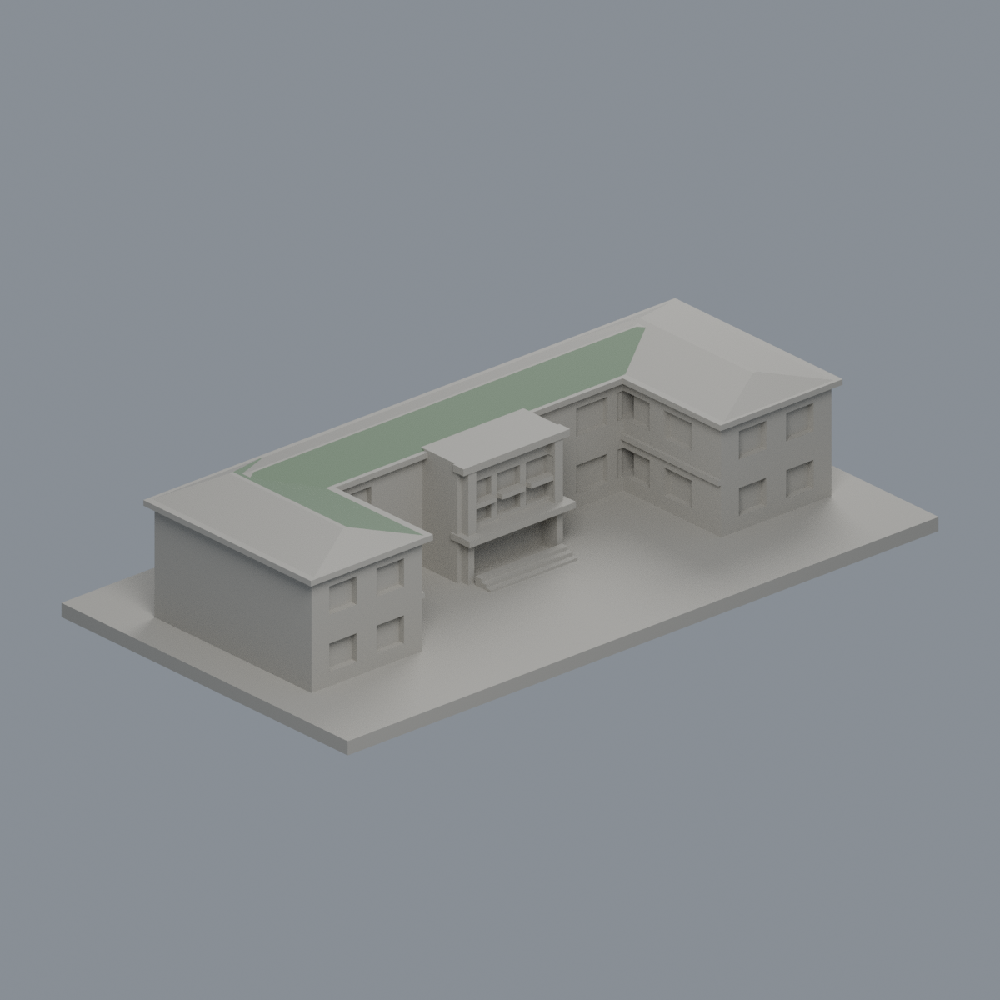](buildings/nccu-guofu/README.md) **[果夫樓](buildings/nccu-guofu/README.md)** [兩個可見瓦坡限域配色](buildings/nccu-guofu/appearance/) | [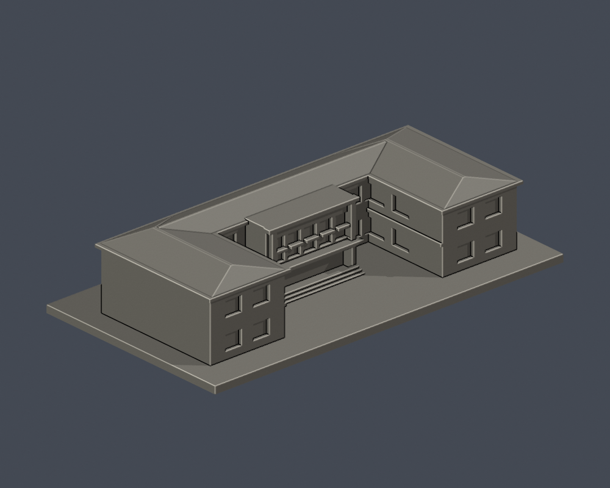](buildings/nccu-zhixi/README.md) **[志希樓](buildings/nccu-zhixi/README.md)** | [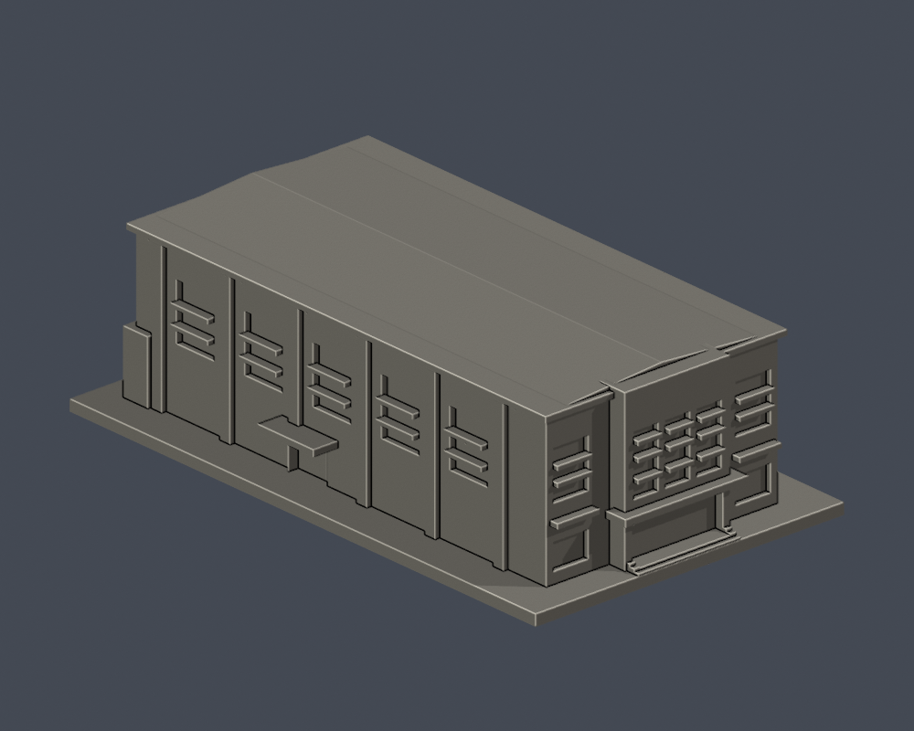](buildings/nccu-siwei/README.md) **[四維堂（修復前外觀近似）](buildings/nccu-siwei/README.md)** |
| [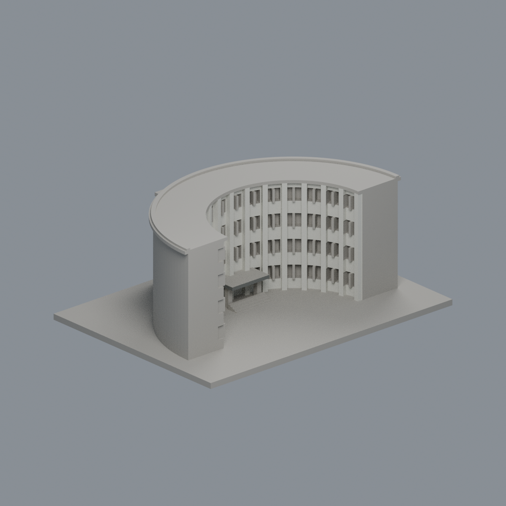](buildings/nccu-jingtang/README.md) **[井塘樓](buildings/nccu-jingtang/README.md)** | [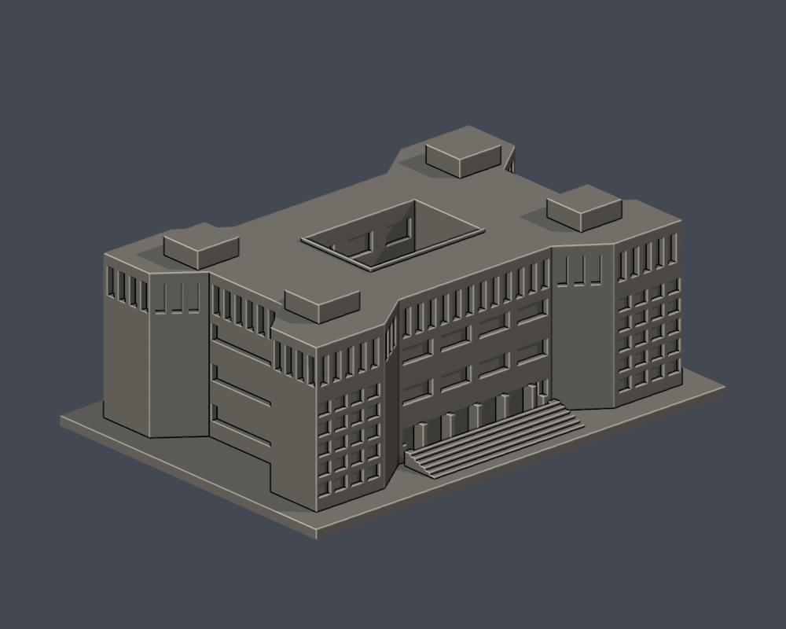](buildings/nccu-zhongzheng-library/README.md) **[中正圖書館](buildings/nccu-zhongzheng-library/README.md)** |  **[行政大樓](buildings/nccu-administration/README.md)** |
| [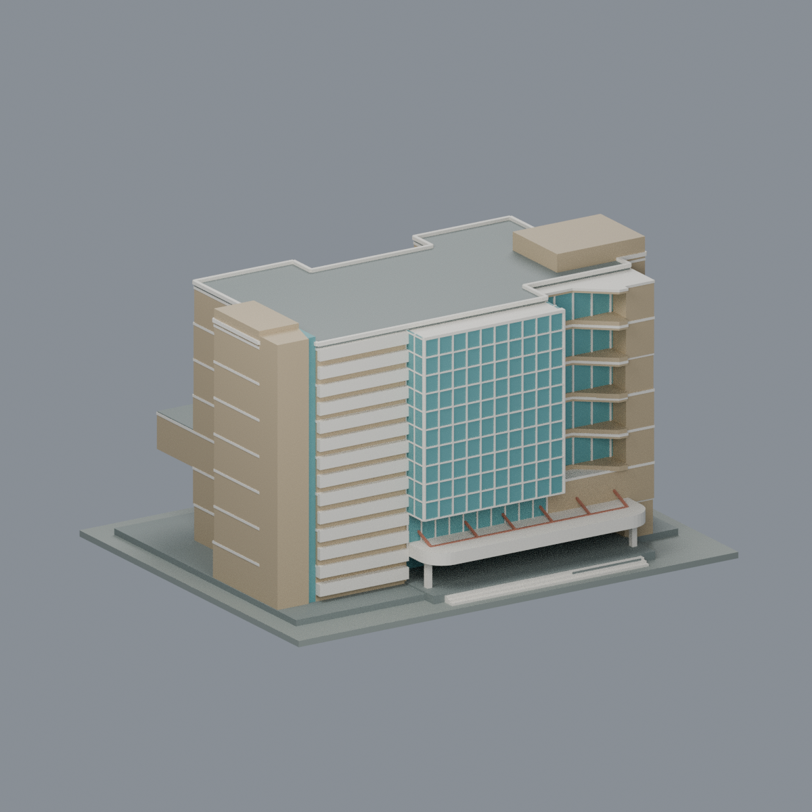](buildings/nccu-yixian/README.md) **[逸仙樓](buildings/nccu-yixian/README.md)** | [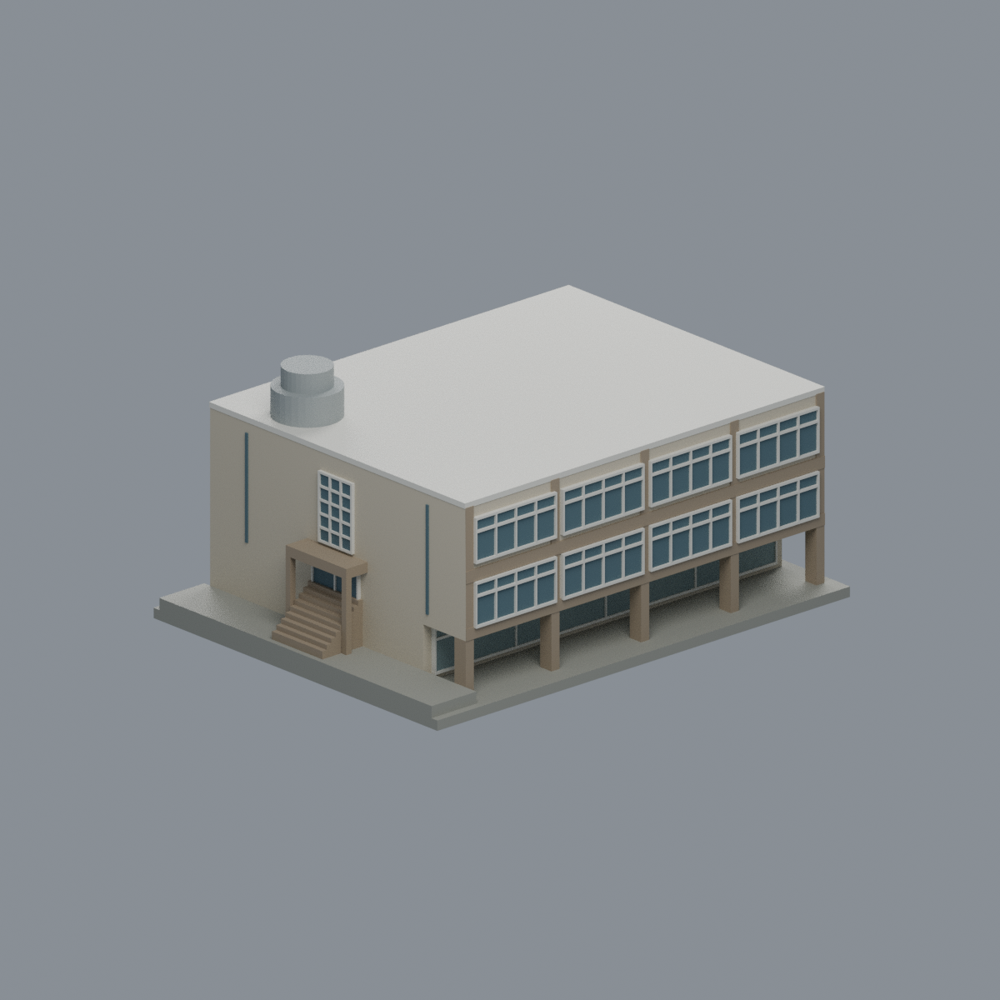](buildings/nccu-fengyu/README.md) **[風雩樓](buildings/nccu-fengyu/README.md)** | [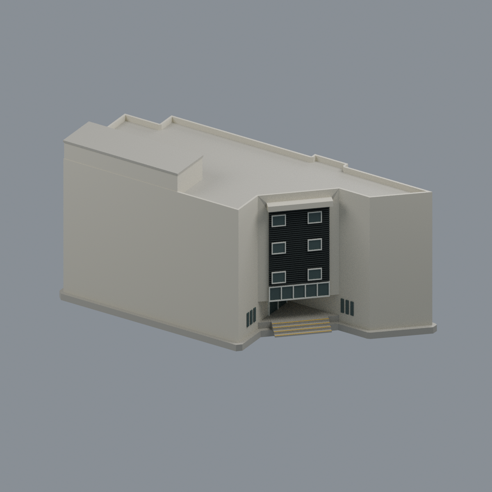](buildings/nccu-health/README.md) **[健康中心大樓](buildings/nccu-health/README.md)** |
| [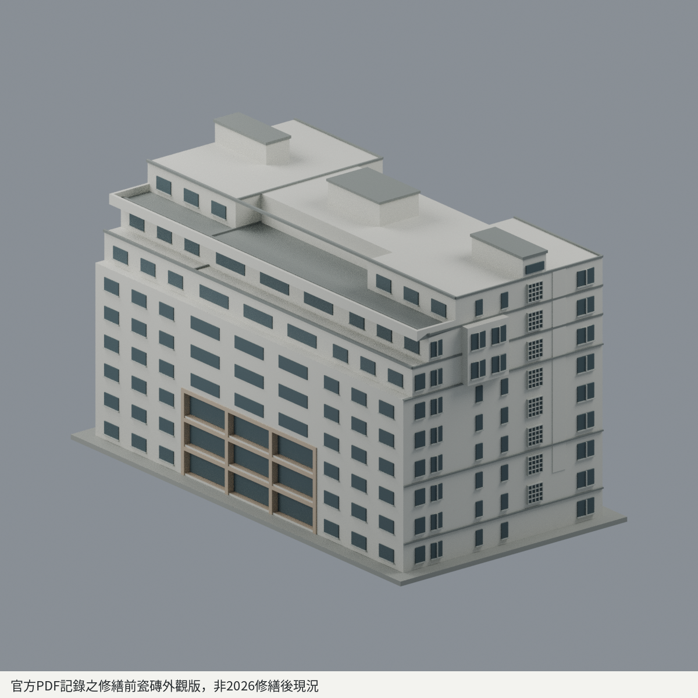](buildings/nccu-research-building/README.md) **[研究大樓 — 官方PDF記錄之修繕前瓷磚外觀版，非2026修繕後現況](buildings/nccu-research-building/README.md)** | [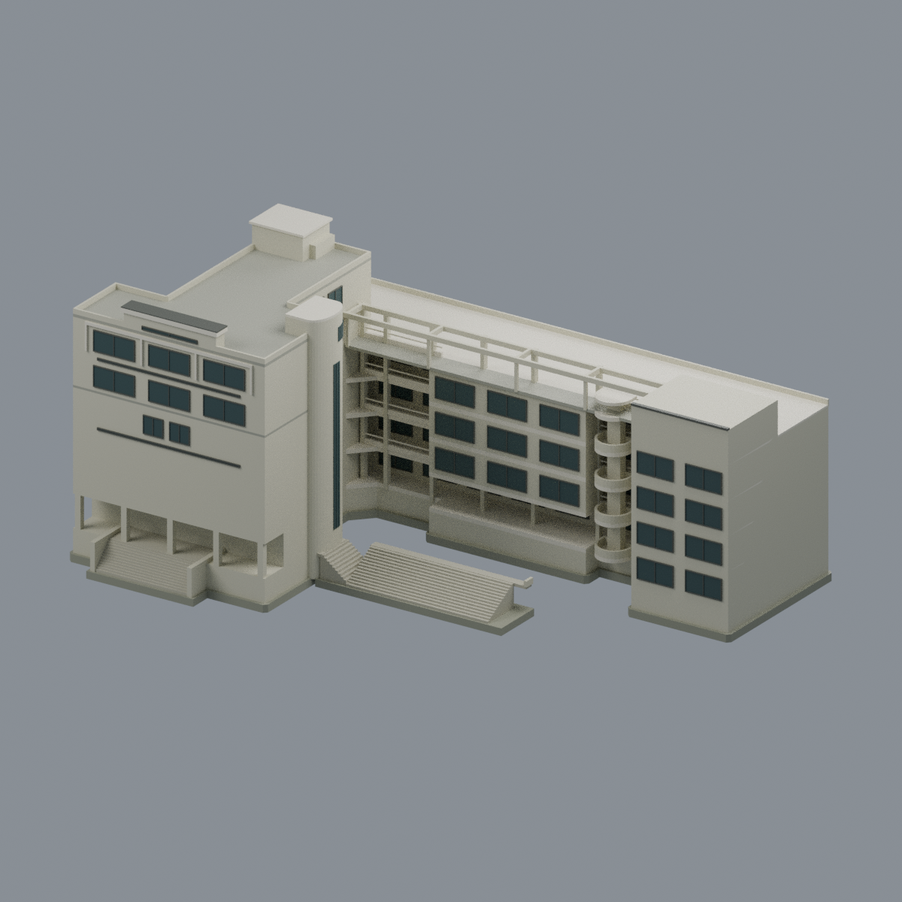](buildings/nccu-information-complex/README.md) **[資訊大樓（含電算中心）](buildings/nccu-information-complex/README.md)** | [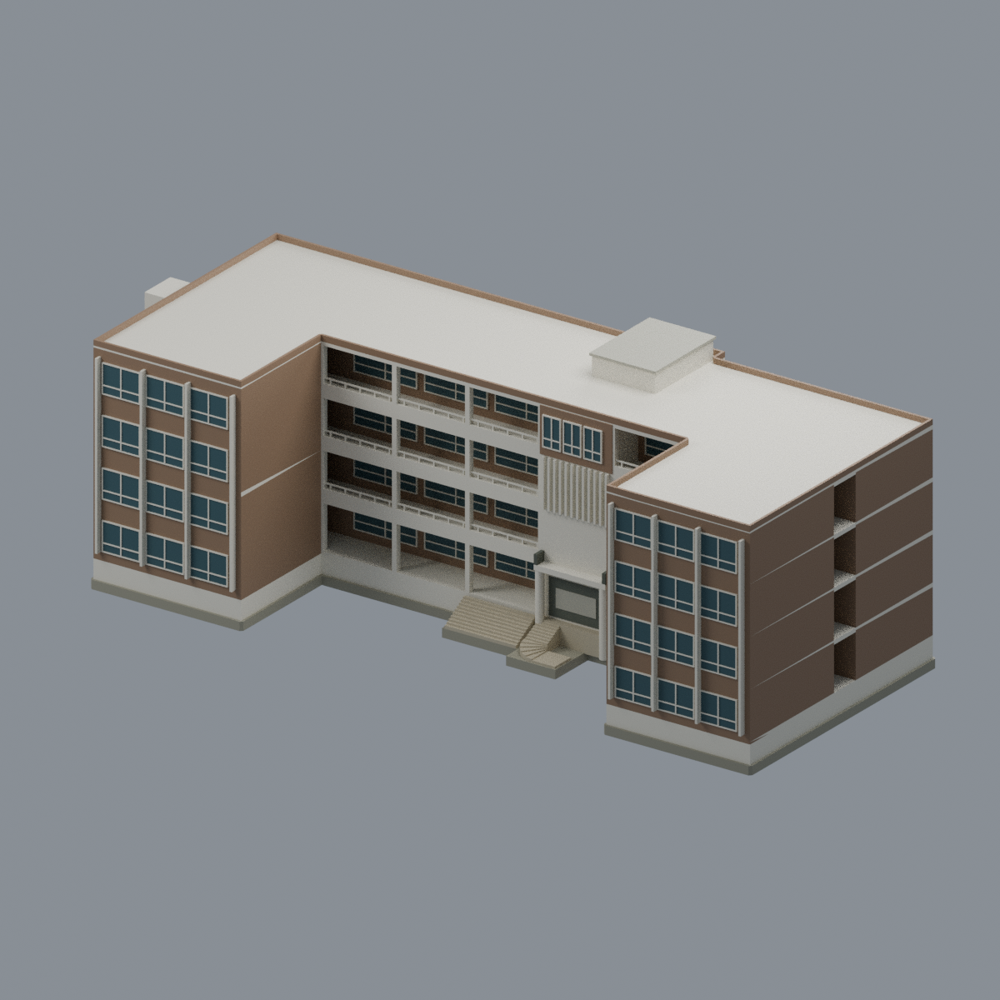](buildings/nccu-xuesi-hall/README.md) **[學思樓](buildings/nccu-xuesi-hall/README.md)** |

每件具STL、可編輯Blend、參數來源、實際STL正背俯視預覽與可重跑QA。數位QA不等於切片軟體驗證或實體試印。

[井塘樓前庭有限白牆／雨棚配色與五視角](buildings/nccu-jingtang/appearance/README.md)（1404完整原面，其餘4772面中性；拍攝年代未知，非整樓現況全彩復原）。

逸仙樓、風雩樓、健康中心大樓與研究大樓的版本、來源與製造限制見各模型README；研究大樓保留官方PDF記錄之修繕前瓷磚外觀版，非2026修繕後現況。未實印，非全校區完成。

資訊大樓（含電算中心）是同一完整L形連體外觀參考模型；山下分組依官方PDF第9–10頁圖文及A15/A16同列建物(14)。低翼四層、開放頂框與局部端房，高翼五樓露台及六樓屋頂分別保留；包含退凹入口、柱階及曲核旁完整寬階，遠端外場通路不納。消防簡圖非建築竣工圖，細窗、高程及局部核心為近似；攝年未知，非已核2026現況。Blend／3MF／STL、五張實網格預覽及原byte重建來源ZIP齊備；薄框、切層警示與有限壁厚抽樣見QA，未實印。原照片和平面像素不入模型包，來源權利見SOURCES與LICENSE。

學思樓為完整四層九跨主樓及兩端突出教室翼的彩色外觀近似模型；山下分組依官方PDF第9–10頁溪流界文字及A5「學思樓(04)」圖文聯讀。保留中央與西端梯核、真開放柱廊、背牆、分別接地的外階及二樓貼樓平台，通往逸仙樓的獨立跨橋不納。屋頂簡圖六跨只作局部約束，不縮掉四樓實房；攝年未知、消防簡圖非測量竣工圖，精高、背面細窗及地形近似，非已核2026現況。Blend／3MF／STL、五張實網格預覽及可執行來源ZIP齊備；保留18層薄件警告，未實體試印。原照片和平面像素不入模型包，來源權利見SOURCES與LICENSE。
