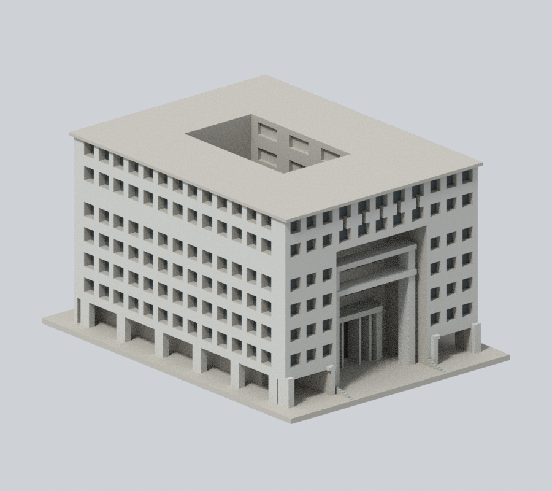
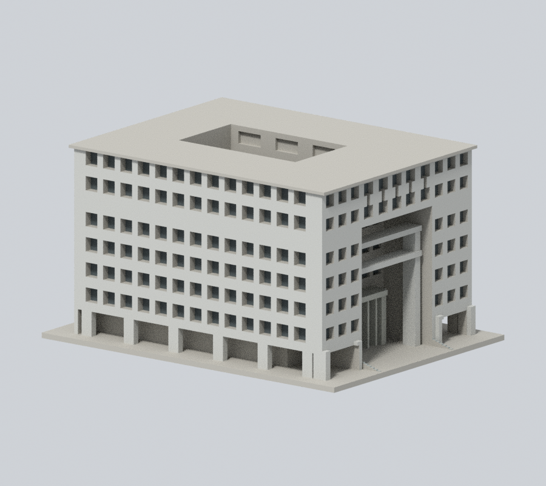
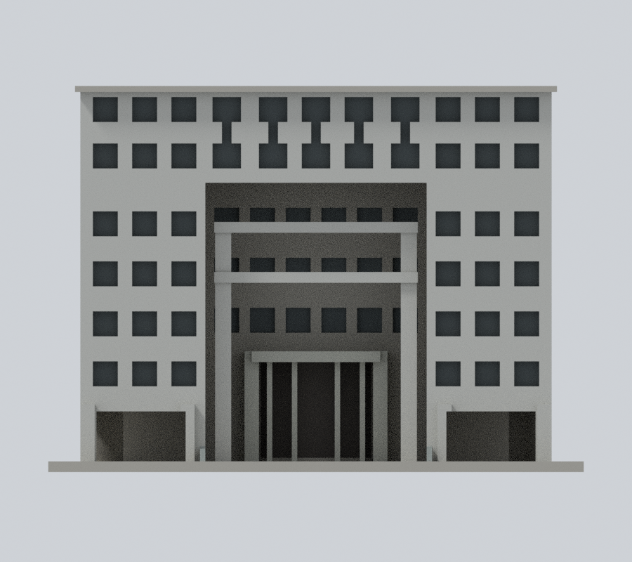
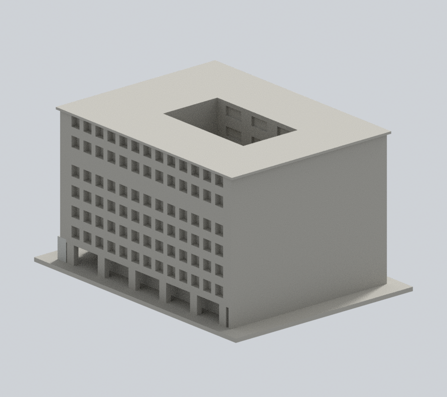
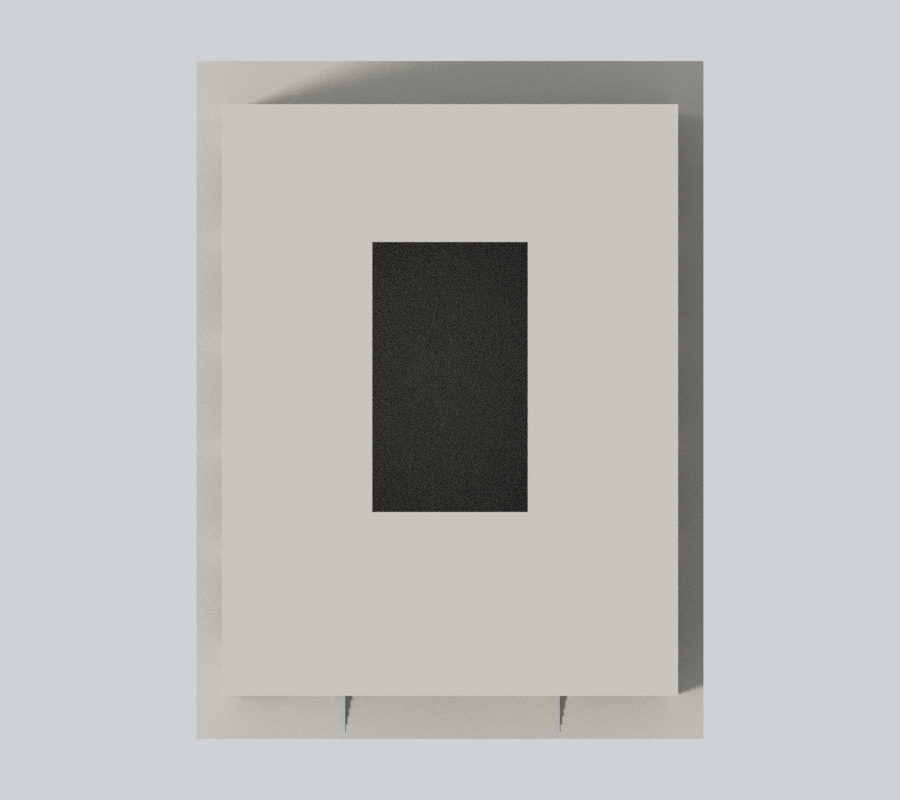

# 國立政治大學｜行政大樓

## 模型預覽

山下校區。依公開實景與官方平面外輪廓自建的完整建物外觀近似，非测绘、BIM或結構設計。

### 正面與可見左側有據彩色預覽

依兩張官方實照，只為前面與左側有據原面增補灰石、真窗背深灰混合表觀及原入口構件；另一長側、後方、內院、屋頂與未見面中性。不添加文字、玻璃面或照片細格。

| 正斜視 | 來源角度 | 正立面 |
| :---: | :---: | :---: |
|  |  |  |
| 背向 | 上視 | 新外觀下載 |
|  |  | [3MF](appearance.3mf) · [Blender](appearance.blend) |

[材料證據與未知面](APPEARANCE.md)。原四張模型圖檔保留，README只展示新彩圖；原幾何、STL、scene與原列印警告不變。

## 形狀及證據限制

深凹多層中央入口、可見框架橫梁及高柱、底層側跨架空、上層連窗、長邊立面、中央完整開口天井。長側身比例依官方平面伸展，不用正方盒取代。

未見完整遠後立面，後牆保守留白。窗距、屋頂機房、坡地與地下部分近似；只表達外殼與可見大挑空，不複製內部辦公配置。模型尺寸不是實測。

官方防災表内日期2021-10-01、PDF編成2026-03-04為原來源記錄，本輪補色未重讀該PDF；兩者不可當照片拍攝日。本輪兩張政大記憶網照片均未載攝影日期。來源網址、頁碼與支持特徵見[sources.json](sources.json)。第三方原圖不隨包散布。

## 使用方式

- [model.stl](model.stl)：毫米，112.2 × 150.0 × 80.8 mm；含底座最長150 mm，各館獨立比例
- [scene.blend](scene.blend)：實際STL匯入的可編修網格，已與交付STL幾何比較
- [build_model.py](build_model.py)：獨立參數重建來源；[requirements.txt](requirements.txt)
- [SHA256SUMS](SHA256SUMS)：逐檔雜湊；STL SHA-256為 371917d26299d14f15eca66b2f4d24d8402246d038fb0ff3dcb750258d67426f

底座朝下。可先以0.2 mm層高、0.4 mm噴嘴作切片檢查起點，按自己的材料、機台及冷卻條件決定支撐；深凹入口、柱廊、雨遮、頂層簷口和凹窗頂尤其需檢視。窗框／柱／天井邊緣已加粗連接，不代表不需要支撐。

## Fail-closed數位QA

Python執行build_model.py；Blender背景執行render_preview.py產生實際STL預覽與scene.blend；再依序執行validate_model.py、check_contour_validity.py、check_thin_features.py，任一步非零退出都必須停止交付。

[validation.json](validation.json)全部checks=true：原始STL法向／繞序／正體積、水密、每邊2面、vertex link單一環、單一連通表面且無內腔殼、尺寸、獨立重建SHA、Blend/STL幾何一致。

[contour-validity-check.json](contour-validity-check.json)：固定z=0.071 mm起、0.2 mm層距，共404層，degree2閉合、每個與組合Polygon均有效，遇invalid不修補。

[thin-feature-check.json](thin-feature-check.json)：canonical邊內插，1 mm取樣，以0.8 mm參考寬度形態opening輔助篩檢；最大面積損失0.05196%，大於1%層數0。不是全面最小壁厚或實際工具路徑。

未做Cura/Prusa实际切片或實體試印，不宣稱保證可印或全校完成。
