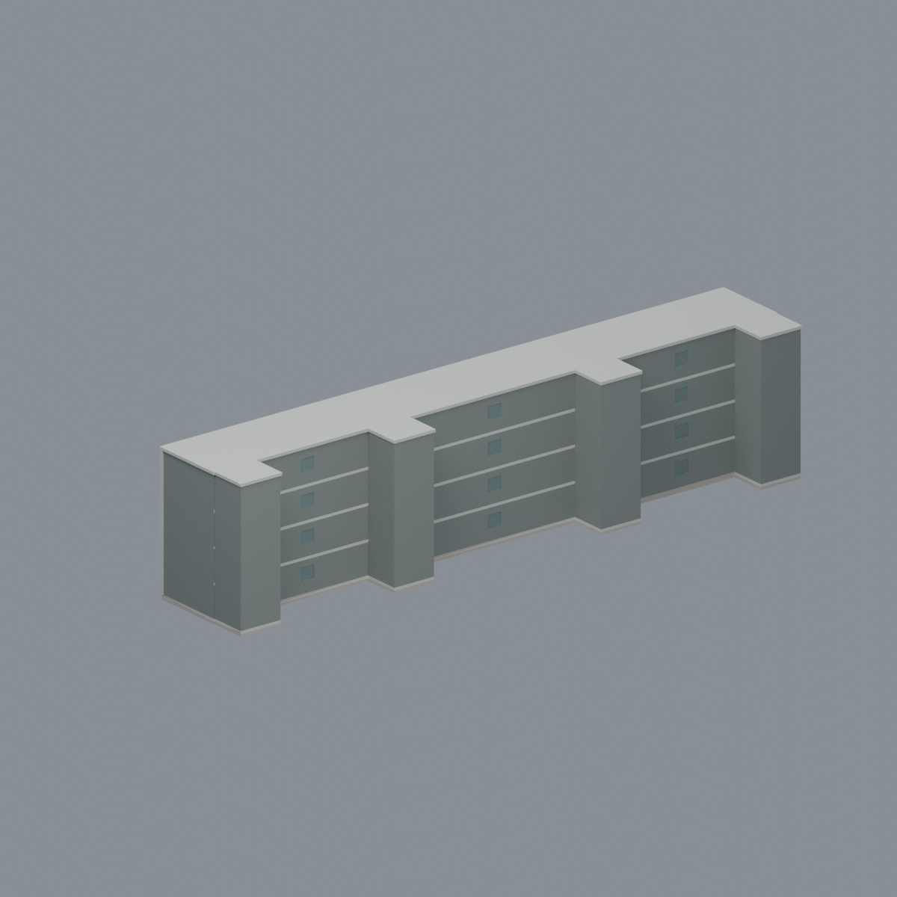
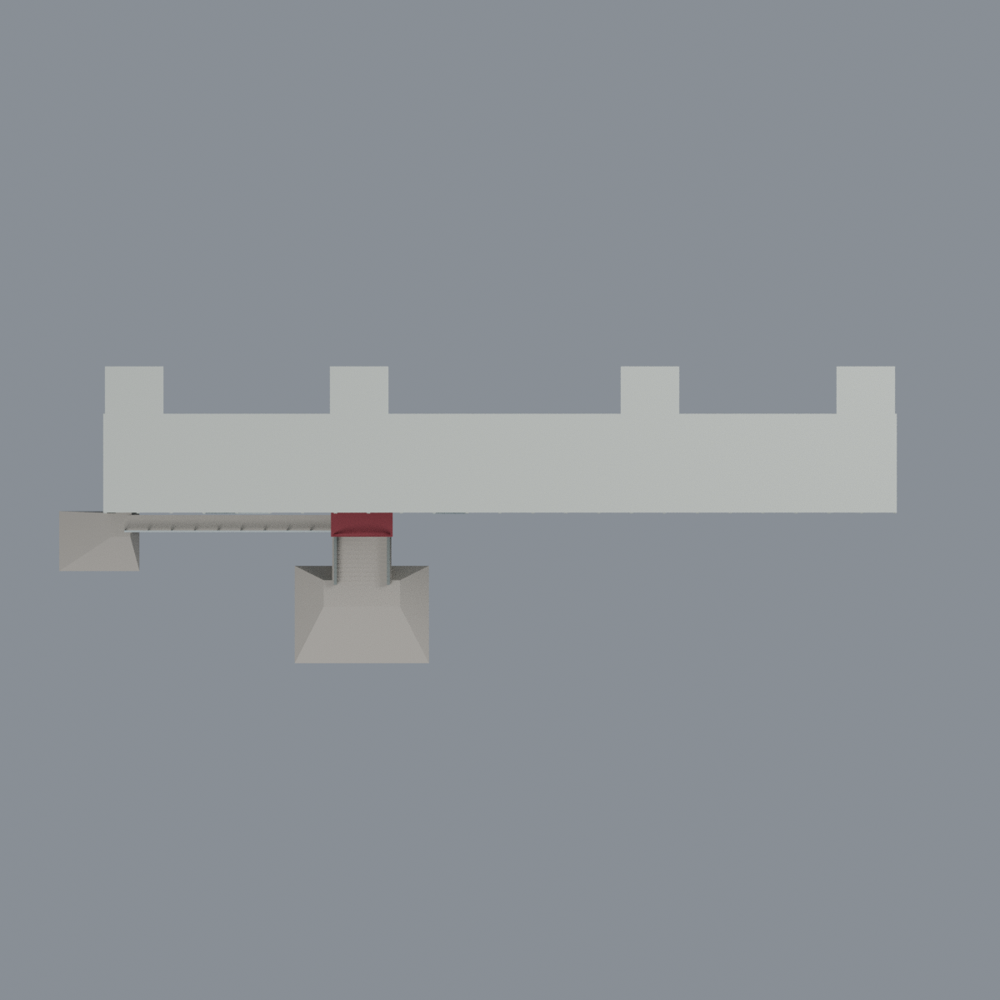

# 國立政治大學 大勇樓

[山下校區圖鑑](../../README.md) · [政大圖鑑](../../../README.md) · [全部模型](../../../../README.md)

彩色四層長形主體研究模型；官方建物編號60-21、校圖A26（21），山下校區。以官方外觀照片及消防平面簡圖建立四層、無地下室主體、長廊與四個突出樓梯核心，以及一處紅拱簷二樓入口候選、完整外階和有限左側坡道。不包含完整校園地景。

- `scene.blend`：可編輯網格、七種材質與相機。
- `model.3mf`：毫米單位、逐面材質，可修改頂點及顏色。
- `model.stl`：不保存顏色的幾何交換格式。
- `previews/`：同一網格五視角。
- Python生成、檢查與重建程式：見 `requirements.txt`、`QA.md`。

## 來源範圍與近似

平面主體採60×7.2正規化座標，每單位2.5毫米，並非實測公尺或測繪比例。四樓層共用固定樓梯核心；兩端圖示錨點約145／780像素，一樓中間兩核約320／571與二至四樓約340／593有20／22像素示意殘差。本模型以二至四樓中核共框規整，沒有逐層斜移、增加樓梯或塔樓。實際內梯使用有限厚度階板及平台，而非填實階梯井。

二樓房間側有兩個門洞候選；只在左候選配置一處紅色拱簷及外階。照片693／694視為同一入口的兩個角度，不是相反立面；照片尚不能唯一確認其對應左或右門洞。右門洞保留但未複製紅簷、外階，也未另造中央入口。

外階完整下降至腳平台，平台外另有有限周圍地坪及斜面漸降接模型基準面；左坡道有上、下平台，下腳外也延伸有限地坪與漸降坡。這些地坪不是孤立高台，也不是完整校園地形。地坪高度、階級數、坡長與坡度是近似，非現地地形測量。平面簡圖未提供完整屋頂圖；屋頂及四核頂部只作低封閉近似，沒有屋頂塔樓、設備或額外樓層。未見背面採有界封閉及少量窗，非聲稱整面開放走廊。室內細隔間未建立；立面窗格、顏色及未見細節均簡化；只在入口鄰近有證框架表現左側相鄰降／升（低點V）、右側下降斜撐，連接對應柱線，不據此重建全樓結構或精確根數。

照片攝年未知，不能視為已核實2026現況。此模型不是竣工、結構、消防或無障礙施工依據。

## 製造限制

尚未實體試印。薄窗片、窗框、扶手、有限階板、屋面及封閉空間可能需要放大、支撐和方向／材料調整，並評估封腔、困料及支撐移除。數值檢查不保證全域最小壁厚、免支撐或直接可印；模型通行探針也不是人身淨高或法規認證。

來源及權利見 `SOURCES.md`。不含原始照片、圖紙、PDF、標誌、文字招牌或第三方貼圖。

## 模型預覽與下載

| 長窗面 | 未見側近似 | 頂視 |
| :---: | :---: | :---: |
|  |  |  |

[可編輯 Blend](scene.blend) · [彩色 3MF](model.3mf) · [單色 STL](model.stl) · [重建來源 ZIP](rebuild-source.zip) · [來源](SOURCES.md) · [數值檢驗及製造限制](QA.md)

模型約159.13 × 56.37 × 34.88 mm，非建築實測尺寸。175切層中155層薄警保留；獨立768個法線樣本中376個低於0.8 mm、最小約0.22451 mm；builder512樣本中231個低於0.8 mm，兩者都不是全域最小壁厚證書。四內梯全級、多層平台、完整外階／有限坡道及真平台界做有限寬模型空實與首擊測試，但不是人員通行、無障礙或法規認證。薄框、階板、屋面及空腔需比例／方向／支撐／困料評估；未實印。
