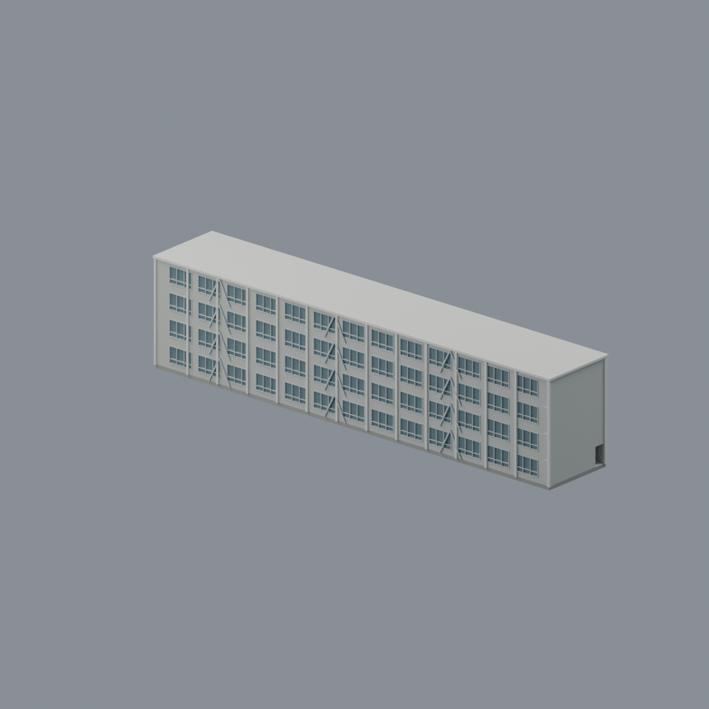
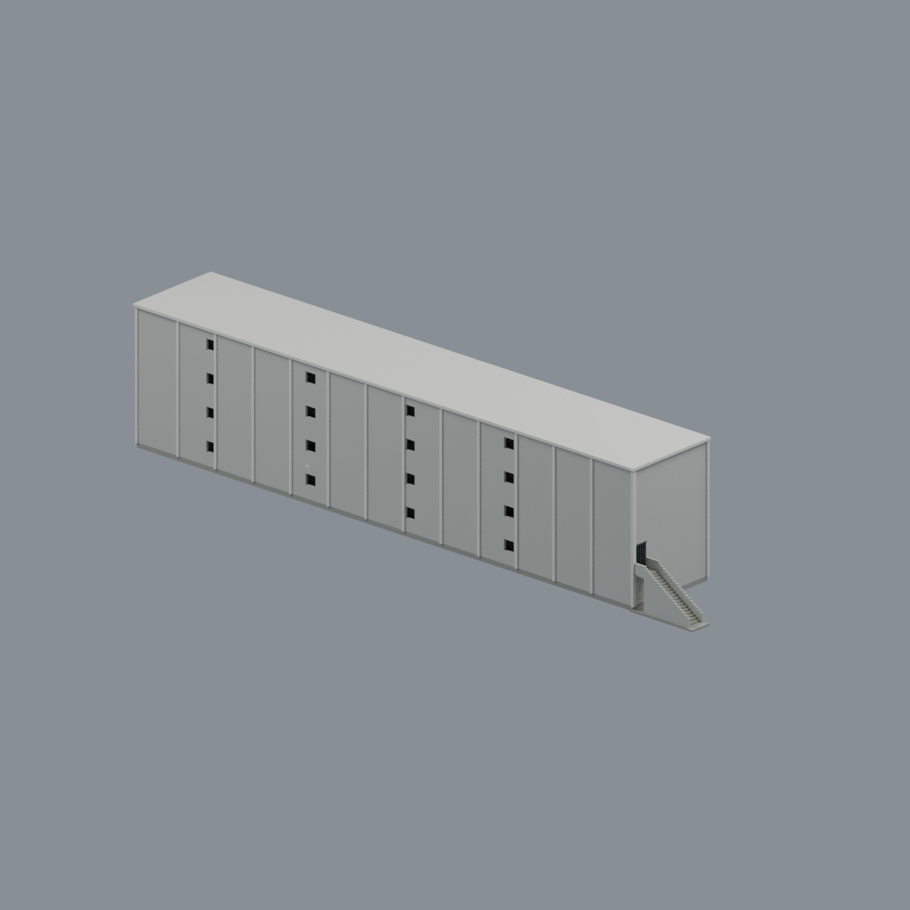
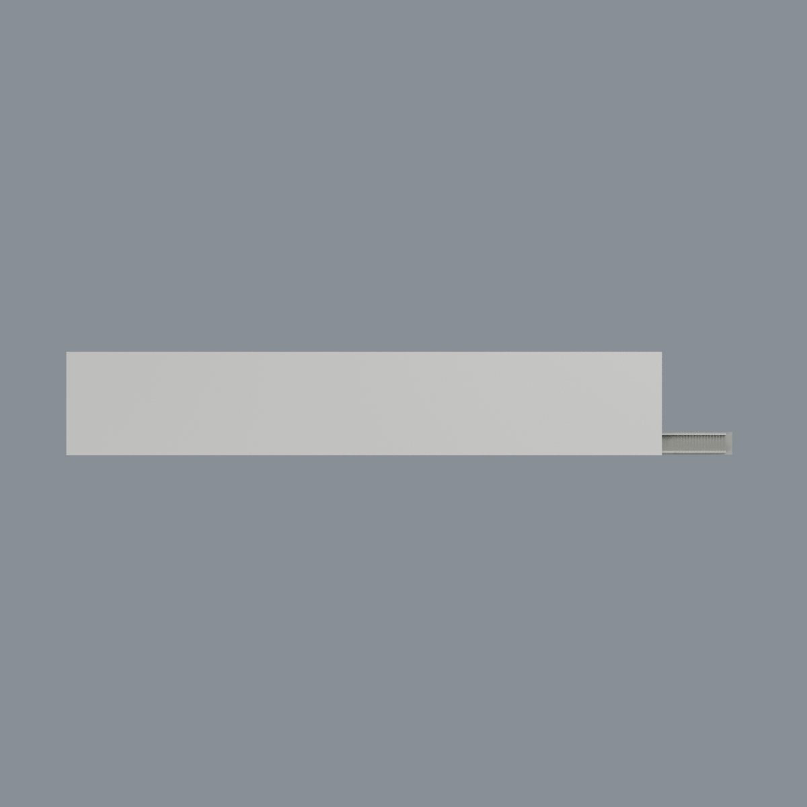

# 國立政治大學大智樓

## 模型預覽

| 長窗面 | 未見側近似 | 頂視 |
| :---: | :---: | :---: |
|  |  |  |

[山下校區圖鑑](../../README.md) · [政大圖鑑](../../../README.md) · [全部模型](../../../../README.md)

政大山下校區大智樓，官方消防資料資產編號60-19、校圖A24（19）。本模型為來源所示完整四層主樓的近似外觀研究，不是實測、竣工圖或現況測繪復原。

## 內容與尺度

- 四層窄長矩形主體，沒有地下層或加高屋頂塔樓；兩端樓梯與各層同一柱線／走廊位置對齊。
- 左端單一衛生間區、右端成對衛生間區作為共同左右手性錨點；室內隔間只是簡圖式近似，不代表復原所有55間房間。
- 二樓右短端的有限狹長平台、完整外接直階、階側擋牆與接地基腳。外階不是四層新翼，也不是室內折返梯的替代。
- 長教室側窗面、深色不透明玻璃代理、淺色直柱及局部補強斜撐；窗格與補強構件數量位置均為近似，未復原冷氣機數量。
- 未見廊側採克制中性實牆與有限開孔，不鏡射已見窗面；實際模型內部廊道、門洞、兩端梯空間保留，不為單殼而填腔。
- 低平屋頂封閉包絡是有限近似；未有RF／設備測繪，沒有任意加塔或新增使用樓層。

六色不透明材質；窗玻璃是薄實體色彩代理，不是透明光學玻璃或照片貼圖。模型約169.13 × 26.25 × 34.88 mm（以最終QA數值為準）；共同60×10建模單位、2.5 mm／單位是模型尺度，**不是建築實測尺寸**。層高、階數、細窗、顏色、屋頂及未見側細節都是近似。沒有整片道路、植栽、車輛、校地、鄰樓、招牌文字或原圖片紋理。

## 來源與方向限制

官方資料的兩張外觀照片及1至4樓簡圖支援主體辨識。入口照片676與二樓右端接道是有界候選配對；677以教室長側為較合理候選，**近端究竟是哪一端及地理方位沒有唯一證據**。相機使用同一網格，不為不同照片獨立鏡射。來源平面不是完整測繪，紙張邊距差異不作樓層退縮。

表列1969年建造、四層、無地下室、2010-11-15補強、2021-10-01調查，建築設計圖勾選「無」。照片攝年未知，文件日期不等於攝影日期，**不宣稱已核實2026現況**。來源歸屬與限制見SOURCES.md。

## 檔案與重建

`scene.blend`為可編輯網格／六材質；`model.3mf`為毫米制逐面材質；`model.stl`為單色交換網格。`previews/`含front、rear、elevation、top、left_oblique五張同網格渲染。`mesh.json`及`palette.json`是精確交換記錄。

使用requirements.txt相依套件及Blender4.3.2，執行`python build_model.py`和`blender -b -t 4 --python-exit-code 1 --python render_model.py`。`python rebuild.py --output /new/empty/path`可獨立建模／五圖渲染，比對四核心與五PNG精確位元組。`python run_all_checks.py`進行原始STL、剖面、空實探針、3MF及原生編輯／重開測試。

## 製造限制

水密、連通及三角形接觸檢查不等於可直接列印。窗片約0.325 mm，細窗框、斜撐、階側牆及柱可能低於0.8 mm；175層逐0.2 mm剖切中152層薄片警告保留，512面法線抽樣最小約0.225 mm（非全域保證），不以填死空腔求通過。多層頂板、細階、連通廊道與房室可能需支撐，狹小空間有支撐難移除／困料風險，應先評估放大、設備、方向和材料。未實體試印，不保證免支撐或print-ready。

## 模型預覽與下載

[可編輯 Blend](scene.blend) · [彩色 3MF](model.3mf) · [單色 STL](model.stl) · [重建來源 ZIP](rebuild-source.zip) · [來源](SOURCES.md) · [數值檢驗及製造限制](QA.md)

模型約169.13 × 26.25 × 34.88 mm，非建築實測尺寸。175切層中152層薄警保留；另有768個獨立法線樣本，其中390個低於0.8 mm、最小約0.17324 mm。這與512個builder樣本分開，兩者都不是全域最小壁厚認證。薄階板、窗框及多層空腔需支撐／困料評估；未實體試印。
