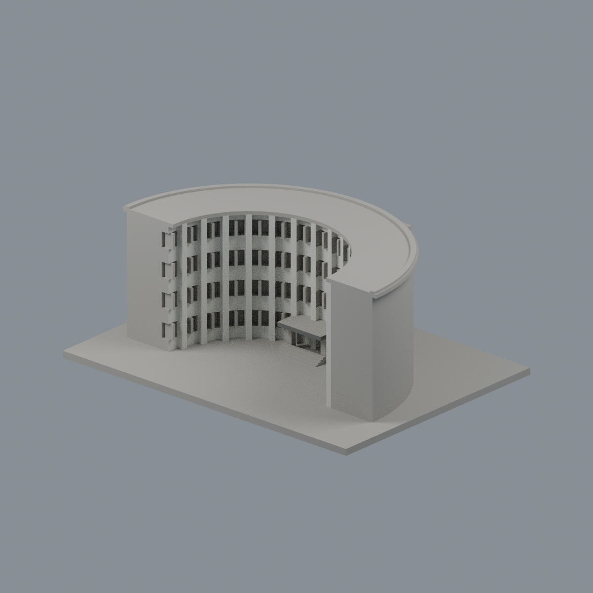
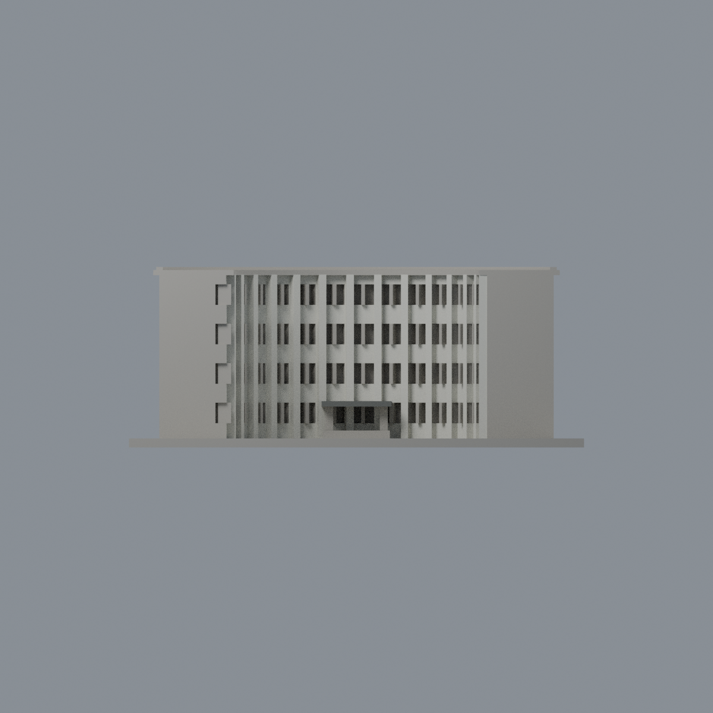
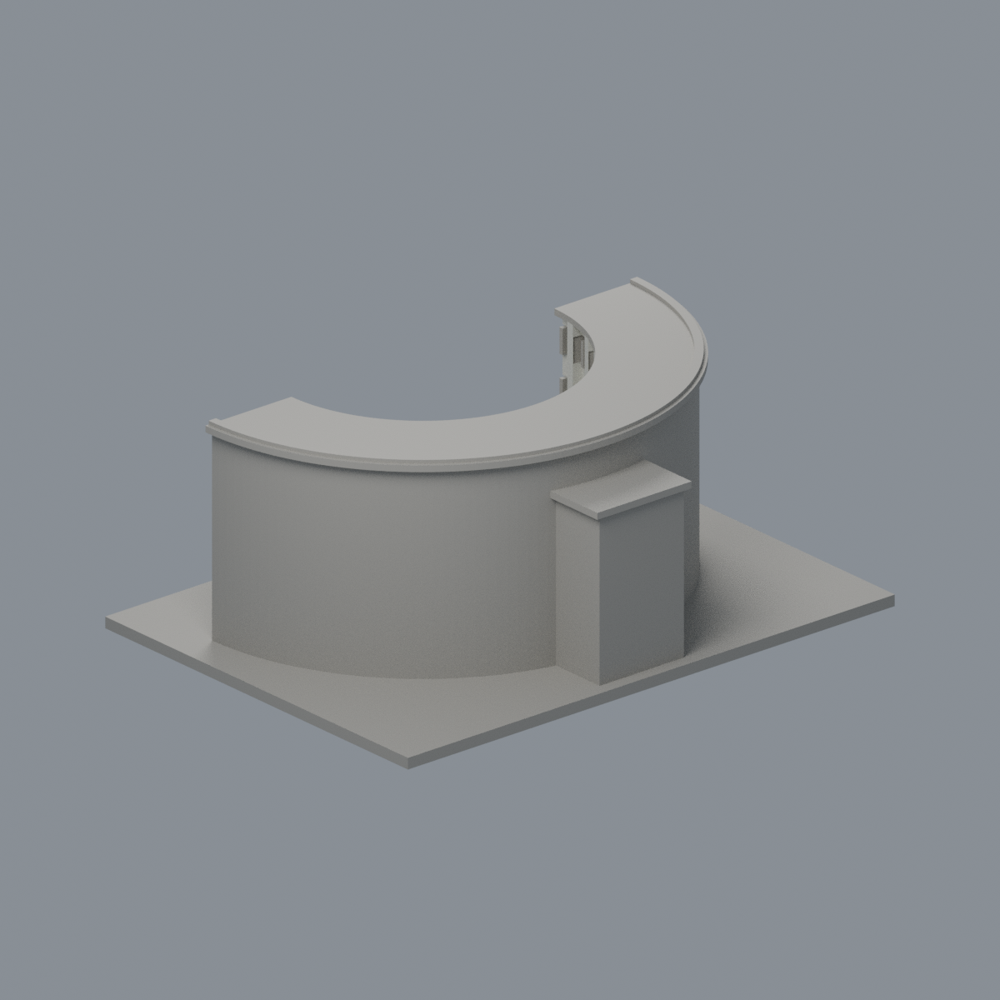
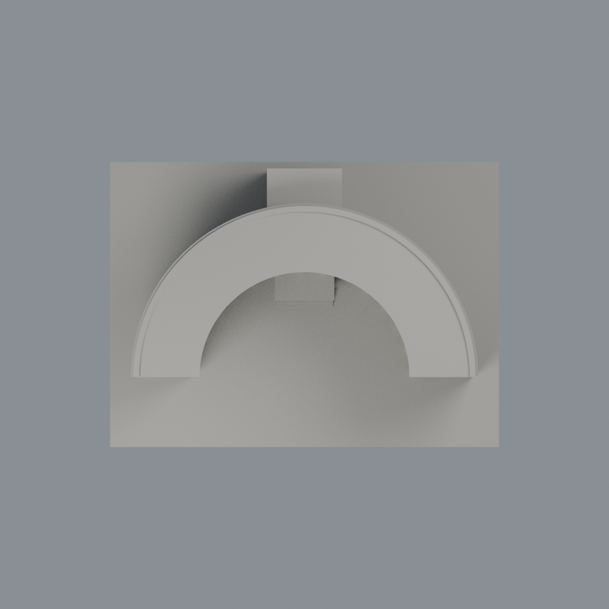

# 政治大學井塘樓：前庭有限白牆／雨棚外觀層

僅1395個完整原面白色內弧瓷磚牆與柱（#D4D4CA）＋9個灰色雨棚立邊原面（#666966），共1404面、7740.38026137 mm²；其餘4772面維持中性。不是整樓全彩復原、實測色票或2026現況。

[三材質3MF](nccu-jingtang-appearance.3mf) · [可編輯Blend](scene.blend) · [逐面表](face-materials.json) · [色表](palette.json)

[前庭左斜](previews/front.png) · [前庭右斜](previews/opposite.png) · [正立面](previews/elevation.png) · [背面](previews/rear.png) · [頂面](previews/top.png) · [同角中性比較](qa/mono-front.png)

| 模型預覽 | 模型預覽 | 模型預覽 |
| :---: | :---: | :---: |
| 前庭左斜  | 前庭右斜  | 正立面  |
| 背面  | 頂面  |  |

五圖均包含完整建物及底座，不用裁切或額外染屋頂強化收益。後／頂面幾乎無收益是限域證據的正常結果。原幾何窗肚混有簡化白框，不能整片冒稱深玻璃；門窗、窗凹背、框、屋頂、屋簷、背面／端牆、底座與後突出部全部中性。原雨棚為簡化方板，未補造照片中的弧形。

原STL bytes、6176個三角面順序與所有座標維持不變。80個弧段各自檢查三頂點切向界與平面、柱有限旋轉盒及灰雨棚有限前／側平面，使用actual cross-product normal；不以bbox或centroid整片套色，不切三角、不加厚。native對應原STL使用完整oriented exact triangle bijection。

## 重建／驗證
原model.stl放在appearance上一層；安裝source/requirements.txt，依序執行source/build_appearance.py、source/verify_exchange.py、source/verify_material_boundaries.py。Blender 4.3.2執行source/render_appearance.py與source/verify_scene.py。QA包含strict 3MF讀取、單材質存讀、native材質及頂點編輯存讀、原始交付重開渲染與乾淨重建。此層不代表實體試印、FFF切片或新的製造驗證，不覆寫原幾何歷史QA。原建築一件不增模型數。

[來源](SOURCES.md) · [權利](LICENSE-NOTICE.md)
