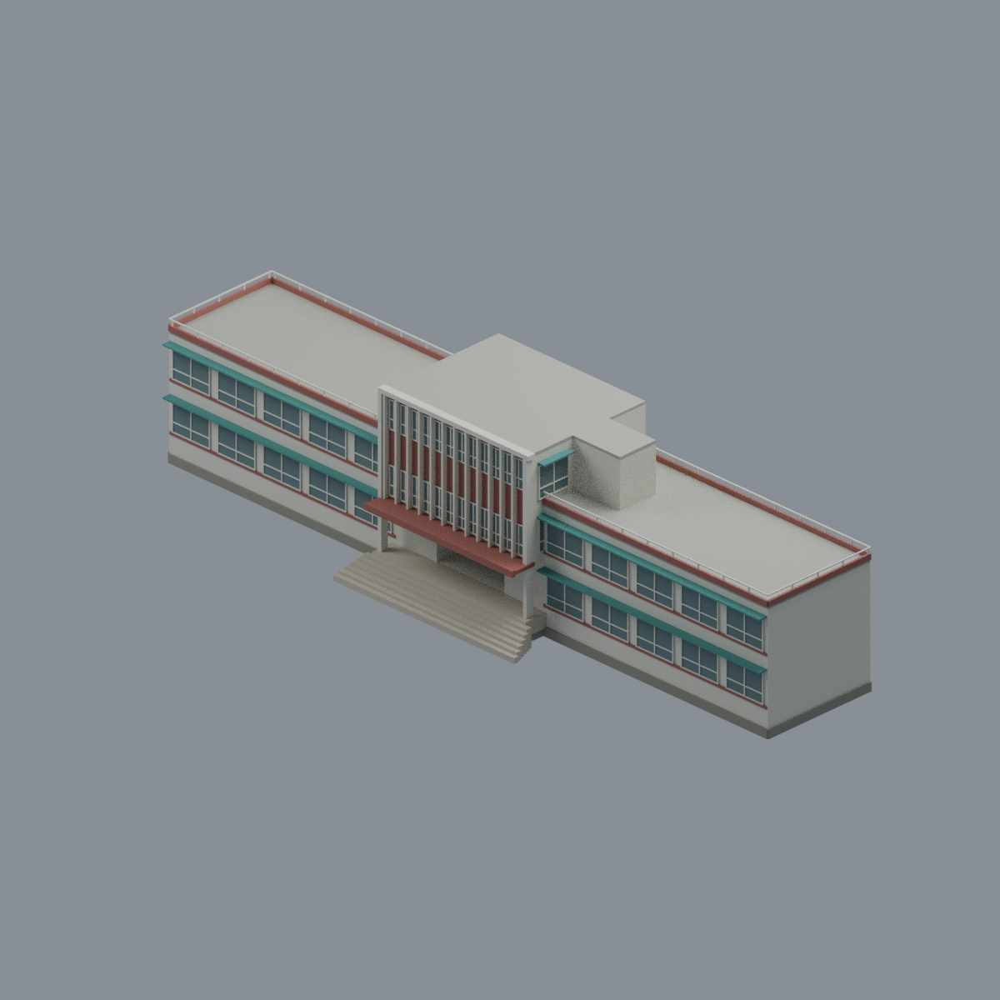
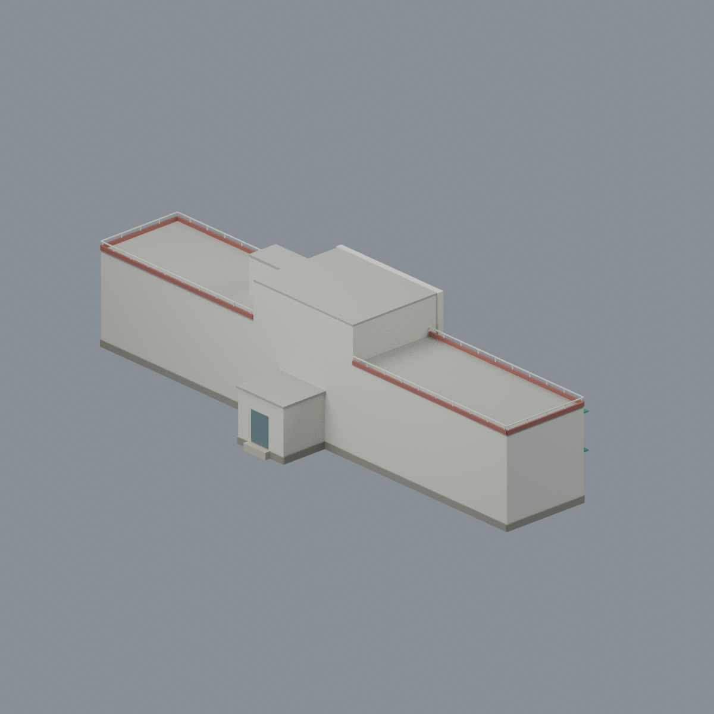
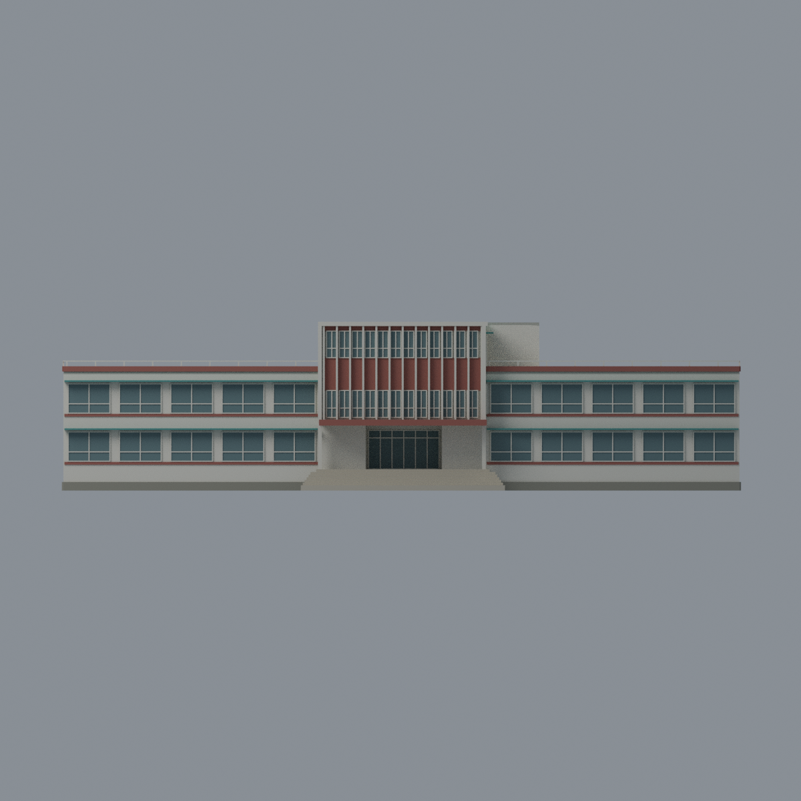
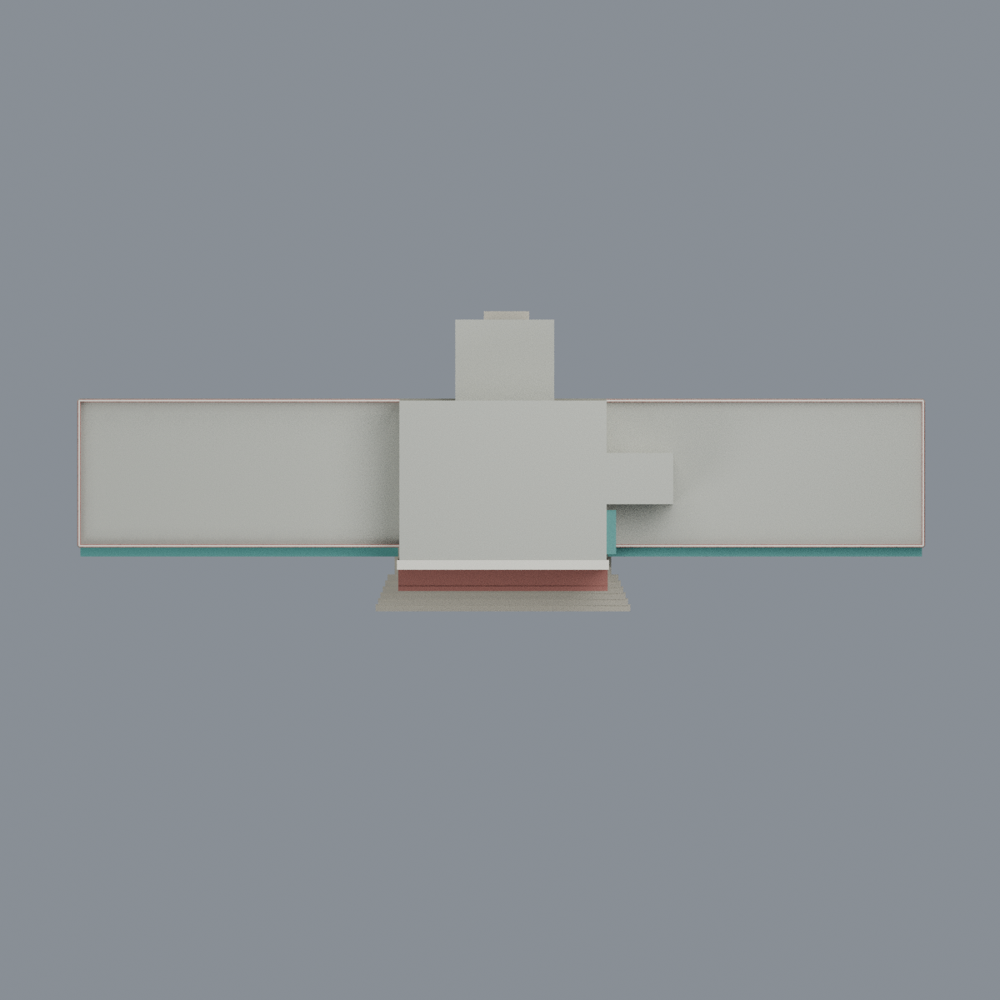
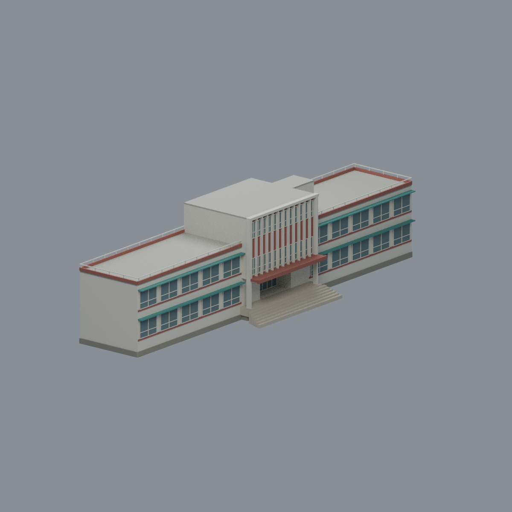

# 國立政治大學 新聞館｜彩色建築外觀模型

[山下校區圖鑑](../../README.md) · [政大圖鑑](../../../README.md) · [全部模型](../../../../README.md)

官方消防資料所記錄的外觀及簡易平面參考版，並非已核實的2026年現況或竣工測繪。對象為山下校區新聞館（官方校圖A23；資產表60-18）。

## 模型內容

完整兩層長條左右翼、中央三層實體與側小房、兩翼屋頂露平台、僅一層的後凸門廳，以及正面入口雨簷、凹入門廳與貼樓階梯。保留白色豎框、紅色實腹、灰綠窗代理色與青綠遮陽板；玻璃以不透明表面呈現。背面未見細節採中性處理。沒有整片校園地形、鄰樓、樹木或額外屋頂塔。

- `scene.blend`：可編輯網格與材質，附五視角攝影機設定的主視角。
- `model.3mf`：同一三角網格、七種不透明材質；可供支援3MF基礎材質的軟體編輯。
- `model.stl`：同網格單色格式，STL本身不保存材質。
- `previews/`：由實際交付網格渲染的五張圖。
- `build_model.py`、`render_model.py`、`rebuild.py`：參數化建模及重建程式。

| 模型預覽 | 模型預覽 | 模型預覽 |
| :---: | :---: | :---: |
|  |  |  |
|  |  |  |

## 幾何與限制

外形約203.5×72.0×50.6毫米，是參考來源比例的展示尺度，不是現場量測比例尺。各層以共同梯核及柱距平移對位，未把不同頁框各自縮放。高度、平頂厚度、窗格間距、色值及局部地面均為近似；668入口簷的圓鈍邊在本模型簡化為厚矩形邊。來源669受樹木遮擋，只作局部側角參考，不宣稱已還原完整背面或唯一端頭。封閉房間以實心外形代理；入口凹空及露平台保留，不宣稱室內復原。

原圖、PDF頁面、平面圖像素與貼圖均不包含。來源權利及版本見[SOURCES.md](SOURCES.md)與[LICENSE.txt](LICENSE.txt)。

## 重建

Python依賴見`requirements.txt`，渲染使用Blender4.3.2 CPU Cycles。

```sh
python build_model.py
blender -b -t 4 --python-exit-code 1 --python render_model.py
python run_all_checks.py
python rebuild.py --output /path/to/new-empty-directory --blender blender
```

未實際列印，不能視為可直接列印保證。細框、欄杆等存在小於0.8毫米特徵，雨簷、入口頂與懸挑接合可能需要支撐；縮放、材料、切片與支撐須另行評估。幾何水密不等於列印成功，檢查結果與限制見[QA.md](QA.md)。

## 模型預覽與下載

| 正面 | 背面 | 頂視 |
| :---: | :---: | :---: |
|  |  |  |

[可編輯 Blend](scene.blend) · [彩色 3MF](model.3mf) · [單色 STL](model.stl) · [重建來源 ZIP](rebuild-source.zip) · [來源](SOURCES.md) · [數值檢驗及製造限制](QA.md)

模型約 203.53 × 72.00 × 50.60 mm；尺寸、細窗及高程為比例近似。
