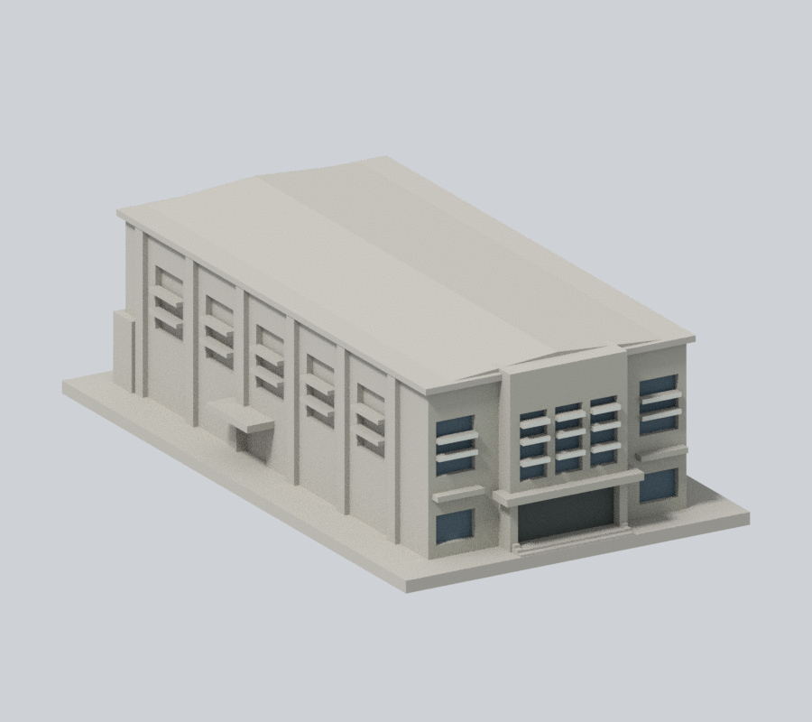
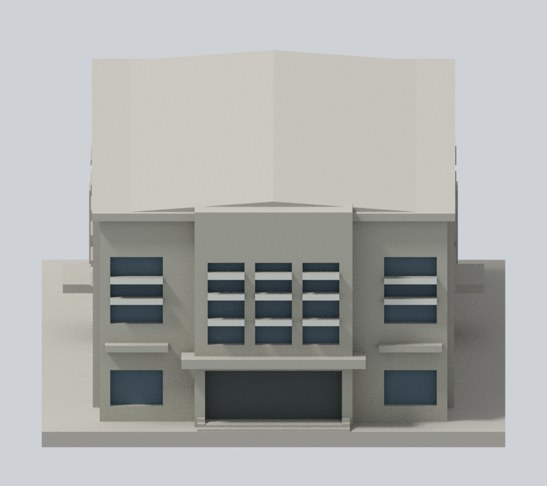
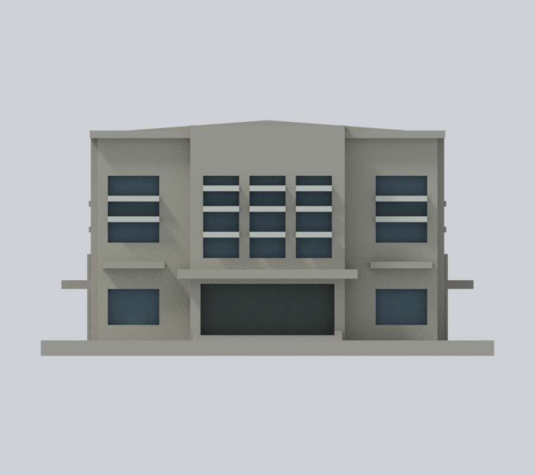
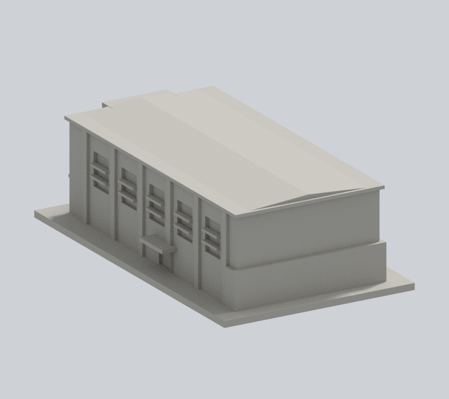
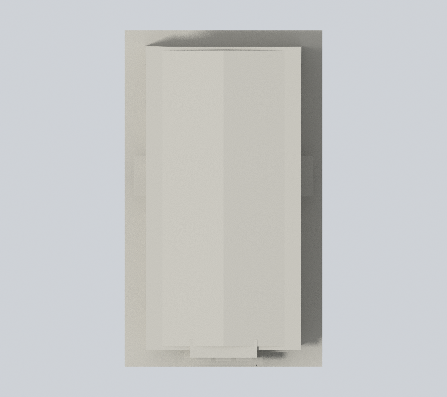

# 國立政治大學｜四維堂（修復前外觀近似）

## 模型預覽

山下校區。本件為依公開實拍與官方平面外輪廓自建的完整建物外觀近似模型，不是測繪、BIM或結構工程資料。

### 有據材料彩色預覽

依2023年官方主照，正面洗石子灰米、已有粗窗框淺灰白、真窗背深灰藍混合表觀；側後與屋頂未證面中性。不是鮮彩重繪，也不是完整四面實景色復原。

| 正斜視 | 來源角度 | 正立面 |
| :---: | :---: | :---: |
|  |  |  |
| 背向 | 俯視 | 新外觀下載 |
|  |  | [3MF](appearance.3mf) · [Blender](appearance.blend) |

[來源、材料與未驗證範圍](APPEARANCE.md)。原4張模型圖檔保留，不再於README展示；原模型幾何、STL與scene不改。

## 特徵與證據限制

完整長跨距禮堂外輪廓、突出中央入口、三組高窗、側面深直柱與高窗、側出入口雨遮；不以普通教室層窗替代禮堂立面。

本輪讀取官方主照，caption明載攝於2023年、陳家弘攝影。原防災表2021-10-01及2026修復再利用場勘是既有sources記錄，本輪未重讀該表／公告；不由此推定現在工程進度或已完工。仍為修復前外觀近似。

背面舞臺與服務空間僅按官方平面輪廓近似，留白不造窗；屋頂採淺坡保守體量，未測繪預力屋面實際曲率。2026修復案未作成品現況推定。

第三方照片/PDF不隨包散布。完整網址、頁碼與各自支持的特徵見 [sources.json](sources.json)。不將來源網頁更新日視為攝影日。

## 3D列印檔案

- [model.stl](model.stl)：毫米，88.0 × 150.0 × 45.8 mm，含底座最長150 mm，各館獨立比例
- [scene.blend](scene.blend)：從交付STL匯入的可編輯網格；形狀與STL經比較一致
- [build_model.py](build_model.py)：獨立參數化重建來源；[requirements.txt](requirements.txt)
- [SHA256SUMS](SHA256SUMS)：逐檔校驗；STL SHA-256：b8c7c0d959a7c39c1ac9f647ffc4c9daf9f25accd5c33a1a34eb653d8b01619e

底座朝下列印。建議先以0.2 mm層高、0.4 mm噴嘴在自己的切片軟體檢視，確認簷口、雨遮、門楣與深凹窗的支撐需求。細窗框已加粗，仍須依材料、噴嘴及散熱調整。不要把數位QA解讀成免支撐保證。

## 可重現數位QA

1. Python執行 build_model.py 重建模型。
2. Blender背景執行 render_preview.py 生成實際STL正背、正立面、俯視與scene.blend。
3. Python依序執行 validate_model.py、check_contour_validity.py、check_thin_features.py；任何非零退出必須停止交付。

[validation.json](validation.json) 全部checks通過：原始STL法向、繞序、正體積、水密、每邊兩面、vertex link單環、單一連通表面、無分离内腔壳、重建SHA一致、Blend幾何一致與150mm限制。

[contour-validity-check.json](contour-validity-check.json)：以z=0.071mm起、0.2mm逐層，共229层，輪廓degree2闭合、单个與組合Polygon有效；不修補或吞掉invalid。

[thin-feature-check.json](thin-feature-check.json)：0.8mm參考寬度形態opening、1mm取样，最大損失比例0.02395%，超过1%層數0。此為輔助幾何篩檢，不是全面最小壁厚或工具路徑。

尚未做Cura/Prusa实际切片或實體試印，不宣稱保證可印。
