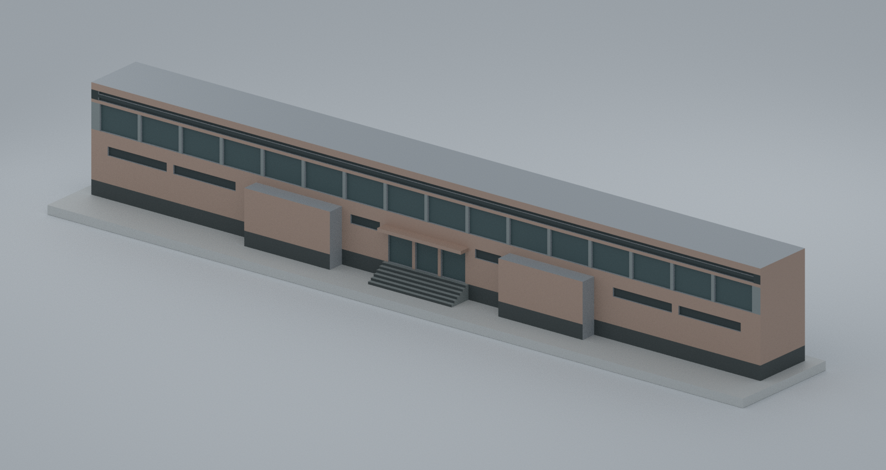
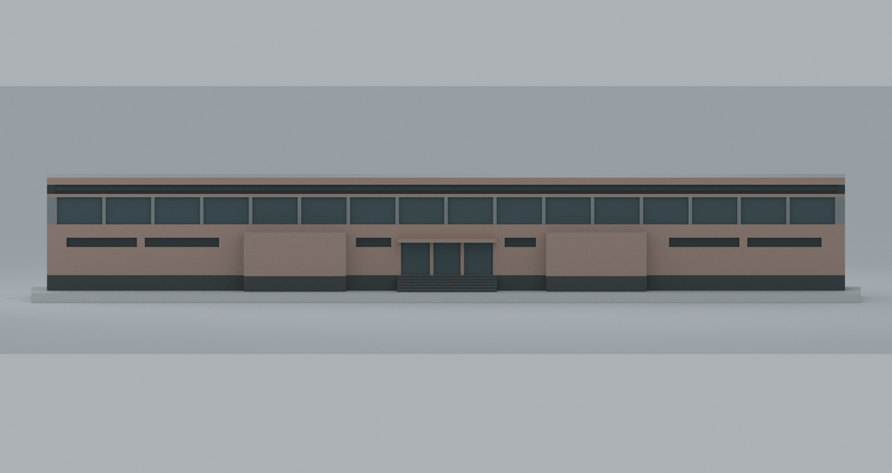
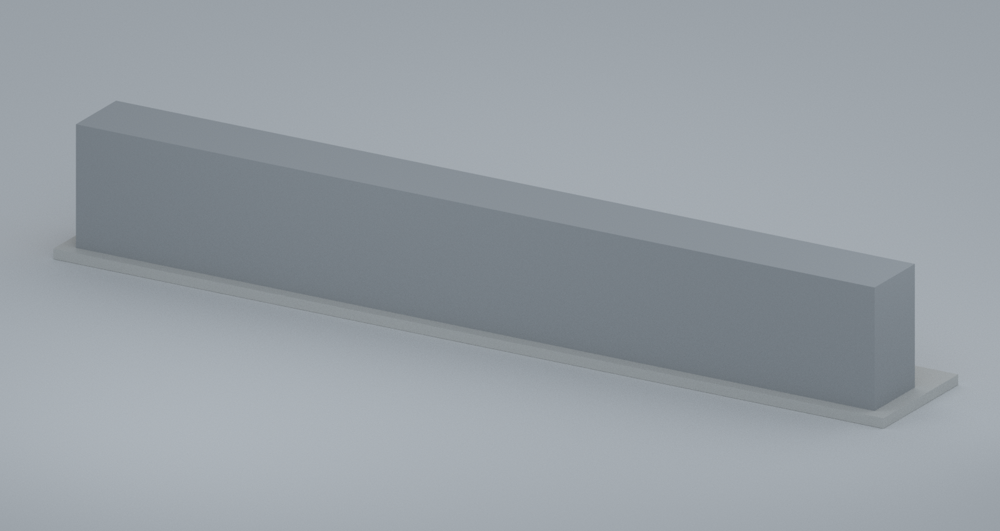
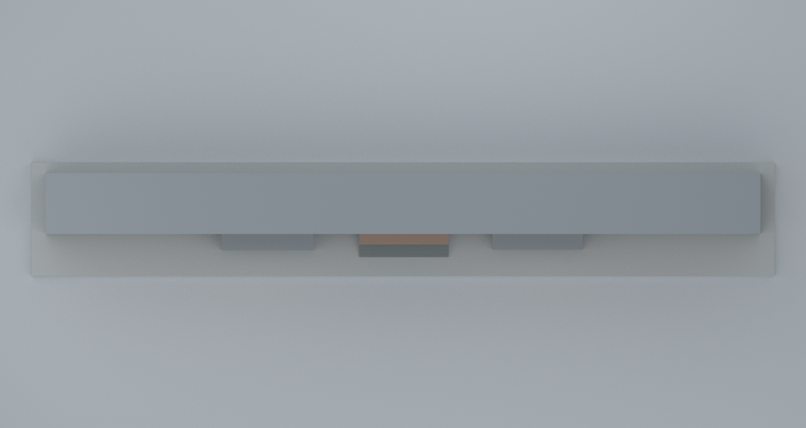
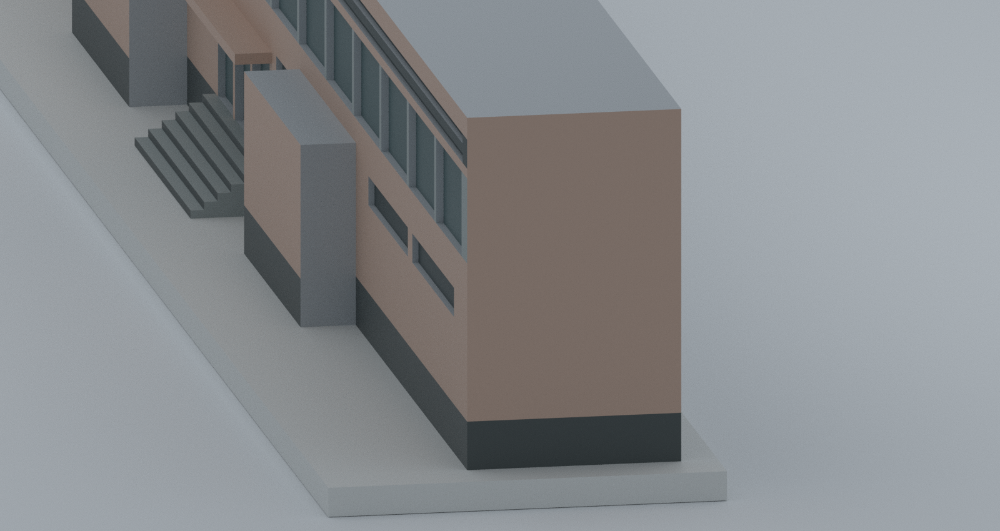

# 游泳館入口側服務翼節段（校方調查資料參考外觀；照片年代未定）

國立政治大學／山下校區／游泳館 60-22。**這是入口側狹長兩層服務翼的局部外觀近似模型，不是整棟游泳館，也不是已核實的 2021 或 2026 現況。** 高池廳、整座池廳屋頂與屋頂板列完全未建模。



## 交付

- [model.stl](model.stl)：單一封閉實體，毫米；STL **不含顏色**。
- [model.3mf](model.3mf)：同一幾何，7 個實際 Core base-material 色組及逐三角面指派；不是切片軟體專用工程檔，也不保證自動轉成多材料列印分色。
- [scene.blend](scene.blend)：Blender 4.3.2 可編修三角網格、實際材質槽、隱藏施工參數方塊與攝影／照明。僅 `NCCU service-wing segment — NOT full swimming hall` 為列印網格；展示地面、光源、相機和隱藏 guides 不得一起匯出。
- [parameters.json](parameters.json)、[build_geometry.py](build_geometry.py)、[build_scene.py](build_scene.py)：可重建原始程式與推估參數。
- [sources.json](sources.json)：原始來源網址、頁碼、雜湊及年代／授權限制；**沒有來源照片、平面圖像素或貼圖**。
- [QA.md](QA.md)：數位檢查、實際列印風險與未做項目。

## 範圍、封閉面與未解部分

1. 依校方平面圖保留狹長服務帶、入口與兩處樓梯區的相對位置。兩個前凸體只代表**低樓層局部樓梯包覆量體**；高度、外側牆面與細部是保守簡化，不是兩座完整對稱露天樓梯。室內、樓梯踏步與電梯均省略。
2. `+Y` 長面是**與高池廳相接之模型切面**，不是實際後立面；以中性灰封閉。未見短端、前凸體未確定的側面／頂面、整條服務翼簡化頂蓋亦用中性灰。灰頂蓋僅使模型可封閉，**不證明原屋頂是平屋頂**。
3. 入口前保留簡化寬階與淺遮雨棚。照片可見無障礙坡道，但起訖、走向、與平面圖配準不足，故**坡道明確未建模**。這不是宣稱現地無坡道，也不能用本模型判斷無障礙動線。
4. 上層玻璃以 16 個規則淺凹格、上方深色帶以兩條淺槽表意；下層通風窗、三段入口門、6 級前階皆是可列印簡化，**不是精確窗數、葉片數、門扇數或階數**。磁磚縫、招牌文字、扶手、植物、設備皆不捏造。
5. 外牆暖粉褐／深灰勒腳／灰藍深色玻璃與百葉色族來自照片700可見區，RGB 是展示選色，不是實測油漆、磁磚或玻璃規格；樓梯包覆前面的色彩為同一前立面色族的推估。照片701僅輔助核對高池廳脈絡，不用來臆造完整屋頂或隱藏外觀。

## 尺度推估（非實測）

校方體育室寫明 50 m 泳池；native 平面圖703的長向池矩形約 612 像素、外部長向約 748 像素，服務帶深約 64 像素。把「池矩形代表50 m」當作**二級近似錨點**，可得約 61 m 長、5.2 m 深的比例估計；這不是測量，也不把印在圖上的 `S=1/150` 當作可直接量取的 PDF 比例尺。高度缺少剖面，僅依照片比例選擇約 8.7 m 的視覺量體。

名義約 **1:300**：服務翼本體 204 × 17.4 × 29 mm；含底座整件 **212 × 32.4 × 31.4 mm**。這些是可重建的**模型尺寸**，不是校舍尺寸宣告。局部坐標 `X` 沿入口長向、`-Y` 面入口、`+Y` 為池廳切面；**未配準方位，不標東西南北**。

## 來源與年代

主要依據[校方校園建物調查 PDF](https://osa.nccu.edu.tw/CSRC/files/169362228269a7c8ada230d.pdf)的實體第93–95頁（印刷頁碼2-86、2-87、2-88）：建物60-22、外觀照片700/701、平面圖703/704。原 PDF SHA-256：`6f3b5072196adbac6f78211bc29b340fd2eaf91e6a6edce31b38063a04a97c75`。

表單日期2021-10-01；PDF容器日期2026-03-04。**兩者都不能推定照片拍攝年分。** 未宣稱照片是2021外觀、2023太陽能工程前狀態或2026現況。官方2023太陽能屋頂訊息不會讓這兩張未定年的照片變成可定年的屋頂證據。

原照片／平面圖僅私下研究留存；未查得可重製其像素的開放授權。本模型為原創簡化網格；實際幾何、材質與數位驗證結果以本包所附檔案為準。

## 其他視角

| 入口正面（非方位） | 池廳接合切面（非後立面） |
|---|---|
|  |  |

| 頂視：中性簡化封閉蓋 | 照片可見短端／局部細節 |
|---|---|
|  |  |

## 重建

幾何依賴記錄見 [requirements-geometry.txt](requirements-geometry.txt)，材質格式驗證另需 lib3mf 2.5.0，場景需 Blender 4.3.2。

```sh
python build_geometry.py --output ./rebuilt
cp parameters.json rebuilt/
blender -b --factory-startup --python build_scene.py -- --input ./rebuilt --output ./rebuilt --render
python verify_3mf.py --input ./rebuilt
python check_geometry_and_slices.py --input ./rebuilt
```

幾何 Python 與 lib3mf Python 可分別使用現有環境；程式不自行安裝任何依賴、不下載來源、不存取網路。`parameters.json` 改動可重新建模；工程未宣稱場景 `.blend` 的所有序列化位元具跨環境決定性。幾何／STL／3MF／材質與重建雜湊的實際核驗見 QA。
