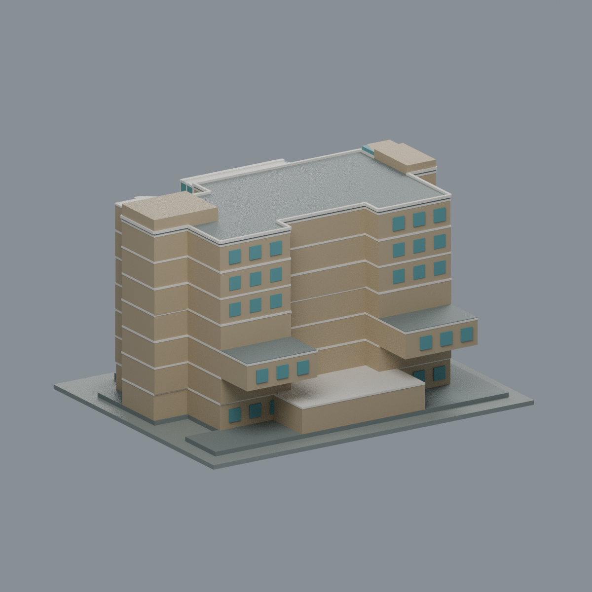
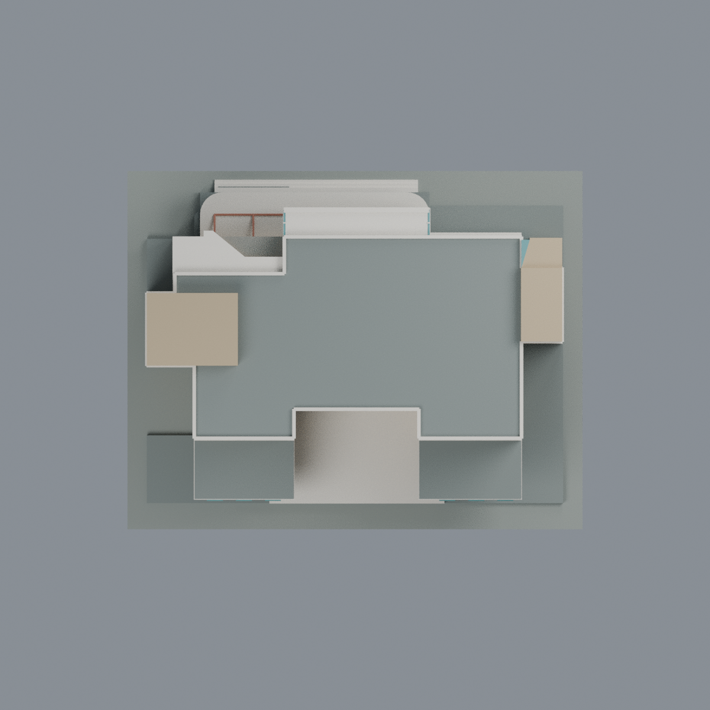

# 國立政治大學逸仙樓｜完整主樓彩色模型

[山下校區圖鑑](../../README.md) · [政大圖鑑](../../../README.md) · [全部模型](../../../../README.md)

本模型以官方防災報告 B1–7F/R 平面與四張官方現存照片建立完整、不對稱主樓；包括雙端階梯核心、階梯式平屋頂、中央玻璃突出部、半層白屏、貼樓入口曲面厚簷與平台。學思樓及兩棟之間的獨立橋跨不納入；保留貼樓接口，不製造斷橋自由端或虛構封牆。

**不是2026實景測繪，也不是實印驗證。** 1981年完成史、2006年照片標示、2026年PDF匯出日期是不同時間事實。比例尺寸、屋頂小核心高度、窗格與色彩為合理近似；未見背面採中性、稀疏窗近似，不鏡射正面。6/7F中央多邊形是房間與廊道，模型沒有虛構天井。

## 檔案
- `scene.blend`：可編輯真實三角網格及材料；沒有照片材質或渲染假幾何。
- `model.3mf`：毫米、分面材質、多色單模型；材料可編輯。
- `model.stl`：同一外表面幾何，STL不保存色彩。
- `previews/`：五方向、同一交付網格的實際渲染。
- `build_model.py` / `render_model.py` / `rebuild.py`：可重建原始碼。
- `qa/`、`qa-topology.json`、`qa-layers.json`：逐項檢查；薄壁警告不掩蓋。

## 尺度與列印限制
總包絡約141 ×111 ×82.35 mm（以最終QA為準）。設計單位是圖面相對比例假定米數，3 mm/假定米不是測量精度宣稱。室內簡化為實體量體，入口凹空與平台下方保留真空間；B1外框保留在低基座區，內部弧形階梯不變成外棚。
細窗框、屏板、紅棚架與懸挑需切片器、材料及機器個別設定；0.8 mm切片侵蝕與局部射線取樣報告不是保證最小壁厚，未實印，不宣稱免支撐。

## 重建
Python依賴見requirements.txt；Blender4.3.2、CPU4threads。執行 `python build_model.py`，再 `blender -b -t 4 --python-exit-code 1 --python render_model.py`。`python rebuild.py --output /new/empty/path`在全新目錄重建並比較STL/3MF/mesh/palette及五PNG。Blend可重開核對網格，但不承諾Blend容器byteexact。

模型提供展示及下載。來源授權疑義見SOURCES.md與LICENSE.txt；沒有第三方照片、頁圖或可識別來源像素附入交付包。

## 模型預覽與下載

| 正面 | 背面 | 頂視 |
| :---: | :---: | :---: |
|  |  |  |

[可編輯 Blend](scene.blend) · [彩色 3MF](model.3mf) · [單色 STL](model.stl) · [已驗證重建來源 ZIP](rebuild-source.zip) · [技術與製造限制](QA.md)

`qa/independent/` 收錄獨立技術審核；具體製造限制見 `QA.md`。
