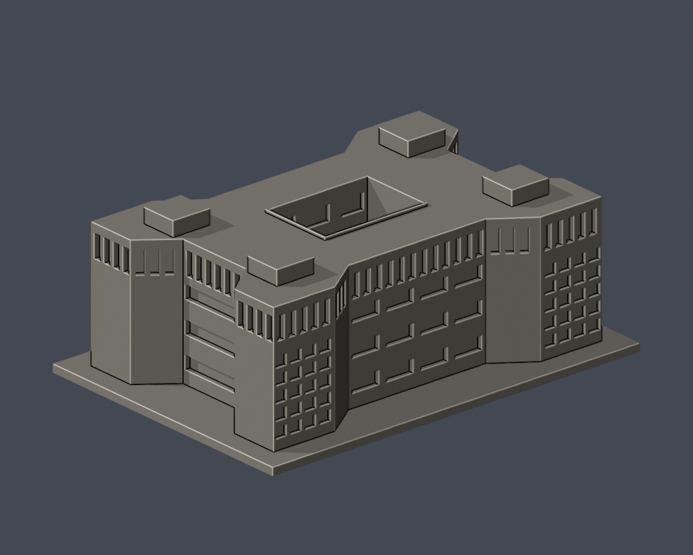
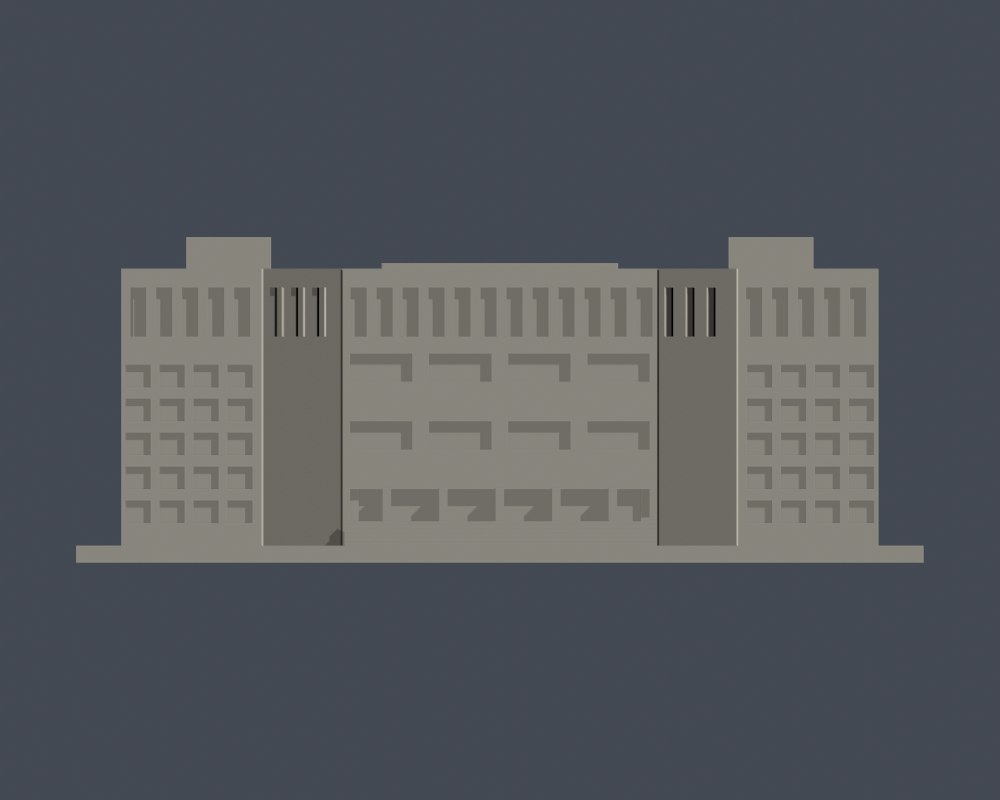

# 國立政治大學｜中正圖書館

## 模型預覽

| 模型預覽 | 模型預覽 | 模型預覽 |
| :---: | :---: | :---: |
| 正面（實際STL）  | 背面（實際STL）  |  |

山下校區。依公開實景與官方平面外輪廓自建的完整建物外觀近似，非测绘、BIM或結構設計。

[俯視](previews/top.png) · [正立面](previews/elevation.png)

| 模型預覽 | 模型預覽 | 模型預覽 |
| :---: | :---: | :---: |
| 俯視  | 正立面  |  |

## 形狀及證據限制

萬壽型／四角突出外輪廓、中央開放天井、頂層連續直向遮陽窗帶、四角網格屏牆、前階及屋頂機房。屋頂形狀另以官方鳥瞰實拍核對。

不把外輪廓或天井填成長方盒。角部網格為有背板凹格，沒有室內房間；背面未覆蓋的窗距、屋頂設備及小型排氣設施簡化。原照片未標攝影日期，並非2026逐點現況。

官方防災表内日期2021-10-01，PDF編成2026-03-04，两者不可當照片拍攝日。來源網址、頁碼與支持特徵見[sources.json](sources.json)。第三方原圖不隨包散布。

入口立面按實拍建4排：地面入口窗帶、上方兩層橫窗、頂層直窗。來源標層有口徑差異：防災資料表稱地面5層，但同文件及館方樓層圖列B1、1F至4F；模型未把B1另加為入口立面的第五排。

## 使用方式

- [model.stl](model.stl)：毫米，150.0 × 106.0 × 57.6 mm；含底座最長150 mm，各館獨立比例
- [scene.blend](scene.blend)：實際STL匯入的可編修網格，已與交付STL幾何比較
- [build_model.py](build_model.py)：獨立參數重建來源；[requirements.txt](requirements.txt)
- [SHA256SUMS](SHA256SUMS)：逐檔雜湊；STL SHA-256為 c7ad8d7559310965da3dcf737fd335d2dba0387e2bd434b5c6d30761ea62b459

底座朝下。可先以0.2 mm層高、0.4 mm噴嘴作切片檢查起點，按自己的材料、機台及冷卻條件決定支撐；深凹入口、柱廊、雨遮、頂層簷口和凹窗頂尤其需檢視。窗框／柱／天井邊緣已加粗連接，不代表不需要支撐。

## Fail-closed數位QA

Python執行build_model.py；Blender背景執行render_preview.py產生實際STL預覽與scene.blend；再依序執行validate_model.py、check_contour_validity.py、check_thin_features.py，任一步非零退出都必須停止交付。

[validation.json](validation.json)全部checks=true：原始STL法向／繞序／正體積、水密、每邊2面、vertex link單一環、單一連通表面且無內腔殼、尺寸、獨立重建SHA、Blend/STL幾何一致。

[contour-validity-check.json](contour-validity-check.json)：固定z=0.071 mm起、0.2 mm層距，共288層，degree2閉合、每個與組合Polygon均有效，遇invalid不修補。

[thin-feature-check.json](thin-feature-check.json)：canonical邊內插，1 mm取樣，以0.8 mm參考寬度形態opening輔助篩檢；最大面積損失0.13274%，大於1%層數0。不是全面最小壁厚或實際工具路徑。

未做Cura/Prusa实际切片或實體試印，不宣稱保證可印或全校完成。
