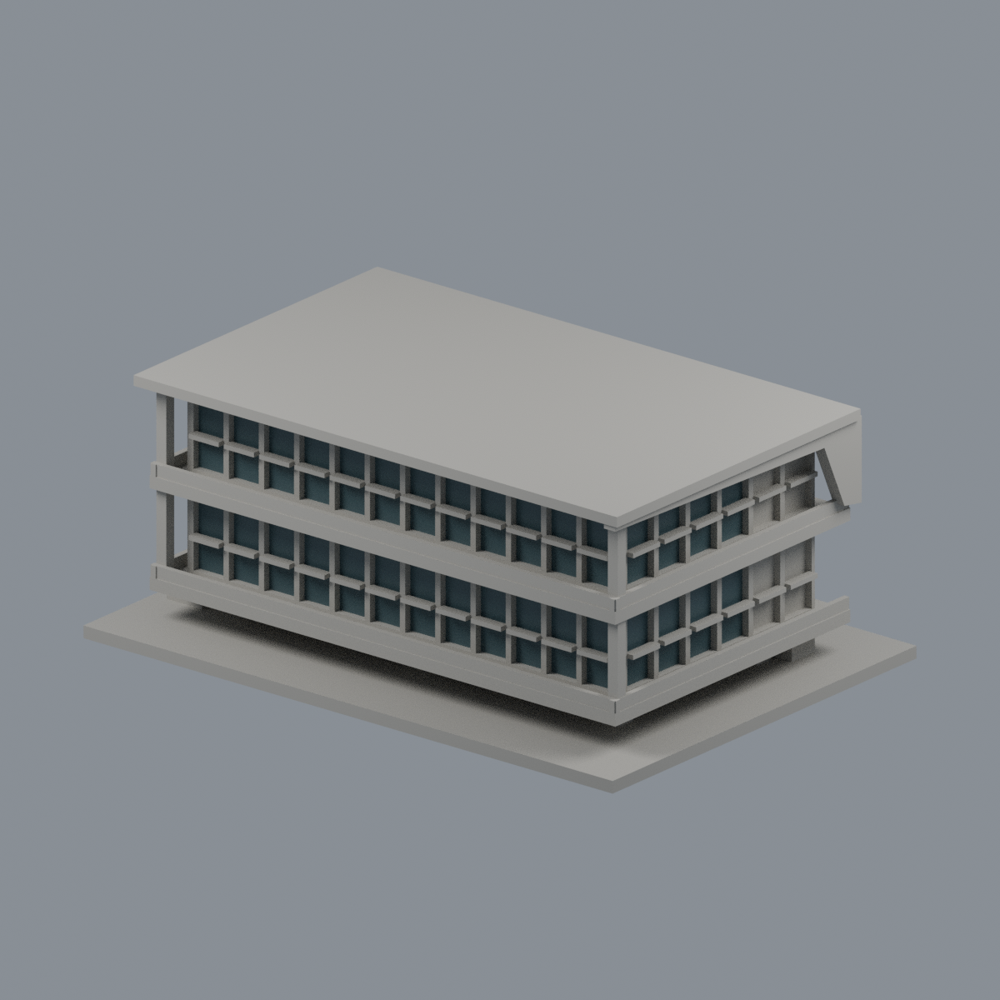
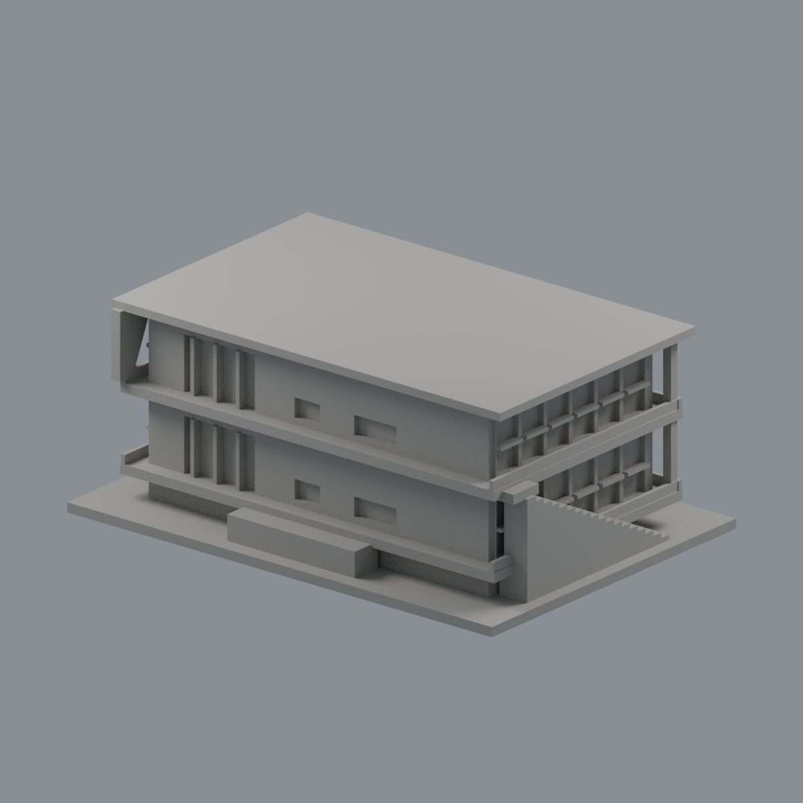

# 國立政治大學｜湖濱悅讀小屋

## 模型預覽

| 模型預覽 | 模型預覽 | 模型預覽 |
| :---: | :---: | :---: |
| 正面與右前窗背  | 未確認後側保持中性  |  |

## 窗背限域配色（2026-10-22）

[五視角、來源與限制](appearance/README.md) · [表面色3MF](appearance/nccu-lakeside-appearance.3mf) · [可編輯Blender](appearance/scene.blend)

僅正面24窗及右前8窗背64個完整三角採深灰青玻璃外觀代理；其餘3340面、原框、左階側、右後2灣、後、屋頂及基座維持中性。中性意為未確認，不是斷言實物灰色。依建築師2022/03刊小屋實拍，曝光日期未報，不聲稱2026現況或實測色。獨立兩層小屋不是主棟；主棟橘色百葉不套用。原3404面座標、面序、STL及歷史QA不變，不增套數。3MF單網格表面色，非分色封閉體或G-code；未實體試印。第三方照片不分發。

指南校區。公開完成實拍與官方平面外輪廓自建的完整建物外觀近似，不是測繪或BIM。

俯視圖（歷史檔案留存，不作本頁預覽） · 正立面（歷史檔案留存，不作本頁預覽）

## 特徵與範圍

完整獨棟二層閱覽小屋，兩道挑出樓板、連續玻璃窗格、湖側凹退陽臺、開放架高底層、後侧實牆/玻璃入口及外露樓梯，側面斜落折板保留。

又稱湖濱小屋／湖濱閱讀小屋。主館另件，不包含空橋、湖水或景觀樹木。欄杆、窗框加厚為可解析外殼 relief；玻璃用有背板凹窗表達，未虛構室內家具。實際結構尺寸及與基地坡差均為估算。

來源是2019完工後实拍、2022建築師刊物和官方防災資料；表內2021-10-01不是照片拍攝日，PDF建立日2026-03-04也不代表全新照片。沒有用效果圖冒充现况。來源URL、頁碼與特徵見 [sources.json](sources.json)，第三方照片不隨包公开。

## 檔案與列印方向

- [model.stl](model.stl)：毫米，150.0 × 106.0 × 60.8 mm，含底座最長150 mm，各館獨立比例
- [scene.blend](scene.blend)：实际STL匯入之可编辑網格，驗证與STL一致
- [build_model.py](build_model.py)：獨立參數重建；[requirements.txt](requirements.txt)
- [SHA256SUMS](SHA256SUMS)：逐檔SHA；STL SHA-256：30769931f58c5095803700b6462694aa6485b42c6979ca540da8d834d3767320

底座朝下。請先以自己的切片軟體檢視，0.2 mm層高／0.4 mm噴嘴只作參考設定。柱廊、架高底層、外挑樓板、凹窗頂與格柵需要按設備評估支撐和橋接。窗框及欄杆已加厚，但數位檢查不保證任何材料或切片設定可印。

## Fail-closed數位檢查

Python執行build_model.py；Blender背景執行render_preview.py；再用Python依序執行validate_model.py、check_contour_validity.py及check_thin_features.py，任何非零退出即停止交付。

[validation.json](validation.json) 全部checks為true：原始二進位STL法向、繞序、水密、每邊兩面、單環vertex links、單一連通表面且無封閉内腔壳、正體積、150 mm限制、獨立重建SHA及Blend幾何一致。

[contour-validity-check.json](contour-validity-check.json)：0.2 mm层距、起始z=0.071mm，共304層；degree2閉合，每個Polygon與組合Polygon均有效，不修補invalid。

[thin-feature-check.json](thin-feature-check.json)：canonical邊內插、1 mm取樣、0.8 mm參考寬度opening，最大面積損失0.06029%，超過1%共有0層。這是窄特徵篩檢，不是全面最小壁厚或實際工具路徑。

未做Cura/Prusa實際切片或實體試印；全校建物尚未完成。
