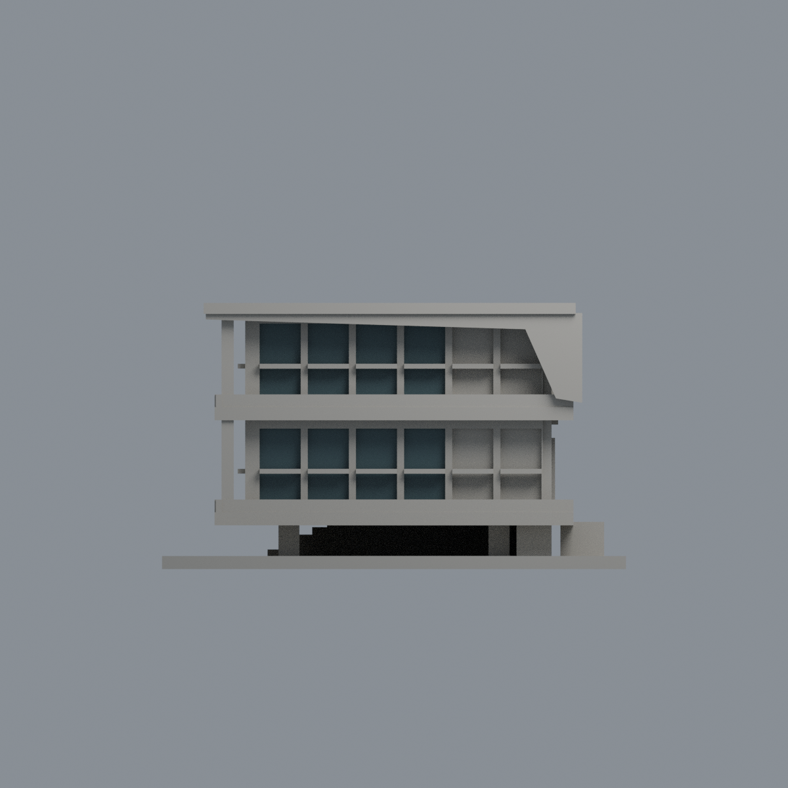
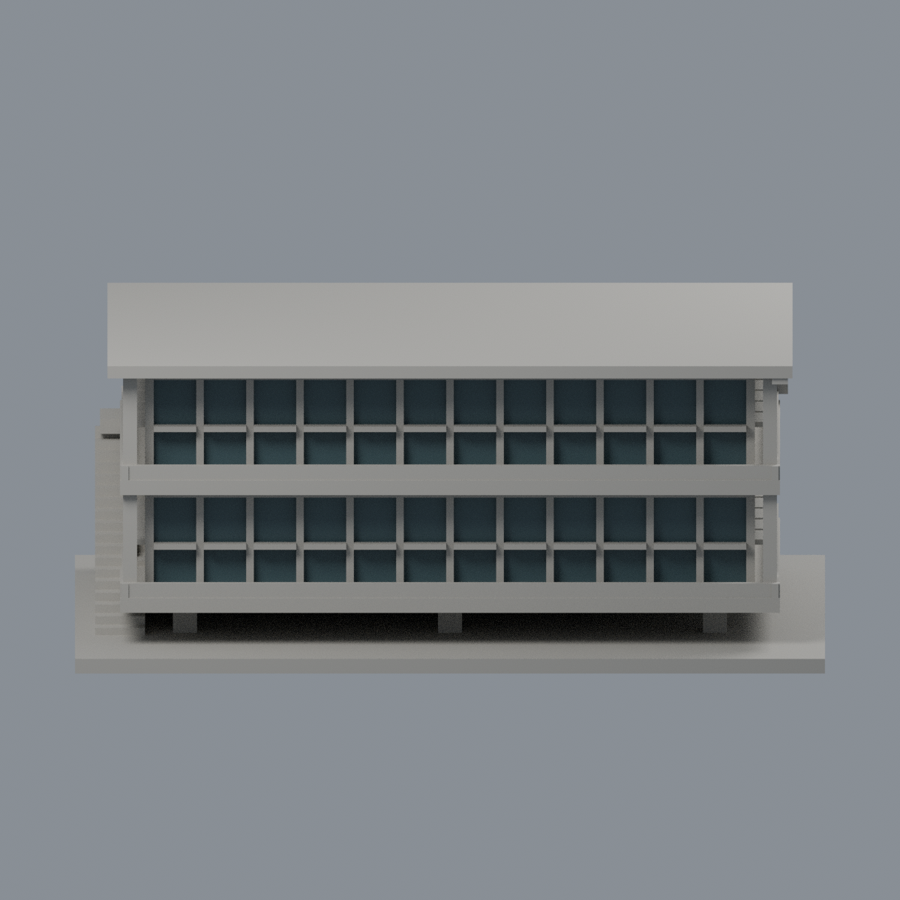
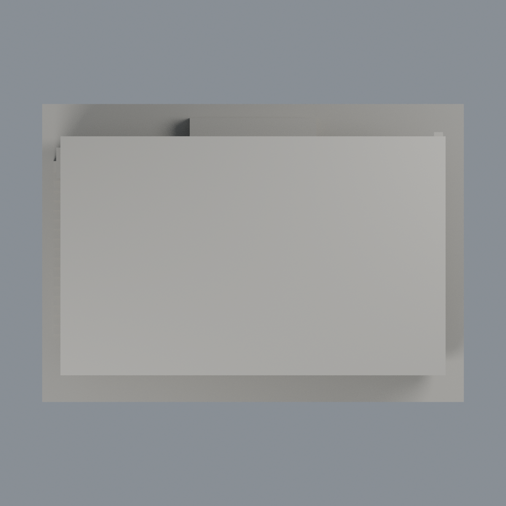

# 政大湖濱悅讀小屋：正面及右前窗背限域配色

獨立二層湖濱小屋，不是司徒達賢圖書館主樓。原3404面中，正面24窗及折板右側前8窗的64個完整背面三角採深灰青 #465C61 不透明玻璃外觀代理，其餘3340面維持中性 #AAA79F。中性意為未確認，不代表所有實物皆灰色；不是全棟材質復原或2026現況。

| 模型預覽 | 模型預覽 | 模型預覽 |
| :---: | :---: | :---: |
|  |  |  |

[後左](previews/rear.png) · [右立面](previews/elevation.png) · [正立面](previews/side.png) · [俯視](previews/top.png)

| 模型預覽 | 模型預覽 | 模型預覽 |
| :---: | :---: | :---: |
| 後左  | 右立面  | 正立面  |
| 俯視  |  |  |

## 來源和選面界線
親看建築師2022/03刊照片：小屋兩層窗帶深冷灰青反射、淺色框與折板。攝影曝光日期未知，刊載月份不是攝影日。照片未校色；#465C61只是顯示代理，不聲稱實際玻璃RGB、透光率或塗料色。主樓橘色百葉、湖水、綠化、反射與陰影不移植到小屋。

正面所有三頂點 y=-32.2；12個窗中心 x=-55..55 每10mm，寬8.5mm。右前所有三頂點 x=59.2；窗中心 y=-26,-15,-4,7，寬9.4mm。兩層 z=[14.1,32.1]、[38.1,56.1]；各完整窗背2面。以完整三頂點選面、不重心猜測、不切面或重網格。前48面+右16面約5025.6mm²。框、欄杆、窗洞側邊皆中性。左階梯側、右後兩灣 y=18/29、背面、屋頂、底座與架空層不染；右後兩灣不染不是認定其實物不透明。

## 檔案與重建
[彩色3MF](nccu-lakeside-appearance.3mf) · [可編輯Blender](scene.blend) · [面映射](face-materials.json) · [色盤](palette.json) · [來源](SOURCES.md) · [權利](LICENSE-NOTICE.md) · [重建來源ZIP](rebuild-source.zip) · [校驗碼](SHA256SUMS)

保留原STL全部座標、三角面序及拓撲，尺寸150×106×60.8mm。原native場景只有Warm stone preview only單材質；本補充不改寫原件、歷史來源或製造QA。解壓重建來源ZIP後，以Python依source/requirements.txt安裝依賴，依次執行build_appearance.py、verify_exchange.py、verify_material_boundaries.py，再以Blender 4.3.2+執行render_appearance.py、verify_scene.py。相對目錄須為model.stl及appearance/source/。

驗證包含lib3mf strict零警告、實際材質修改/存檔/重開、Blender實際材質修改/存檔/重開與其他材質/幾何不變。乾淨重建3MF、映射、色盤及五PNG逐byte比對；Blend僅語義一致，不宣稱binary決定性。未做切片器、多色FFF或實體試印；模型為目估外觀研究，不供施工。
