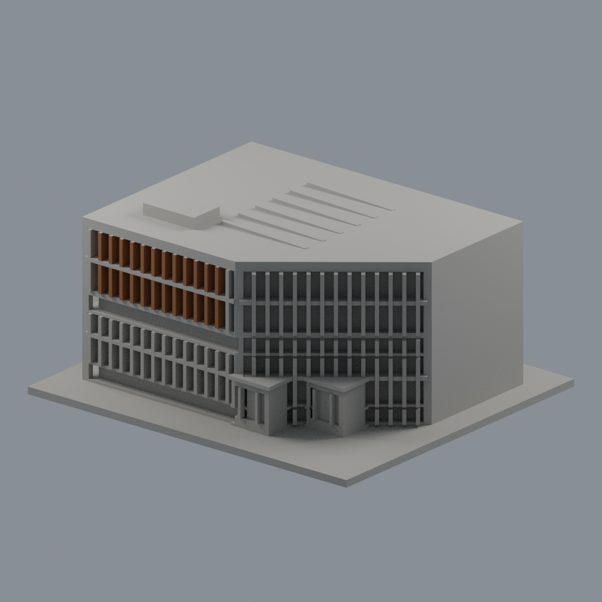

# 國立政治大學｜達賢圖書館主棟

## 模型預覽

| 模型預覽 | 模型預覽 | 模型預覽 |
| :---: | :---: | :---: |
|  |  |  |

## 湖側上層直段遮陽板限域配色（2026-10-22）

[五視角、來源與限制](appearance/README.md) · [彩色3MF](appearance/nccu-seetoo-appearance.3mf) · [可編輯Blender](appearance/scene.blend)

僅主館湖側直段上層中央12板、240完整三角面採觀察棕色表面proxy；不確稱木材。橫向梁、兩端角板、斜面、其他立面及下層保持中性。中性表示未確認，不代表實物灰色。依建築師2022/03刊實拍，曝光日未報，不稱2026現況或實測RGB。原7246面座標/面序/STL/歷史QA不變，不增套數。非分色封閉體或G-code，未實體試印；第三方照片不分發。

指南校區。公開完成實拍與官方平面外輪廓自建的完整建物外觀近似，不是測繪或BIM。

俯視圖（歷史檔案留存，不作本頁預覽） · 正立面（歷史檔案留存，不作本頁預覽）

## 特徵與範圍

完整主棟外輪廓包含湖側大斜角、正面兩層高傾斜混凝土屏板、中間玻璃帶、側/湖面雙層遮陽格柵、側入口柱廊與下層露臺。

僅建主棟，不把獨棟湖濱悅讀小屋或連接空橋算入本件。室內多層書牆與中庭不在外觀模型範圍；屋頂已蓋住，沒有擅自開成露天院落。最內側遮陽、屋頂採光窗採外輪廓近似，沒有精密窗構或細部設備測繪。

來源是2019完工後实拍、2022建築師刊物和官方防災資料；表內2021-10-01不是照片拍攝日，PDF建立日2026-03-04也不代表全新照片。沒有用效果圖冒充现况。來源URL、頁碼與特徵見 [sources.json](sources.json)，第三方照片不隨包公开。

## 檔案與列印方向

- [model.stl](model.stl)：毫米，150.0 × 132.0 × 71.5 mm，含底座最長150 mm，各館獨立比例
- [scene.blend](scene.blend)：实际STL匯入之可编辑網格，驗证與STL一致
- [build_model.py](build_model.py)：獨立參數重建；[requirements.txt](requirements.txt)
- [SHA256SUMS](SHA256SUMS)：逐檔SHA；STL SHA-256：a0e21a20d4e7b24b256ebdd70d1fd4f954b3e0beec129cff795a68ef50d9987a

底座朝下。請先以自己的切片軟體檢視，0.2 mm層高／0.4 mm噴嘴只作參考設定。柱廊、架高底層、外挑樓板、凹窗頂與格柵需要按設備評估支撐和橋接。窗框及欄杆已加厚，但數位檢查不保證任何材料或切片設定可印。

## Fail-closed數位檢查

Python執行build_model.py；Blender背景執行render_preview.py；再用Python依序執行validate_model.py、check_contour_validity.py及check_thin_features.py，任何非零退出即停止交付。

[validation.json](validation.json) 全部checks為true：原始二進位STL法向、繞序、水密、每邊兩面、單環vertex links、單一連通表面且無封閉内腔壳、正體積、150 mm限制、獨立重建SHA及Blend幾何一致。

[contour-validity-check.json](contour-validity-check.json)：0.2 mm层距、起始z=0.071mm，共358層；degree2閉合，每個Polygon與組合Polygon均有效，不修補invalid。

[thin-feature-check.json](thin-feature-check.json)：canonical邊內插、1 mm取樣、0.8 mm參考寬度opening，最大面積損失0.23231%，超過1%共有0層。這是窄特徵篩檢，不是全面最小壁厚或實際工具路徑。

未做Cura/Prusa實際切片或實體試印；全校建物尚未完成。
