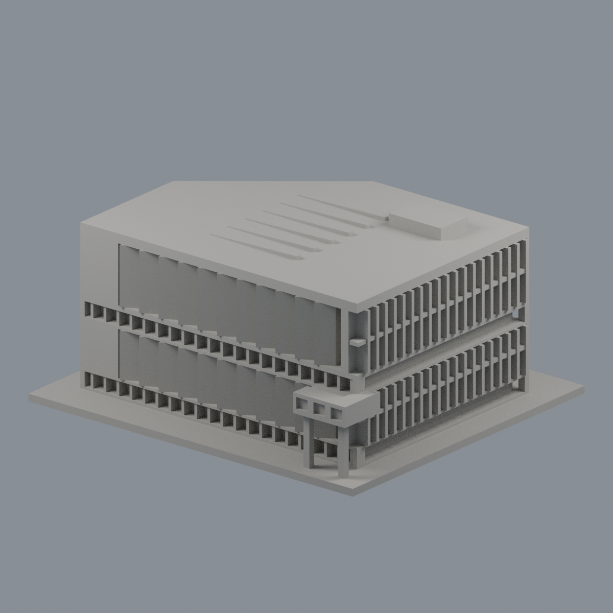
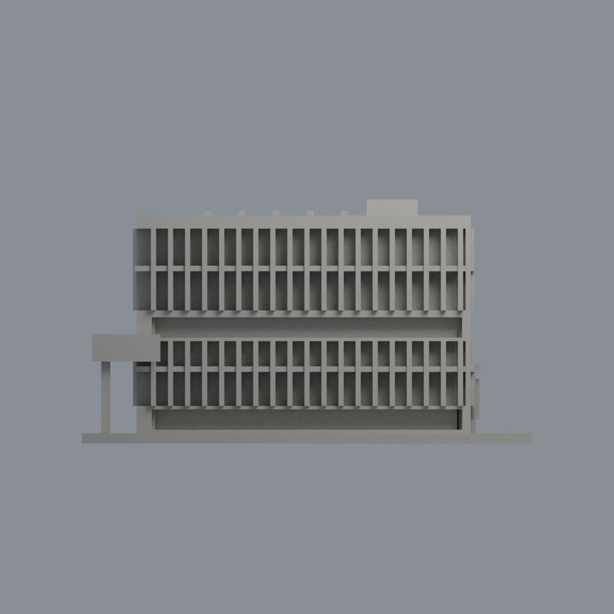
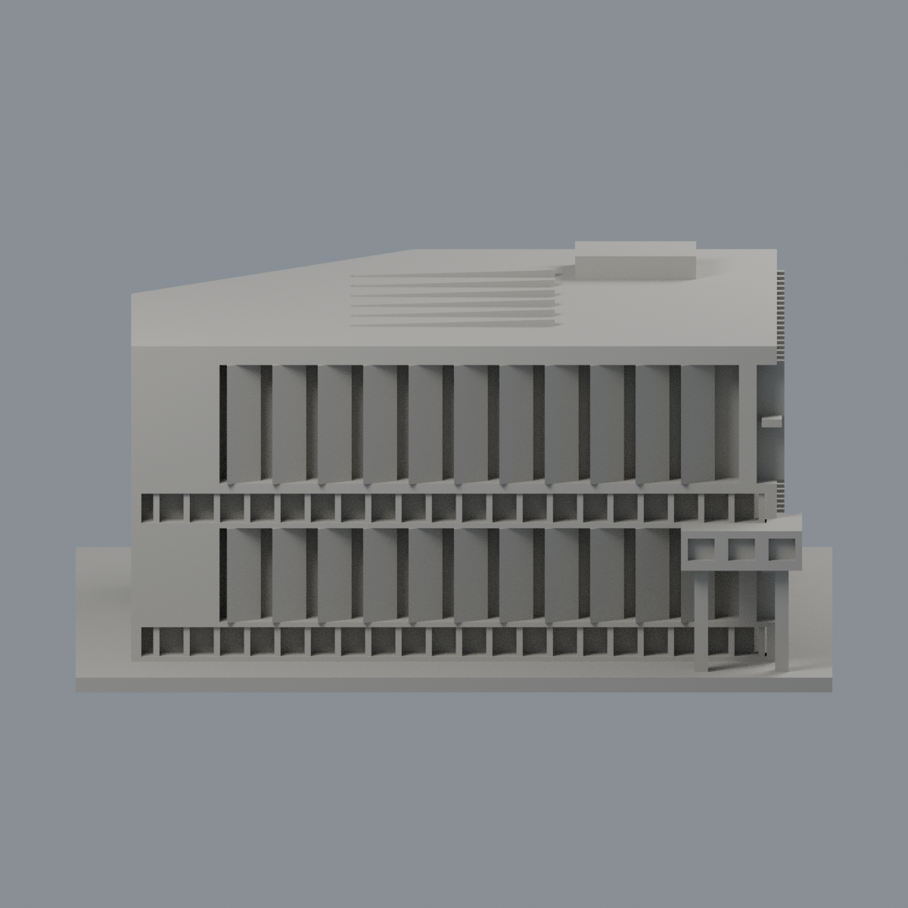
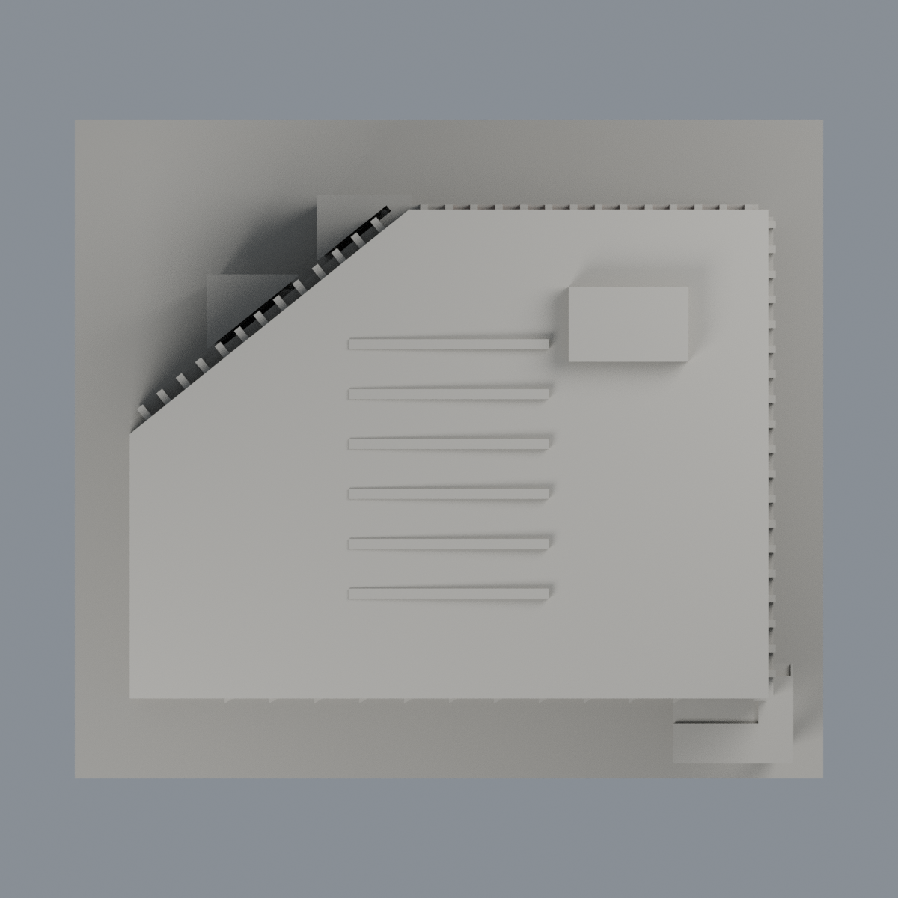

# 政大達賢圖書館主館：湖側上層直段遮陽板限域配色

本案是主館，不是前方獨立湖濱悅讀小屋。原7246面中，僅湖側直段上層中央12片遮陽板的240個完整三角面採棕色表面代理 #98633D，其餘7006面維持中性 #AAA79F。中性表示未確認，不代表實物均灰色；不是全棟材質復原或2026現況。

| 模型預覽 | 模型預覽 | 模型預覽 |
| :---: | :---: | :---: |
|  |  |  |

[前視](previews/front.png) · [右立面](previews/elevation.png) · [正立面](previews/side.png) · [俯視](previews/top.png)

| 模型預覽 | 模型預覽 | 模型預覽 |
| :---: | :---: | :---: |
| 前視  | 右立面  | 正立面  |
| 俯視  |  |  |

## 來源與選面
親看建築師2022/03刊實拍，主館上層可見棕橘色垂直遮陽板、淺灰橫向梁。曝光日期未報；照片未校色，棕色是外觀代理，不宣稱確為木材、銅、塗料品牌或實測RGB。照片前方小屋不是本模型；入口混凝土屏風不套用棕色。

只取 y約48直段、x中心0至55每5mm的12板；各20完整三角面、合計約3129.6mm²。所有頂點限於各中心±0.75、y44..49、z39..63；取x兩側面，以及y49端面且整面z≤50.5或≥52.1。橫向淺灰梁z50.5..52.1不染；梁後y44..45殘存板側仍屬棕色板。兩端x=-5與60板、下層、斜立面、其他側面、入口、凹背、屋頂與底座全部維持中性。不以重心跨界、不切面、不增加幾何或貼圖。

## 檔案及重建
[彩色3MF](nccu-seetoo-appearance.3mf) · [可編輯Blender](scene.blend) · [面映射](face-materials.json) · [色盤](palette.json) · [來源](SOURCES.md) · [權利](LICENSE-NOTICE.md) · [重建ZIP](rebuild-source.zip) · [校驗碼](SHA256SUMS)

保留原STL全部座標、面序與拓撲，3295頂點7246三角面、尺寸150×132×71.5mm。原native單Warm stone材質，本次additive不改原件或歷史製造QA。

重建目錄為model.stl及appearance/source/；Python依requirements.txt安裝，執行build_appearance.py、verify_exchange.py、verify_material_boundaries.py，再用Blender 4.3.2+執行render_appearance.py、verify_scene.py。包含strict 3MF零警告、真正單材質編輯存檔重開及Blender同項驗證。乾淨重建3MF/映射/色盤/五PNG逐byte相同，Blend僅語義一致，不宣稱binary決定性。未切片器、多色FFF或實體試印；非工程測繪或施工模型。
