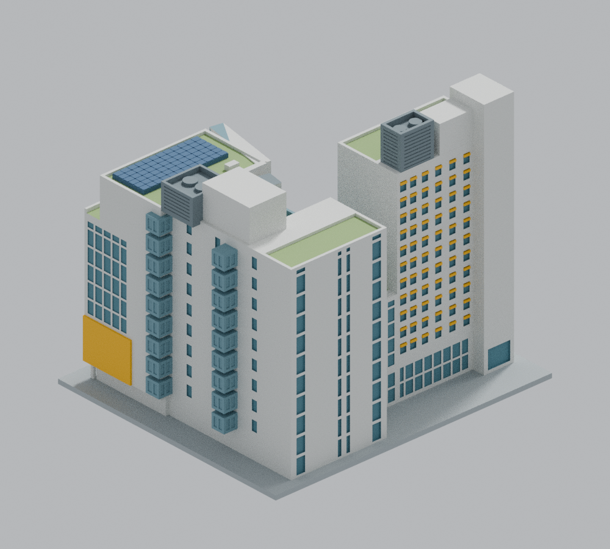
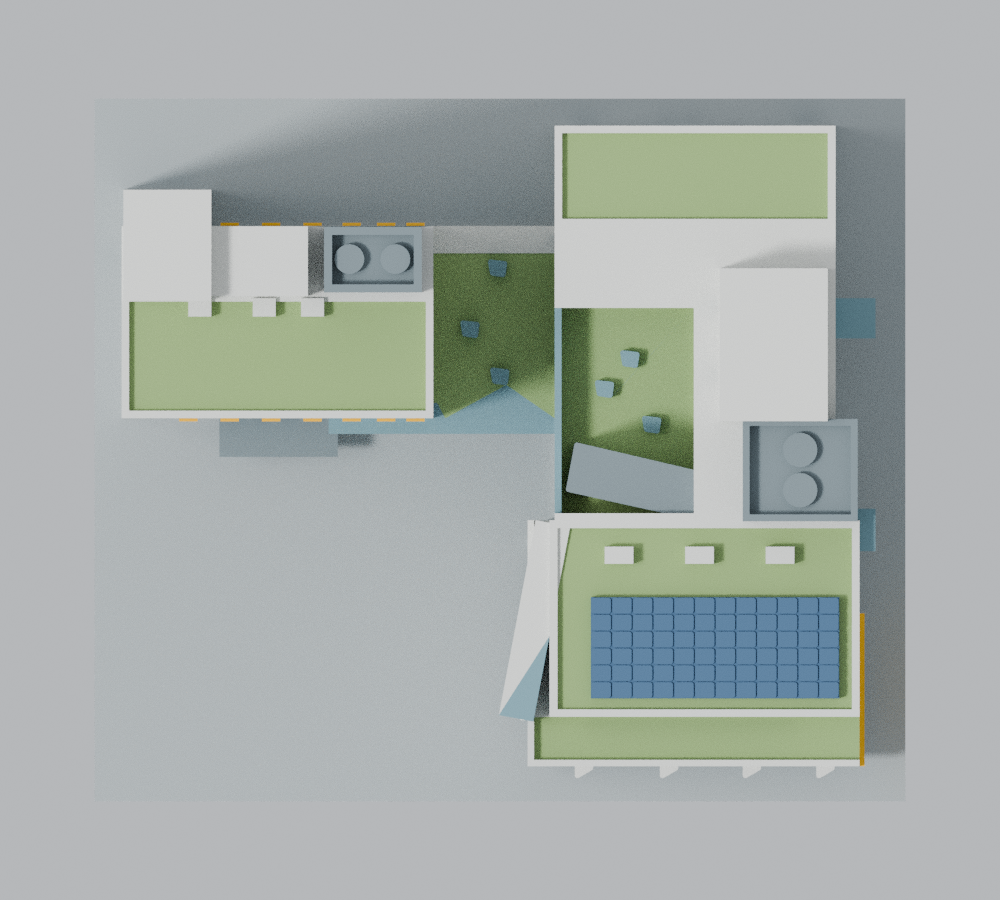

# 政大公企中心：整案外觀近似模型

國立政治大學公共行政及企業管理教育中心（住宿棟＋會展棟＋公共連接），只計一套模型。2021 完工，依 2021–2022 公開影像重建。本件為自行參照公開圖文建立的比例近似，不是竣工測繪，也不代表 2026 年現況。

目前狀態：建模與獨立 QA 已完成，進入正式發布準備。僅接受四條原射線沿共面邊界行進的限定例外；原始 strict=false、四個旗標與完整入口非零退出均保留。這不是所有嚴格檢查均已通過，也尚未實體試印。完整倉庫中的[獨立稽核摘要](../../../inventory/qa/nccu-public-center-2021-review.md)列出受審版本、證據與限制。

## 正面與背面

| 西南側（正面） | 東北側（背面） |
| --- | --- |
|  |  |



PNG 及 scene.blend 都使用同一份 model.stl 的原始有向三角面；色彩只幫助辨識材質區，STL 為單色實體，沒有透明玻璃。圖中沒有另加渲染專用的建築構件。

## 範圍與比例

- 採等比例 1:470（每公尺 2.12766 mm）。完整底座 150 × 130 mm，底板厚 2.4 mm，最高點約 126.87 mm。沒有為了底座把某一軸獨立壓窄。
- 建築平面外包約 65.6 × 56–57 m，印件主體約 139.6 × 120 mm。原先 1:450 的外包約 146 × 126 mm 尚未含底座，因此略縮至 1:470。
- 住宿主矩形約 27.1 × 16.7 m，保留北側約 3.1 m 凸出核心。會展北端寬約 24.4 m、南端約 28.9 m，東側另有凸出核心；沒有用單一等寬方盒替代。
- 主要屋面高差、中央凹庭與西側玻璃邊界、兩層跨棟露臺、4F／6F 廊橋、南端退縮露臺、斜向上層盒體、向上庭園伸入的斜樓梯屋蓋、PV 主陣列、屋突與冷卻設備圍屏均保留。
- 會展北立面為四條逐層分段的豎窗帶，外側較寬、中間較窄。東側為兩組上下堆疊的凸出玻璃盒；沒有鏡射西側，也沒有把北側做成水平通窗。

尺寸是依圖面比例尺與影像反推，並非施工尺寸。平面量讀約容許 ±0.5 m；高度另見下節，不能與圖面標註值混為一談。

## 高度基準與不確定性

建築師雜誌提供住宿棟「13 層、49.4 m」，但沒有完整拆出主屋面、女兒牆與所有屋突的標高定義。會展棟雖列 10 層，沒有獨立發表的總高度。因此本模型各高度是可調參數，不把會展硬套 49.4 m。

本模型採用的近似方案以住宿主屋面 49.4 m、最高主要屋突 58.5 m、會展主屋面 45.5 m、主要設備屋突 53.5 m、中央庭園 34.5 m、南端退縮露臺 35.8 m 進行比較。這是一組影像比例假設，此主屋面解釋是模型選擇，發表來源未拆明主屋頂、女兒牆與最高點；若 49.4 m 已包含最高屋突，整體垂直尺度仍有另一種較低的可能解釋。

校準使用 AD05、校方空拍、三張有比例尺平面與可識別的同一直立角。照片裁切、透視修正、相機內參與角點遮蔽會改變回推結果。無法證實全案誤差在 ±5% 以內，亦不提供該尺度精度保證；屋突等局部會更不確定。窗高、窗距、局部玻璃框及小設備尺寸亦為比例近似。

[校方 2021 年報導](https://www.nccu.edu.tw/p/405-1000-10793%2Cc87.php?Lang=zh-tw) 指出 4F／6F 連通道、7F／9F 露臺、1–2F 挑空 8 m，以及 2–8F 中庭高 30 m。模型以這些明示層級及照片互校；沒有直接把「十樓平面」上的所有露臺都當成十樓地坪，也沒有用爆炸圖像素直接量整棟高度。

## 來源與年代

完整引用與量讀說明見 sources.json。

- [ArchDaily 建築師提供圖組](https://www.archdaily.com/1001827/nccu-center-for-public-and-business-administration-education-jjp-architects-and-planners)：2023-06-03 發表；27 張照片、平面與示意圖。主平面 20 m 比例尺約 298 px，以約 14.9 px/m 量讀。
- [建築師雜誌](https://www.twarchitect.org.tw/works/國立政治大學公共行政及企業管理教育中心/)：2023/01，建築資料與完整頂視。
- [政大 2022-02-11 校方空拍](https://www.nccu.edu.tw/p/405-1000-11010%2Cc87.php?Lang=zh-tw)：原照片 EXIF 日期 2021-10-28；與 AD15 的 2021-10-06 日期線索共同確認當時已有 PV 與主要綠屋面。EXIF 不等於經驗證的測量日期或精確時刻。
- Google 官方歷史街景：會展北、東面為 2022 年 1 月，住宿北面為 2022 年 3 月。來源網址及 pano ID 見 sources.json。未使用 2025 街景作模型年代依據。
- 臺北市細部計畫書第 9 頁／印刷頁 7 圖 6 照片 3：僅補充住宿北面新樓；未誤用舊樓照片。
- 利晉工程的會展 9F／住宿 12F 與建築師雜誌 10F／13F 相差一層，這項來源差異明列，未默默混用。

只提供引用網址，不重新散布來源照片、街景截圖或研究對照板。原始建築設計與攝影的權利仍歸各權利人；本包不宣稱擁有那些圖像的授權。

## 列印與必要簡化

- 一個封閉連通的 STL，底座朝下。建築主要體量採實心背材，玻璃以淺凹實面表示；未重建看不到的室內家具、房間或機電管線。
- 外部跨棟空隙、橋下空間與屋頂凹庭是真空隙／高差，沒有填成整座實心長方盒。內部 30 m 中庭的室內空間不是可開合剖面模型。
- 小尺度窗框與轉角根部加粗。規則幕牆凹玻璃的外邊框至少約 1.28 mm，凹深至多約 0.38 mm；相鄰窗間框約 1.02 mm。住宿窗與個別大凹窗另採較深凹面，均保留實體背材。遮陽板厚 1.0 mm，屋面邊牆至少約 1.2 mm。
- 梯形天窗、斜凸窗及小柱的外形在參數化源設計加入 0.5 mm 平面圓角，去除不利列印的尖端；這是明示的設計簡化。QA 仍檢查未經 repair、補面、座標取整或刪面的原始 STL。
- 南端四個斜凸窗保留西向淺凹玻璃面、斜石材翼與頂面；投影加厚至約 2.55 mm，西長面兩個斜凸窗方向另依原照。
- PV 保留主要陣列與分格，不逐根復刻支架、電纜或模組五金；小型管件、維修梯、樹木、廣場鋪面與花圃、招牌細字、窗扇五金及被樹遮住的小開口省略。
- 兩棟間跨距約 22 mm 的廊橋、下層架空、凸盒、入口雨棚與屋突局部需在切片軟體安排支撐。封閉有效不代表能無支撐列印。
- 可用 0.4 mm 噴嘴、0.16–0.20 mm 層高作切片起點；須確認牆線、細節、支撐移除空間、首層及材料設定。預留 brim 時建議列印床大於模型外包，不能只看底座恰好 150 mm。
- 尚未實體試印。數值篩檢不是全域壁厚證明、切片工具路徑驗證，亦不保證某機器或材料的成功率。再縮小會一起縮薄構件。

## 精簡配送與可再生完整診斷資料

本公開包只外置一個檔案：`qa/dense/dense-original.csv.gz`，它是 301,860 條原法向射線的**完整密集診斷 CSV**，包含四條原旗標，不能稱為「全部通過的快取」。其 31,248,909 bytes gzip 與 248,127,151 bytes 解壓內容都有原受審 SHA256，見 compact-cache.json。全部四條旗標的原始 rows、所有短弦／失敗檔、逐 Polygon、全原面交集與控制證據仍直接附在本包。這是配送大小的選擇，沒有刪除數值失敗或改寫原結論。

完整原包的已審 manifest／validation 與外層入口原碼保留於 reference/full-release，供追溯；它們是歷史審閱紀錄，不是本次本機重跑的成功證明。配送驗證、完整資料檢核與新的科學重跑分開記錄。`--delivery-only` 即使返回 0，也明列 `full_evidence_verified=false`、`current_science_replayed=false`。

不需登入或下載私人檔，即可從此包的 STL 與原碼重建並保留完整 CSV：

```sh
python -B replay_dense_cache.py --out ../nccu-public-center-cache/dense-original.csv.gz
```

省略 `--out` 時使用同一預設外部位置。重建必須與原 gzip SHA256 `8f44fc56b4aa937bbfde7966becf7f663876509a84f12ae7f13b7ae9622b0ead`、解壓 SHA256 `a4b9ef13468cbbd4d5163dd9e0f9a93a2a0747a97704e935e5db7e80dacfa1f9` 完全相符，並精確重現四旗標、short 證據及原 dense 報告，才原子輸出。重建工具返回 0 只表示資料重現；原 dense checker 的預期 exit 1 與 strict=false 仍保留。任意其他 exit 1、缺檔、錯 hash 或偽 metadata 均不可視為成功。

已實證的參考環境為 Linux x86_64、Python 3.12.14、g++ 14.2.0、zlib 1.3.2、Blender 4.3.2，以及 requirements.txt 指定的 numpy 2.3.5、shapely 2.2.0 等套件。其他平台若浮點文字或壓縮結果不同會拒絕精確重現，不會自動放寬 hash。

## 重建與完整驗證

需 Python 3.11 以上、requirements.txt 的套件、Blender 4.3.2 及可編譯 C++17 的 g++。在解壓後的乾淨資料夾執行：

```sh
export PYTHONDONTWRITEBYTECODE=1
python -B run_checks.py --out ../nccu-public-center-full-replay
```

指定尚未存在的外部資料夾；再次重跑請換新目錄，或省略 --out 讓程式自動產生新名稱。一般驗證不必先手動 build/render。若要修改參數或手動重建，請先另外複製工作目錄；修改後版本不可沿用本受審配送包的驗證。

完整入口先精確重建完整密集診斷 CSV，然後在新外部資料夾保留本次全部輸出與 current-run.json；不覆寫包內的已審證據。它會重新檢查原始 binary STL、精確座標拓樸、三個 offset 的 0.2 mm 切層、每個 Polygon 的 0.8 mm 開運算、每個原三角面十點原法向射線、負控制、全部原三角面的精確自交／共面重疊檢查、原始有向面 Blend 重開一致性，以及隔離重建與七向預覽重現。必須成立的條件不使用 Python assert，因此 python -O 不會跳過；Blender 指定 --python-exit-code 1。

若只要配送檢查，可執行 `python -B validate_model.py --delivery-only`；若要核完整已重建證據，執行 `python -B validate_model.py --dense-cache ../nccu-public-center-cache/dense-original.csv.gz`。預設完整模式沒有指定完整 CSV、或 CSV 不正確時，具名失敗並非零退出。上述證據讀取不冒稱本次全部 science 重跑；只有完整入口的當次有序 stages 都完成，current-run.json 才會標記 current_science_replayed=true。

最終彙總需重新綁定當前 README、PNG、來源、參數、所有檢查器及報告，不接受僅依賴舊 passed JSON 的結論。目前原法向短弦已為 0，但四條射線的共面邊界控制仍保留 strict=false，完整入口因此必須以非零狀態結束，不能當成全通過。逐點證據與未通過範圍見 QA.md。公開打包只採 manifest 白名單，不能加入來源圖、私人對照板、操作記錄、__pycache__、私人路徑或 PNG 路徑中繼資料。
