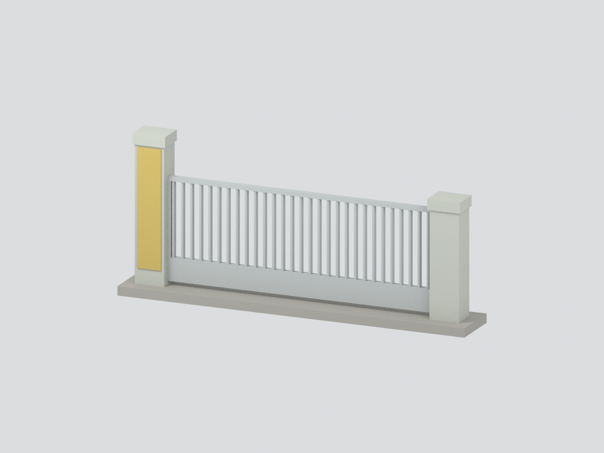
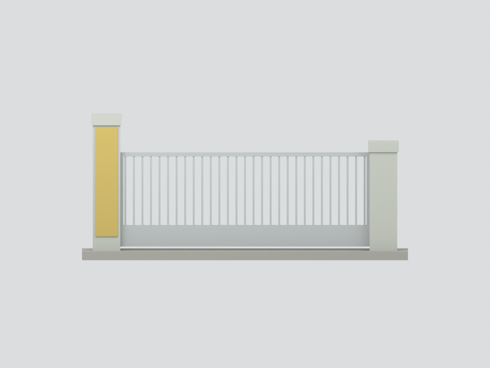
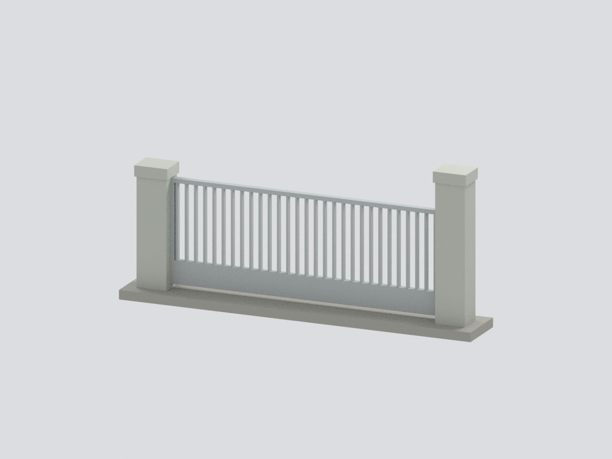
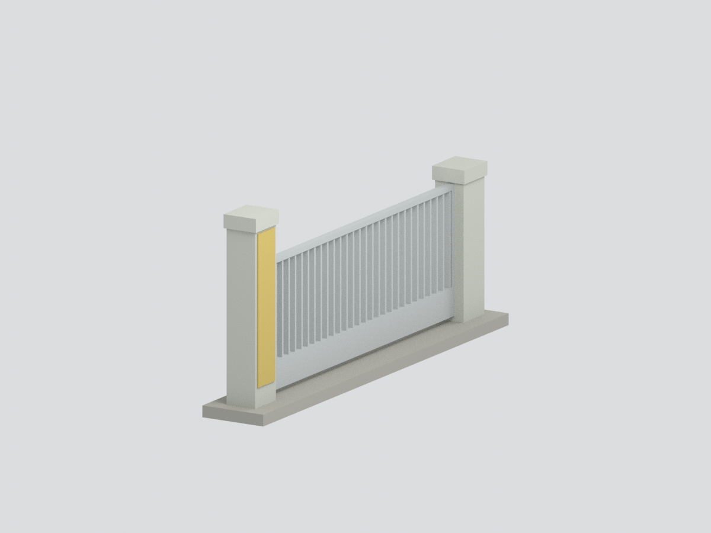
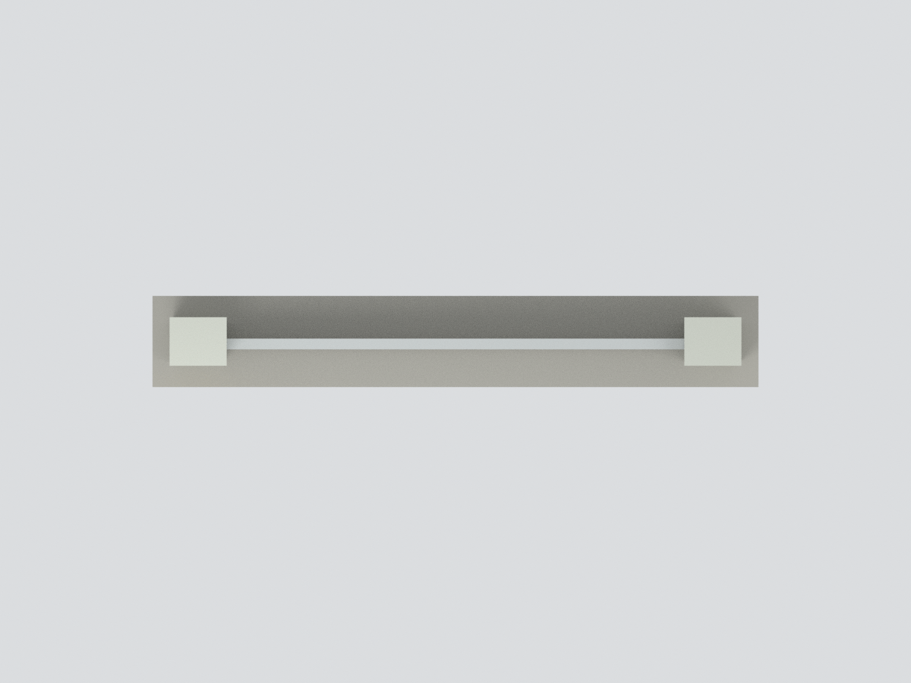
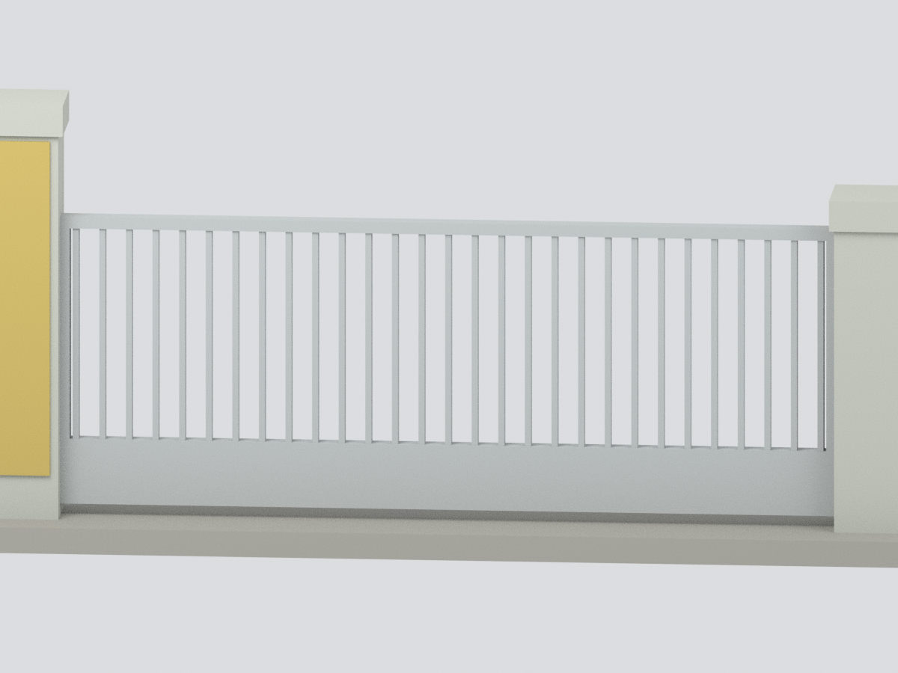

# 國立斗六高級中學｜民生路校門主門組件（2015 照片狀態）

**這是照片內標示「2015-08-15」之狀態的來源約束研究模型，不是經查證的現況，也不是測繪模型。照片時戳未經外部校驗。**

## 建模範圍
完整的兩根石門柱與兩柱間閉合金屬門扇：左側較高柱、平頂帽石、純金色校名牌面（不刻字）、直欄開口和下方實心金屬底板。參照 2015 圖，不混入較舊照片的柱頂校徽。

不包括右側校名磚牆、LED 看板、花台、道路、周邊圍牆與校內建築；不假造門機構、隱藏五金或背面裝飾。柱斷面、名義深度、背面中性封閉與門欄數量均是模型簡化，非工程尺寸。底部展示條是自訂連通支撐，不是現場基礎。門片為靜態閉合呈現，不可動。

## 來源與年代
視覺來源是斗六高中校友會營運的校史館〈校門變遷的歷史〉；文末註照片及資料由總務處提供。這是校史照片，不是校方工程圖。學校官網〈從古至今〉交叉記載 1990 年民生路新校門啟用。各來源月份敘述不同，因此本模型只採年份，且不把 1990 啟用時間當作 2015 照片拍攝時間。

## 檔案與檢查
- `model.stl`：單色打印幾何；`model.3mf`：具名材料色。
- `scene.blend`：實際輸出網格及隱藏、可編輯的建構元件。
- `build_model.py`、`parameters.json`：可重建來源。
- `QA.json`、`REBUILD-QA.json`：幾何與重新建構驗證；不是精確外觀或實體試印保證。
- 六張圖片由同一網格產生；`entry_detail` 是局部細節視圖，其餘為完整物件。

| 正面立面 | 背面 | 側面 |
|---|---|---|
|  |  |  |
| 頂面 | 門欄細節 | |
|  |  | |

尺寸約 153 × 23.04 × 67.68 mm，僅模型尺度。顏色取可見照片的概略冷灰石材、銀灰金屬、金色牌面，未經色彩校準。列印需自行依設備評估細欄厚度與支撐。
