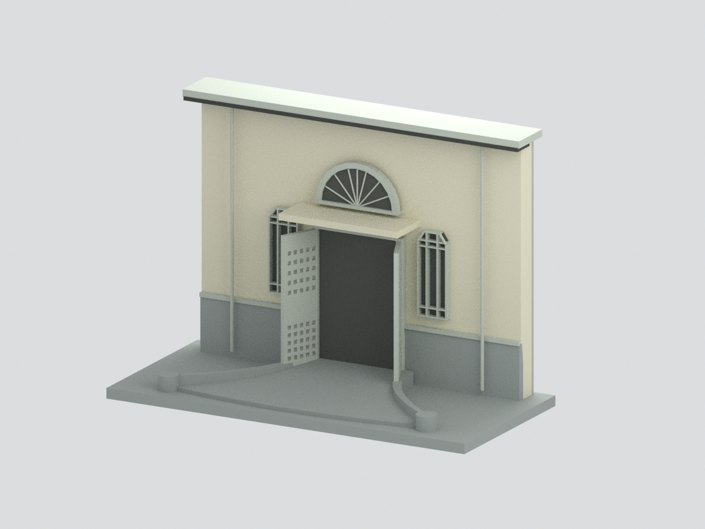

# 國立新竹高級中學｜校本部建築外觀研究模型

現行收錄 **1 套模型包**；數量不等於完整建築棟數，亦非全校／校區完成。新件與既有件的年代、截段範圍及未試印限制請閱各模型頁。

### 既有批次來源與列印限制（數量為各批歷史範圍，非現行總數）

## 當批完整模型圖鑑

當批收錄 **1 套**；套件不等於整棟建築，亦非全校／校區完成。

| 建築模型 | 建築模型 | 建築模型 |
| :---: | :---: | :---: |
|  **[新竹中學校講堂（校史館）｜中央入口截段](buildings/hchs-history-hall-central-entry/README.md)** |  |  |

## 既有說明與更新紀錄

套件數不等於完整建築棟數；尚未完成全校／校區，未實體試印。

[回學校圖鑑](../README.md)
