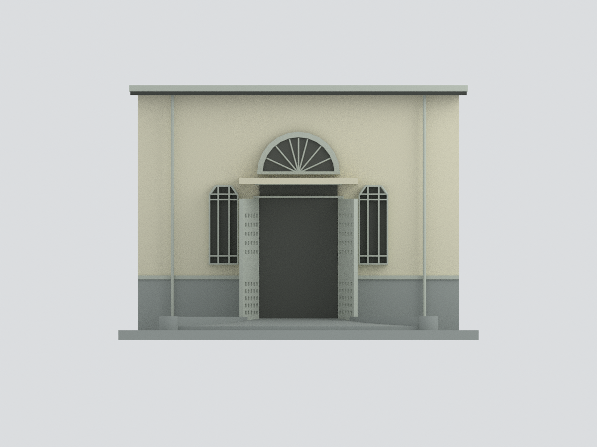
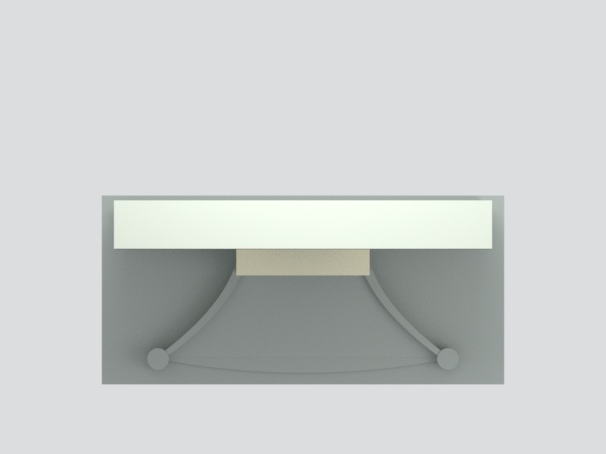

# 新竹中學校講堂（校史館）｜中央入口截段

依新竹中學校友會2023文章封面建立之近似模型。**只做中央入口，不是整棟講堂**；未見主屋頂、左右完整立面及後側均不補猜。左右窄窗部分依對稱推定；背板與底座為人工支撐。

保留半圓放射扇窗、截角窄窗、開啟穿孔門扇及展寬弧邊坡面。門內只有中性暗面，沒有展覽圖片或個人資料。雨庇邊緣、窗格孔數及坡度均簡化近似；[完整來源限制](SOURCES.md)。2023文章不代表2026現況核實。

- `model.stl`單色與`model.3mf`逐面色材質為同網格。
- `scene.blend`包含實際網格與隱藏可編輯原始零件；無來源影像。
- 六視角為實際Blender網格渲染，非生成式建築想像圖。
- 約132.8×62.4×94.08mm，非測繪比例尺；未試印，細窗肋與門孔需按列印設備評估。
- `build_model.py`獨立重建，不需要原照片；[操作](REBUILD.md)。
