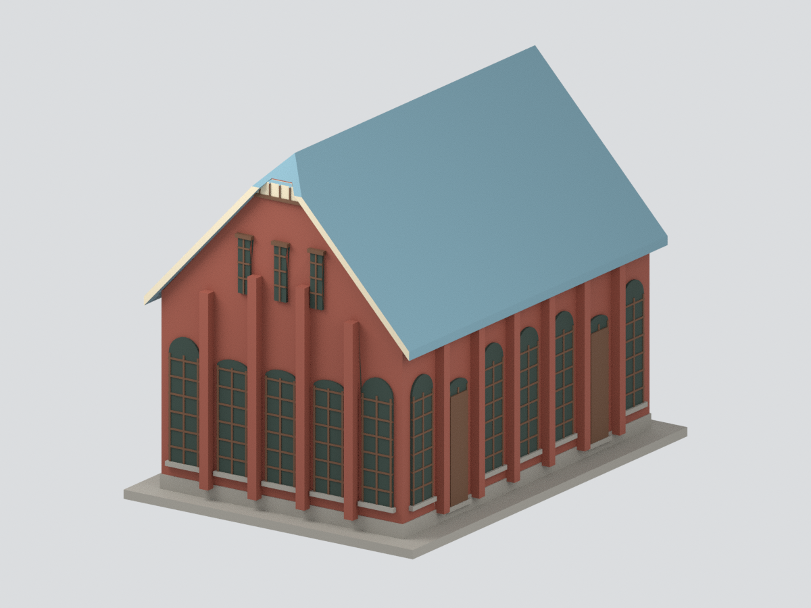

# 國立新竹高級中學 劍道館｜修復後外殼主要量體

依《竹中校友會刊》第49期（2022年2月）刊頁5、12–13，PDF第8、15–16頁，製作2021修復後照片所示外殼的比例近似模型。**不是完整測繪，也未驗證2026現況。**

- 可見紅磚主體、兩坡藍灰屋頂、前山牆五拱窗與上方三窄窗、側牆門窗扶壁。
- 未見側與後牆低層窗／扶壁配置依刊文數量推定；位置、尺寸與深度採名義比例，不聲稱背面已拍照確認。後山牆上部不補造未知窗。
- 第8頁補足前端屋脊輪廓：小截頂、淺色直條嵌面與邊框採簡化建模；截頂深度、細條數與分格名義估算，不是實測；後端沒有同視角證據，不複製前端截頂造型。
- 不建內部木構、室內牆間機構、真實玻璃、文字、逐磚或逐瓦紋理。深色窗為實心外觀表達；底座是自訂連接展示板。
- 108 × 150 × 118.05 mm，非測量比例；6色近似照片色，未校色。

## 檔案與使用
`model.stl` 單色列印；`model.3mf` 含面材質色；`scene.blend` 含統一模型與隱藏可編輯布林前構件（截頂切削由程序重建）；`previews/` 六視角為真實模型渲染，不是參考照。
STL不保存顏色；3MF是否讀入色彩取決於切片軟體。尚未實體試印，請自行檢查支撐、比例與細節。

程序重建見 REBUILD.md；來源與推定界線見 SOURCES.md。參考PDF和照片不放入公開模型包。
