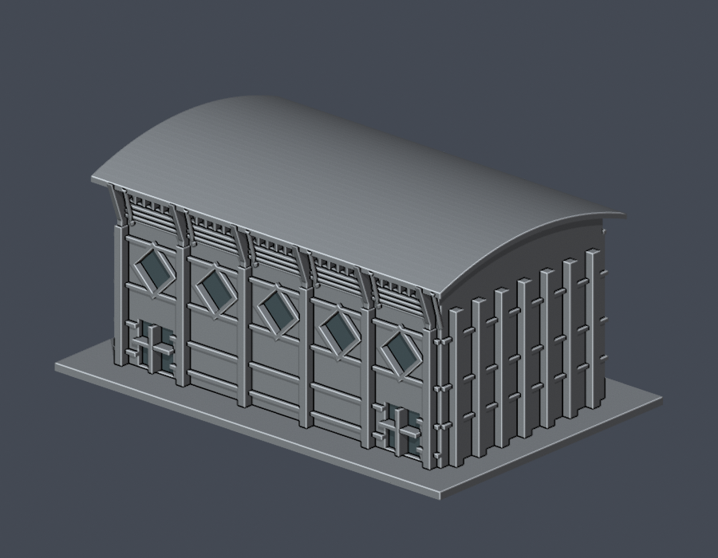
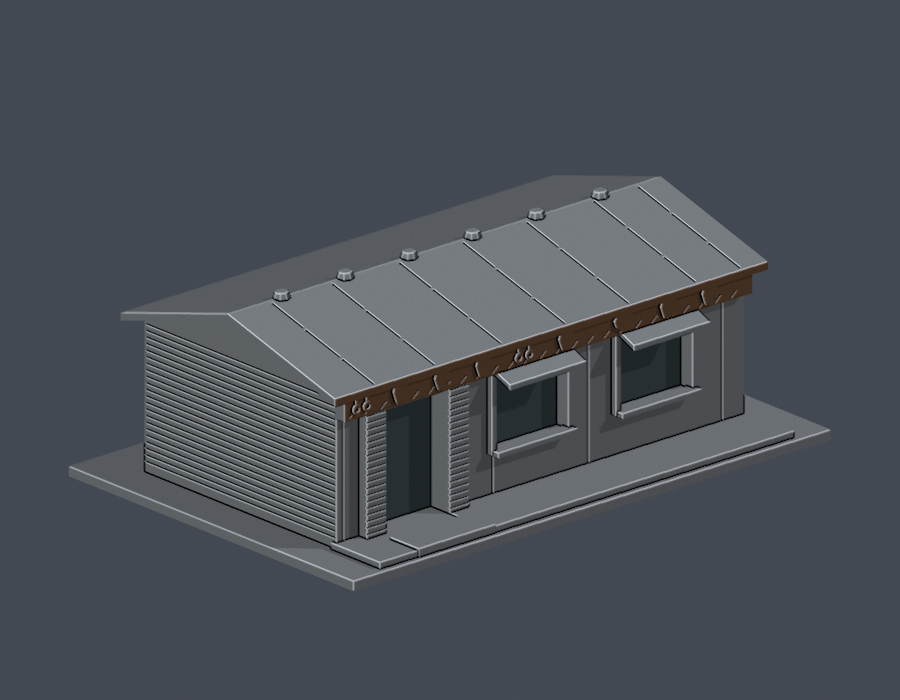

# 埔里校區

國立暨南國際大學主要校園，南投縣埔里鎮。校首頁列大學路1號；各單位另有棟別門牌。累計4件模型，校區仍未全數完成。

| 模型一 | 模型二 | 模型三 |
| --- | --- | --- |
|  [圖書資訊暨多功能大樓入口柱廊段](buildings/ncnu-library-entrance-segment/README.md) |  [體育健康中心綜合球館量體](buildings/ncnu-sports-ball-hall/README.md) |  [體育健康中心矩窗翼端側立面段](buildings/ncnu-swimming-wing-segment/README.md) |
|  [排灣族石板屋外觀量體](buildings/ncnu-paiwan-slate-house/README.md) | 待續 | 待續 |

圖資入口、體健兩個量體範圍與石板屋見各件README。各模型的背側證據、簡化與不同縮尺均有標註。

[逐項續接與来源](../inventory/CONTINUE.zh-TW.md) · [回學校圖鑑](../README.md)
