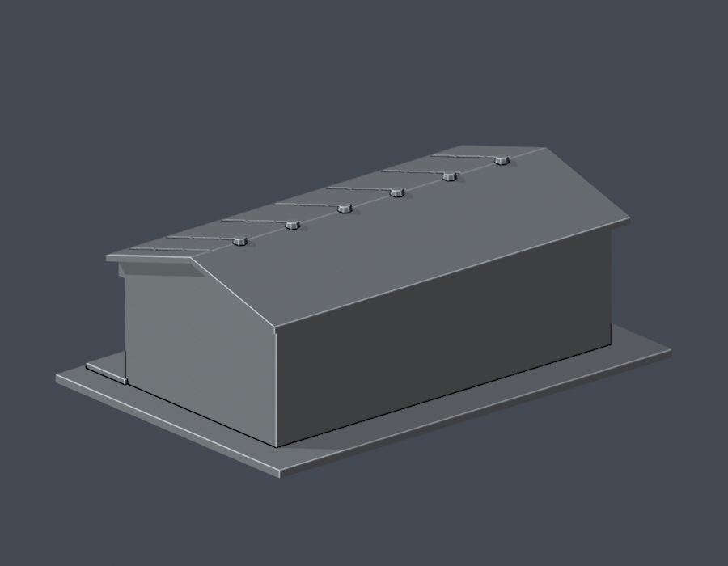

# 排灣族石板屋外觀量體

國立暨南國際大學 · 埔里校區 · 公開實拍近似外觀模型

原住民族環境教育場域中單一排灣族石板屋本體；以2017完工正／側實拍和2025刊載的校方提供全景自建近似外觀。屋外祖靈柱、廣場石座與其他傳統建築不納入。

| 交付 STL 正面 | 交付 STL 背面 |
| --- | --- |
|  |  |

[俯視](previews/top.png) · [STL](model.stl) · [可編修 Blender 網格](scene.blend) · [參數腳本](build_model.py)

## 辨識特徵
- 淺雙坡石板屋頂與6個低矮不規則壓物近似
- 側面疊砌石板層、前方大石板牆與偏左門洞
- 跨正面長木雕門楣，以加厚概括浮雕表達
- 兩扇上掀式窗板、方窗及前臺階

## 列印與縮尺
- 毫米單位，含底座外廓 150.0 × 101.0 × 54.4 mm；最長150 mm。
- 獨立縮尺，不可直接與其他件拼成同一比例校園。
- 底座朝下。0.4 mm噴嘴／0.2 mm層高可作切片起點，須自行檢查懸挑與橋接。
- 屋簷、深陽臺、上掀窗板或托架下方可能需要支撐。突出細框與欄杆拆支撐易折，不建議再縮小。
- 只完成數位幾何QA，未作Cura/Prusa實際工具路徑驗證或實體試印，不保證無支撐或一次列印成功。

## 證據與限制
- 沒有完整測繪圖，進深及屋頂坡度依照片目估；後牆、右側與室內保持簡化實心，沒有複製正門到背面。
- 木雕門楣屬拉夫拉斯作品，本模型僅概括雕帶的位置、厚度與頭形／成對捲曲／壺形浮雕節奏，不精確複刻人物、蛇、陶壺紋樣，也不作儀式器物複製品。
- 屋頂、側牆石板接縫數量與規整度為列印近似；取消會產生薄尖片的橫向屋頂細槽。
- 2025文章中的校方照片未標攝影日，不能稱2025測繪現況；2017施工中照片只輔助屋頂結構辨識，不當成完工外觀。
- 門前臨時遮布、屋旁太陽能設備、廣場石雕祖靈柱與石座不在本件範圍。

[完整來源與特徵對照](sources.json)。原始實拍只供查核，不納入公開包。頁面發布日或圖片檔案月份不當成攝影日期。

## 重建與QA
安裝 [requirements.txt](requirements.txt)（Python 3.11+），並使用Blender 4.3.2或相容版本。

1. python build_model.py
2. blender -b -t 4 -P render_preview.py
3. python run_all_checks.py

[原STL、重建與Blend](validation.json)：原始二進位STL法向／繞序一致、有限非退化面、水密、每邊兩面、vertex link單環、單一連通表面／無獨立內腔殼、正體積、底座z=0及150 mm尺度；獨立重建SHA與saved Blend三角幾何一致。

[0.2 mm逐層輪廓](contour-validity-check.json)：272層，固定z偏移0.071 mm。節點degree2閉合，個別及合成Polygon皆valid；invalid立即非零退出，沒有修補輸入再宣稱成功。

[0.8 mm參考寬度篩檢](thin-feature-check.json)：1 mm層距，共55層，opening最大面積损失0.448%；0層超過1%。這不是完整最小壁厚證明或實際切片。

[統一QA与失敗反例](qa-summary.json)：使用已核SHA的canonical fail-closed v3；對個別與合成Polygon各注入無效bow-tie，均AssertionError且exit 1。

scene.blend包含由實際交付STL匯入的單一可編修網格；build_model.py為重建來源。預覽色只套在STL既有表面，沒有貼圖或新增玻璃面；STL本身無顏色。

本件不代表全校完成。資料查閱：2026-10-13。
