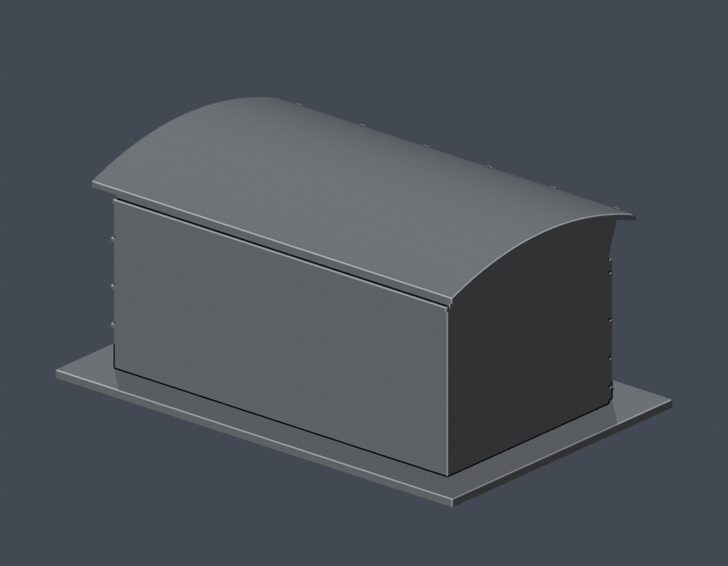
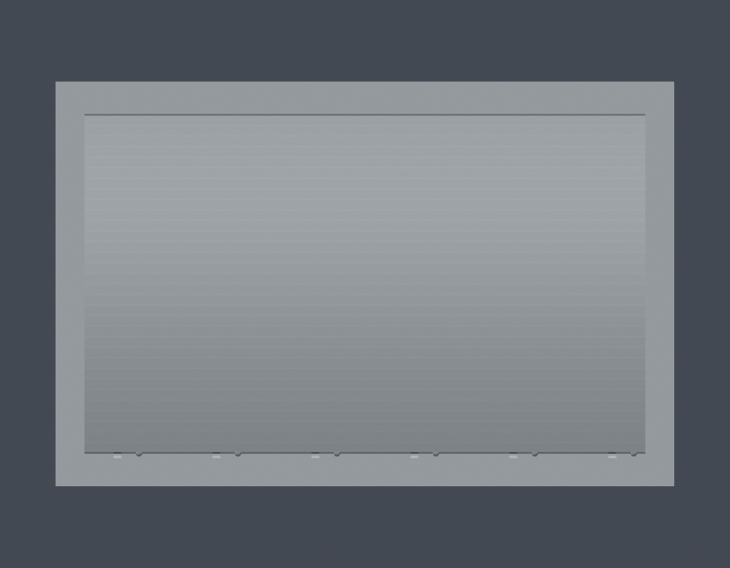

# 體育健康中心綜合球館量體

## 模型預覽

| 模型預覽 | 模型預覽 | 模型預覽 |
| :---: | :---: | :---: |
| 交付 STL 正面  | 交付 STL 背面  |  |

國立暨南國際大學 · 埔里校區 · 公開照片近似外觀模型

體育健康中心中有五個菱形窗的綜合球館外觀量體；不含游泳館、健身/水療區及連接入口廳。

[俯視](previews/top.png) · [STL](model.stl) · [可編輯 Blender 網格](scene.blend) · [參數腳本](build_model.py)

| 模型預覽 | 模型預覽 | 模型預覽 |
| :---: | :---: | :---: |
| 俯視  |  |  |

## 範圍與辨識特徵
- 五個大菱形窗、底部兩端門洞
- 高窗、百葉帶、前側斜撐與深屋簷
- 跨短向的緩弧大屋頂
- 側牆高大磚扶壁及水平腰線

## 比例與列印
- 單位為毫米；含底座外廓 150.0 × 98.0 × 68.6 mm，最長150 mm。
- 每件採獨立縮尺，不能直接和其他件拼成同一比例全校模型。
- 底座朝下。先以0.4 mm噴嘴、0.2 mm層高在自己的切片器檢查；這只是起始參考。
- 雨遮、屋簷與斜撐下方可能需要支撐；請檢查橋接跨度及拆支撐可及性。細柱與突出窗框拆支撐時易折，避免再縮小。
- 已作數位幾何檢查，未作Cura/Prusa實際工具路徑驗證或實體試印，不能保證一次列印成功或無需支撐。

## 證據與限制
- 後立面沒有取得足夠照片，刻意維持簡化素面；沒有把正面菱形窗鏡像到背面。
- 進深與弧頂曲率依斜視照片目估；不是實測或竣工圖復原。
- 館內體育空間未挖空；此為實心外觀量體，屋簷斜撐局部仍有懸挑。
- 校徽及極細百葉不逐一複製；窗以淺凹帶表達。
- 所有圖片來源均為真實公開照片；未把效果圖或校園插畫當測繪資料。
- 原照片拍摄年月未註者保持未知；網頁發布日、圖片路徑月份與查閱日不能當作拍攝日。
- [來源與特徵對照](sources.json)。第三方原照片只供查核，本包不重新散布。

## 重建與驗證
使用 Python 3.11+ 安裝 [requirements.txt](requirements.txt)，並安裝 Blender 4.3.2 或相容版本。

1. python build_model.py
2. blender -b -t 3 -P render_preview.py
3. python validate_model.py
4. python check_contour_validity.py
5. python check_thin_features.py
6. python run_all_checks.py（統一重跑以上檢查及invalid Polygon反例測試）

[原STL/重建/Blend驗證](validation.json)：所有checks為true，原STL水密、每邊兩面、頂點link單環、原法向和繞序一致、正體積、單一連通表面，重建STL SHA相同，Blend座標與交付STL一致。

[0.2 mm逐層輪廓](contour-validity-check.json)：343層；固定起始z=0.071 mm，所有節點degree2、個別及合成Polygon有效，遇invalid立即失敗退出，沒有修補後通過。

[0.8 mm參考寬度輔助篩檢](thin-feature-check.json)：1.0 mm層距、69層；形態opening最大面積損失 0.536%。這不是全表面最小壁厚證明，也不是切片器模擬。

scene.blend含由本STL匯入的單一可編修網格；原始參數在build_model.py。預覽圖由該STL實際渲染；凹槽底面以較深預覽色強調深度，不是貼圖或新增玻璃平面。STL本身無顏色。

本件完成不代表全校建築完成。最後資料查閱：2026-10-13。
