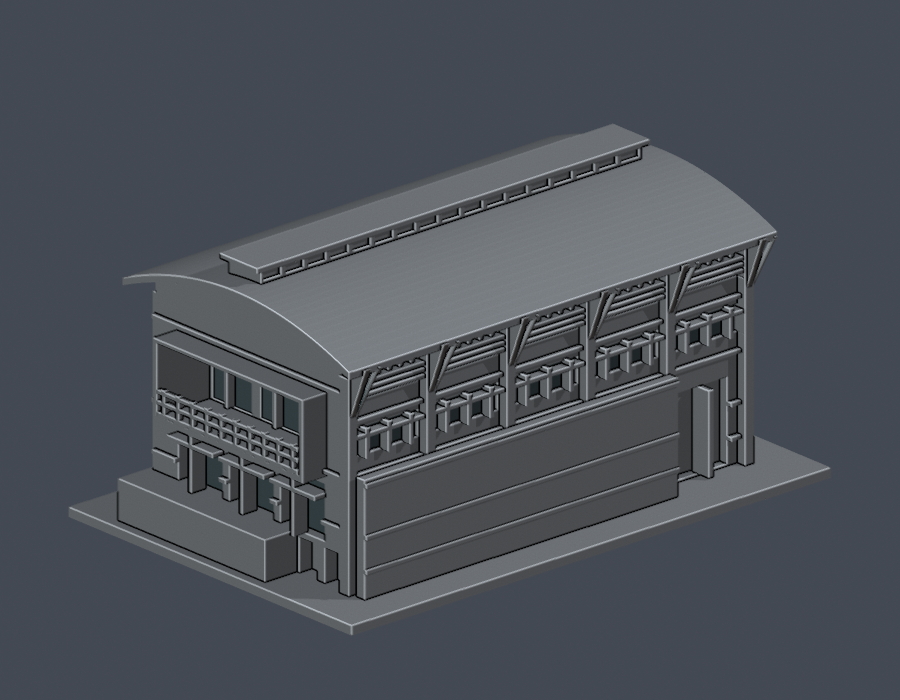
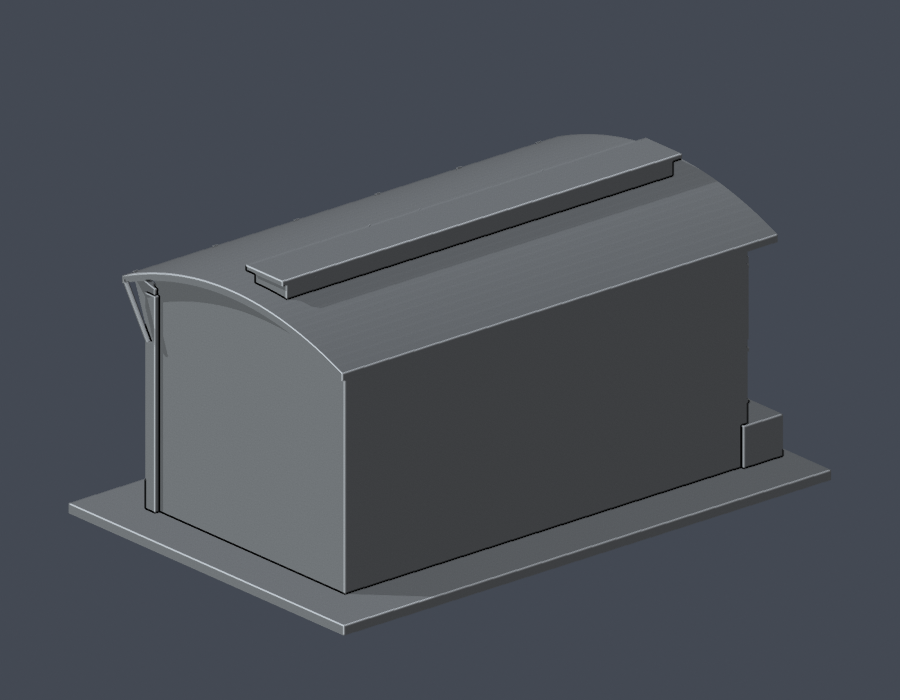

# 體育健康中心矩窗翼端側立面段

國立暨南國際大學 · 埔里校區 · 公開實拍近似外觀模型

泳池與健身設施側之矩形窗翼，只詳化長側立面與深陽臺端面；不是整座體健中心，也未精確切割泳池、SPA與健身房的室內使用範圍。

| 模型預覽 | 模型預覽 | 模型預覽 |
| :---: | :---: | :---: |
| 交付 STL 正面  | 交付 STL 背面  |  |

[俯視](previews/top.png) · [STL](model.stl) · [可編修 Blender 網格](scene.blend) · [參數腳本](build_model.py)

| 模型預覽 | 模型預覽 | 模型預覽 |
| :---: | :---: | :---: |
| 俯視  |  |  |

## 辨識特徵
- 矩形高窗、百葉帶、屋簷托架與斜拉桿
- 淺弧頂與屋脊長條採光高窗
- 端面深陽臺、欄杆、下層三組門窗與局部地下門洞
- 長側前方大幅磚屏牆、水平腰線

## 列印與縮尺
- 毫米單位，含底座外廓 150.0 × 100.0 × 74.3 mm；最長150 mm。
- 獨立縮尺，不可直接與其他件拼成同一比例校園。
- 底座朝下。0.4 mm噴嘴／0.2 mm層高可作切片起點，須自行檢查懸挑與橋接。
- 屋簷、深陽臺、上掀窗板或托架下方可能需要支撐。突出細框與欄杆拆支撐易折，不建議再縮小。
- 只完成數位幾何QA，未作Cura/Prusa實際工具路徑驗證或實體試印，不保證無支撐或一次列印成功。

## 證據與限制
- 未取得完整竣工平面；进深、坡度與端部比例為照片目估。模型名稱採可直接辨認的「矩窗翼」，不把整體虛稱泳館實測模型。
- 背面與右端連接廳截面刻意維持素面，未鏡像複製前側門窗。連接廳、球館及室內水池未建。
- 基座端部階臺僅表達照片可見地面高差，不是實測地形。
- 百葉、欄杆、托架適度加粗；窗框數量與分格簡化，屋頂採光窗依官方實拍保留。
- 官方休憩網載2010年完工啟用，校史時間軸列2011年落成啟用；本模型不以其中一日期推定照片拍攝年。

[完整來源與特徵對照](sources.json)。原始實拍只供查核，不納入公開包。頁面發布日或圖片檔案月份不當成攝影日期。

## 重建與QA
安裝 [requirements.txt](requirements.txt)（Python 3.11+），並使用Blender 4.3.2或相容版本。

1. python build_model.py
2. blender -b -t 4 -P render_preview.py
3. python run_all_checks.py

[原STL、重建與Blend](validation.json)：原始二進位STL法向／繞序一致、有限非退化面、水密、每邊兩面、vertex link單環、單一連通表面／無獨立內腔殼、正體積、底座z=0及150 mm尺度；獨立重建SHA與saved Blend三角幾何一致。

[0.2 mm逐層輪廓](contour-validity-check.json)：372層，固定z偏移0.071 mm。節點degree2閉合，個別及合成Polygon皆valid；invalid立即非零退出，沒有修補輸入再宣稱成功。

[0.8 mm參考寬度篩檢](thin-feature-check.json)：1 mm層距，共75層，opening最大面積损失0.184%；0層超過1%。這不是完整最小壁厚證明或實際切片。

[統一QA与失敗反例](qa-summary.json)：使用已核SHA的canonical fail-closed v3；對個別與合成Polygon各注入無效bow-tie，均AssertionError且exit 1。

scene.blend包含由實際交付STL匯入的單一可編修網格；build_model.py為重建來源。預覽色只套在STL既有表面，沒有貼圖或新增玻璃面；STL本身無顏色。

本件不代表全校完成。資料查閱：2026-10-13。
