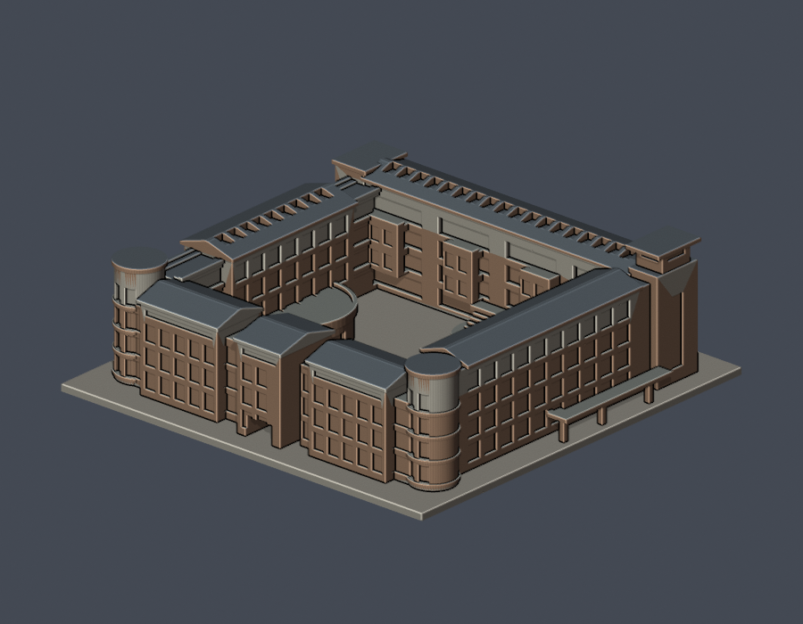
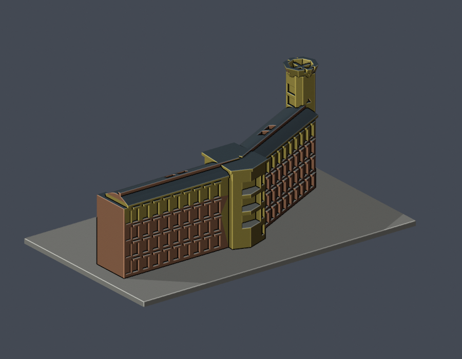
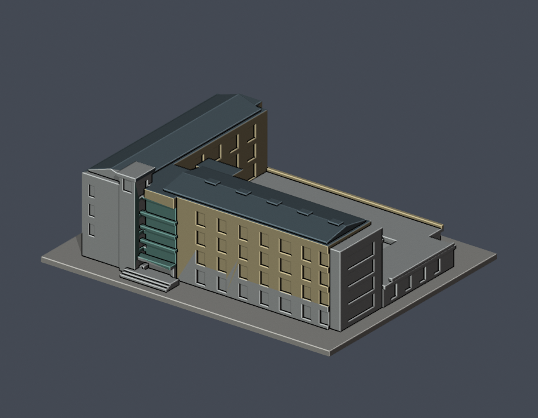
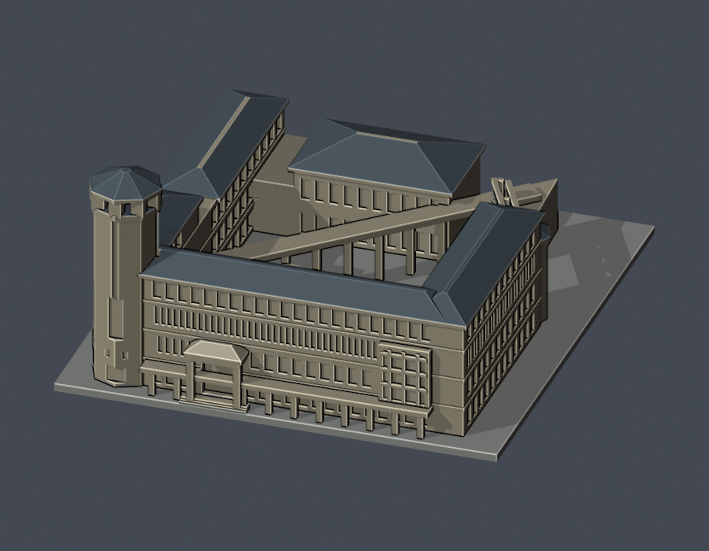
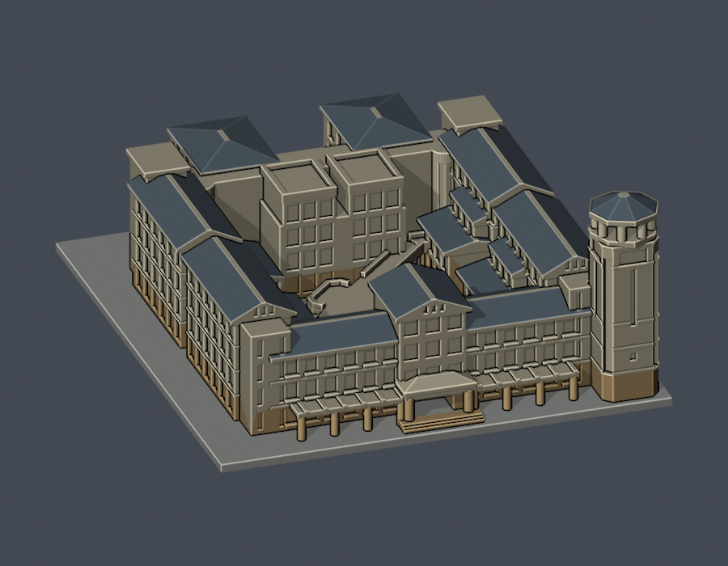
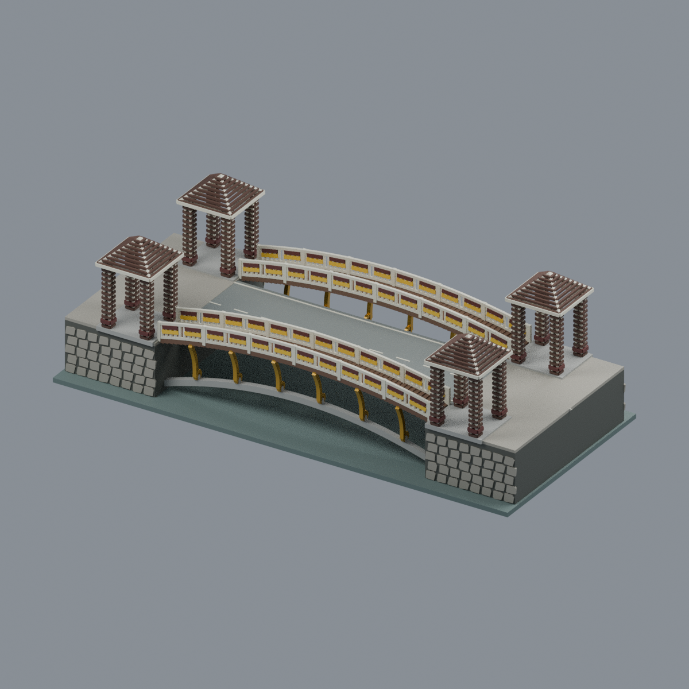
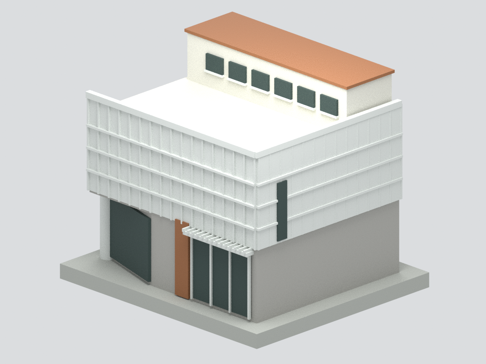

# 國立東華大學建築模型

目前10件有界外觀近似／來源有限研究模型：管理學院、藝術學院A棟局部段、理工三館、行政大樓、人社二館、圖資大樓A棟、花師教育學院、忠興亭有界亭架、景觀橋、花蓮市區藝托邦簡化外觀研究模型。全校及全國尚未完成；藝術件只含A棟段，圖資件排除B資訊中心。原7件含底座最長150mm；新增忠興亭無底板約128.2×104×83.96mm，STL單位毫米，各件獨立比例。

| 建築模型 | 建築模型 | 建築模型 |
| :---: | :---: | :---: |
|  **[管理學院四翼中庭外觀（2017–2021參考版）](壽豐校區/buildings/ndhu-management-courtyard/)** [STL、Blend、來源與正背／頂視](壽豐校區/buildings/ndhu-management-courtyard/) |  **[藝術學院A棟折翼與高塔段（2021參考版）](壽豐校區/buildings/ndhu-arts-a-wing-tower-segment/)** [STL、Blend、來源與正背／頂視](壽豐校區/buildings/ndhu-arts-a-wing-tower-segment/) |  **[理工三館四翼院落外觀（2012–2017參考版）](壽豐校區/buildings/ndhu-science-three-courtyard/)** [STL、Blend、來源與正背／頂視](壽豐校區/buildings/ndhu-science-three-courtyard/) |
|  **[行政大樓與北側廊亭（2006–2020參考版）](壽豐校區/buildings/ndhu-administration-courtyard/)** [STL、Blend、來源與正背／頂視](壽豐校區/buildings/ndhu-administration-courtyard/) |  **[人社二館八角高塔與院落（2006–2017參考版）](壽豐校區/buildings/ndhu-humanities-two-octagonal-courtyard/)** [STL、Blend、來源與正背／頂視](壽豐校區/buildings/ndhu-humanities-two-octagonal-courtyard/) |  **[圖資大樓A棟與塔樓（2000–2020歷史外觀參考）](壽豐校區/buildings/ndhu-library-a-wing-tower/)** [STL、Blend、來源與正背／頂視](壽豐校區/buildings/ndhu-library-a-wing-tower/) |
|  **[花師教育學院四翼院落與鐸鐘蓮花亭（2011–2021參考版）](壽豐校區/buildings/ndhu-education-courtyard-bell-pavilion/)** [STL、Blend、來源與正背／頂視](壽豐校區/buildings/ndhu-education-courtyard-bell-pavilion/) |  **[國立東華大學｜壽豐校區｜忠興亭有界亭架外觀近似](壽豐校區/buildings/ndhu-zhongxing-pavilion/README.md)** |  **[國立東華大學壽豐校區景觀橋](壽豐校區/buildings/ndhu-landscape-bridge/README.md)** |
|  **[國立東華大學藝托邦藝文空間｜來源有限的簡化外觀研究模型](花蓮市區/buildings/ndhu-artopia-exterior-study/README.md)** |  |  |

- [壽豐校區](壽豐校區/)
- [美崙校區／東華創新研究園區](美崙校區/)
- [屏東校區／海生館共享科研設施](屏東校區/)
- [研究清冊與逐項續接](inventory/)
- [模型索引](model-index.json)

七件均明示參考年代，不是2026震後現況測繪。管理北面、各館遮蔽面和細構簡化；藝術件排除B/C、演奏廳、橢圓入口與連橋。圖資A南面2020完成照、北面2000施工照，另核2026公告未標攝影日俯視底圖，不是單一年份竣工測繪。

花師為2011–2021參考版，1F／3F完整平面及多視角照片約束四翼、角塔、低院徽實體亭與斜橋。2F只取得D局部、4F完整圖仍缺，進深／高程與遮蔽面近似。西外伸四坡頂、院向兩個平頂女兒牆塊、兩端高平頂核心分辨。2026塔樓門扇增設只有原定7/7–25施工公告，未證實竣工，不加入未知門片或宣稱現況。

行政／圖書館S05結構補強2026-07-21竣工確認、09-18驗收合格；圖書館4–6F另項裝修8/27開工、預計2027-02-25完工。補強完成不代表所有裝修完成。理工一D與B頂樓舊山牆已拆，異地新館不能因有預定日期就當已完成；湖畔玻璃屋修繕等逐件保留。

102筆清冊包括群棟、同棟使用單位、非建物與待核範圍，不是102棟或模型數。美崙、屏東及其他校外／附屬範圍仍未製作；花蓮市區藝托邦另有來源有限研究模型。

每件有自建腳本、STL、可編輯Blend、actual STL預覽、來源及fail-closed全檢。理工三館、人社二館及花師另核架空通道／曲面實體射線。沒有實體試印或切片器工具路徑驗證，數位QA不保證可印，印前確認支撐及橋接。公開包不重新散布原照片/PDF，不抓現成mesh。

新增景觀橋：景觀橋2019修復後主要外觀近似：中央平車橋、兩側各一窄拱步橋、四座透空格柵亭、外露灰拱與寬向金卷托。202×92×62.62mm、11材質Blend/3MF/STL、5真實mesh圖；82916三角單閉殼，格式實編回讀與九檔隔離重建byte一致；314層有效，保留17層／133個0.8mm薄輪廓警告，需支撐評估，未實印不保證免支撐。尺寸／格柵數／遠側卷托對稱為估值，隱藏內肋與細梁省略；NLSC2024為浮水印非實際航拍年，非測繪或2026現況。 [模型與來源](壽豐校區/buildings/ndhu-landscape-bridge/README.md) · [QA警告](壽豐校區/buildings/ndhu-landscape-bridge/QA.md)。既有八件範圍與限制保持；校區及全校未完成。

- [花蓮市區藝文空間](花蓮市區/)

藝托邦來源有限的簡化外觀研究模型：花蓮市區校外藝文空間，非壽豐校區；平面軸線有設計圖，屋頂高度及深度估計，網皮實心化，未知背面留白，窗框近似，未試印，非高精度或完整現況。
