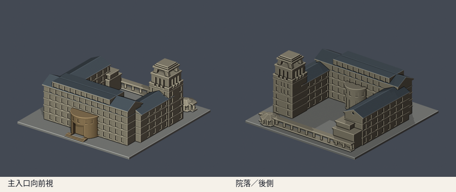
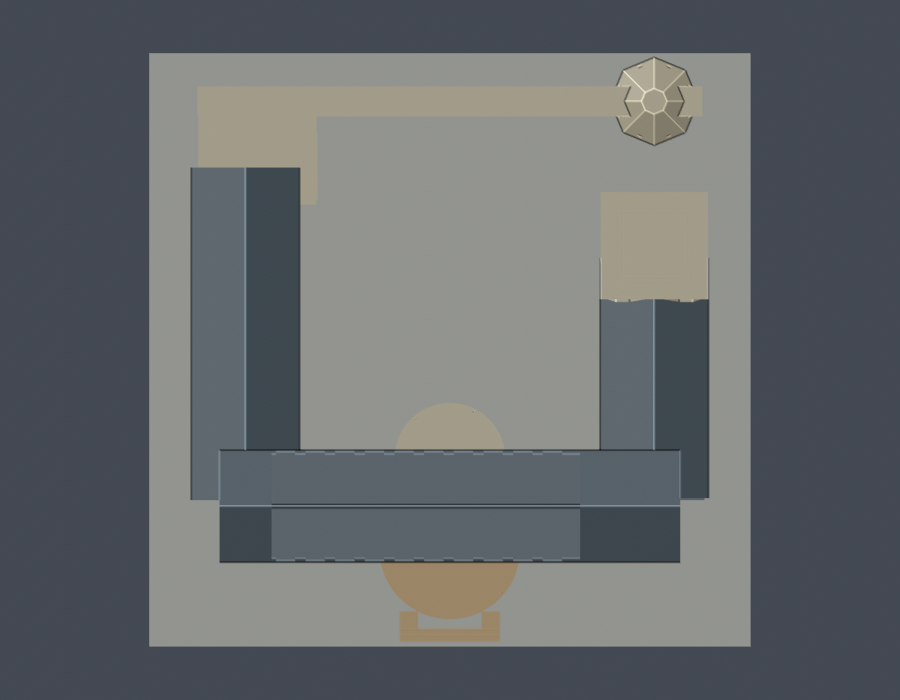

# 行政大樓與北側廊亭（2006–2020參考版）

國立東華大學壽豐校區。依公開照片及官方平面，自行編寫參數式外觀近似模型，未擷取現成3D mesh。全校及全國仍未完成。

參考年代：2006–2020完成外觀實拍；2026演練所附平面僅用於棟界和翼配置。不是2026年震後現況測繪。

## 模型與下載

| 模型預覽 | 模型預覽 | 模型預覽 |
| :---: | :---: | :---: |
|  |  |  |

- [STL列印模型](model.stl)
- [可編輯Blender場景](scene.blend)：匯入實際交付STL的網格，預覽顏色不隨STL保存
- [參數化重建腳本](build_model.py)與[相依版本](requirements.txt)
- [來源與採用範圍](sources.json)
- [模型資訊](model-info.json)

含底座150.0 × 148.0 × 70.9 mm，最長150mm；單位毫米、每件獨立比例。前視為主要入口方向，後視看院落與後翼。座標跟隨官方平面表達方向，未作精確地理定向或工程測量。

## 保留與簡化

- 高南翼、兩條不等長側翼圍成北向開放院落
- 南面寬曲弧門廳與北院半圓玻璃門廳；後者有上部圓鼓量體
- 分段雙坡山牆屋頂、主翼長形採光窗帶與水平樓層線
- 東北側高塔的分段退縮、粗化直立凹槽、開放頂冠與階梯式頂蓋
- 北側真正開放柱廊及八角亭，柱與頂板合為可檢驗的單一實體
- 西側端部低層露臺量體及入口階梯

所有比例為照片估算，樓高、進深、窗數、山牆坡度、兩側翼長度與塔冠細節均非施工尺寸。玻璃用凹面表現，線腳及塔冠支柱刻意加粗；細欄杆、天線、玻璃細框與景觀省略。遮蔽的西側端部與接縫保守簡化，沒有建內部辦公室。

## 年代與震後狀態

行政大樓2026災後工程表列結構補強與第一期裝修完成、第二期仍準備招標；另有消防及室內整修作業。2026-09演練所附逃生圖只核三翼／塔樓與廊亭棟界，不是2026外觀照片，亦不表示所有修繕結束。本模型不加入未有清楚實拍支持的震後外部構造，不聲稱舊照等於2026現況。

## 重建與數位QA

Python 3.12、Blender 4.3.2以上；安裝requirements.txt後：

```sh
python build_model.py
blender -b -t 2 -P render_preview.py
python validate_model.py
python check_contour_validity.py
python check_thin_features.py
python verify_package.py
```

- [原STL、獨立重建與Blend檢查](validation.json)：原始法向及繞序、正體積、水密、每邊兩面、vertex link單一環、單一連通表面殼與無封閉內腔殼、150mm上限；獨立暫存來源重建SHA一致，saved Blend與STL幾何一致
- [0.2mm逐層輪廓](contour-validity-check.json)：z起點0.071mm，共355層，節點degree2閉合，各Polygon及組合Polygon有效
- [薄特徵篩檢](thin-feature-check.json)：canonical v3 shared-edge交點，1mm層距、0.8mm參考寬度opening，共71層；最大面積損失0.863%
- [canonical v3原檔](thin_canonical_v3.py)保持已核SHA256 059f7378c74a1400dcf010365ebf35df3027fd853f1c960462a233dc68ce8915；[wrapper](check_thin_features.py)增加報告防沿用、STL SHA綁定及1%門檻，沒有改演算法
- [包裝驗證](package-validation.json)及[逐檔SHA256](SHA256SUMS)

invalid輪廓直接assert非零退出，不以buffer(0)、make_valid或修復過的STL掩蓋。形態opening只作薄特徵輔助篩檢，不是全面壁厚或支撐分析。

## 列印提醒

STL以毫米匯入，底座朝下，先以0.2mm層高檢查。北側長廊、八角亭、深入口、屋簷與高塔頂冠的開孔／頂蓋可能需要支撐。塔冠支柱已厚化約4mm，仍須確認橋接與支撐可移除；不要再任意縮小。

未實體試印，也未執行Cura／PrusaSlicer工具路徑驗證；數位QA不能保證可印或免支撐。

## 版本

2026-10-13外觀覆核通過，完整包凍結供獨立幾何審核。公開包只含來源URL與說明，不重新散布原照片或PDF。

[返回壽豐校區](../../README.md) · [返回學校圖鑑](../../../README.md)
