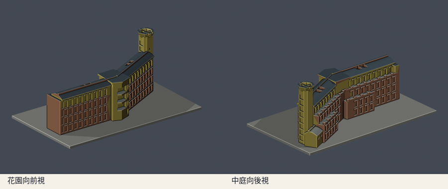
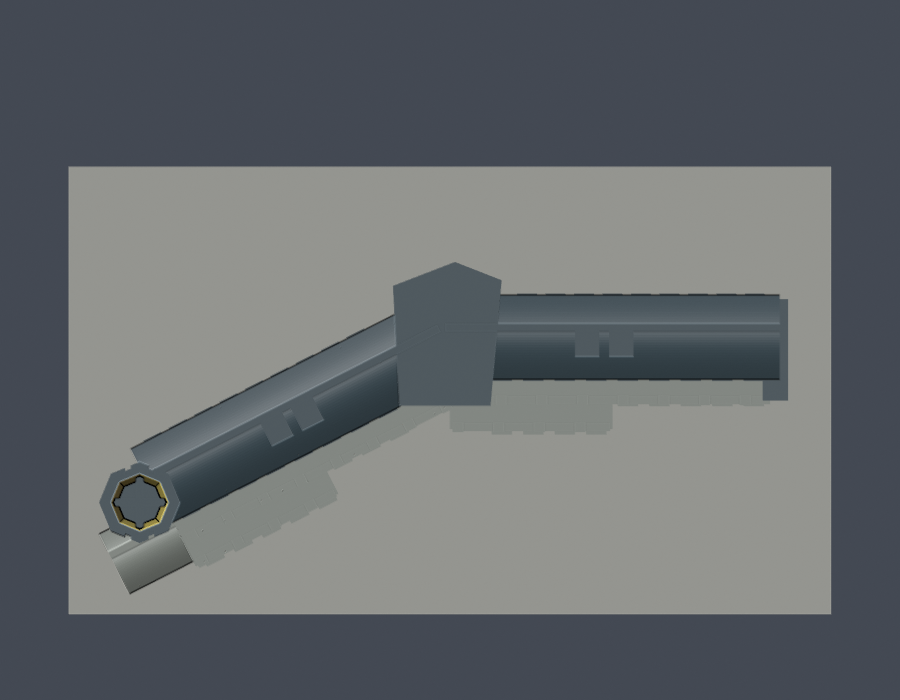

# 藝術學院A棟折翼與高塔段（2021參考版）

國立東華大學壽豐校區。以公開實拍和官方A棟樓層導引圖，自行編寫參數幾何的外觀近似模型；沒有擷取現成3D mesh。

這件只做A棟折翼與端部高塔段，不含B棟、C棟、演奏廳、橢圓入口大廳、連橋及景觀，不是整座藝術學院。全校及全國仍未完成。

## 模型與下載




- [STL列印模型](model.stl)
- [可編輯Blender場景](scene.blend)：實際交付STL匯入後的單一網格，預覽色彩不隨STL保存
- [參數化重建腳本](build_model.py)與[相依版本](requirements.txt)
- [來源、年份與採用範圍](sources.json)
- [模型資訊與排除範圍](model-info.json)

含底座150 × 88 × 58.8 mm，最長150mm；單位毫米、每件獨立縮放。前視是朝詩經花園的外立面，後視是中庭向立面。座標只跟隨導引圖方向，不聲稱地理北向。

## 建築特徵與近似

- 兩段折翼與轉折處突出的三層深凹廊，沒有改成一條直長方盒
- 四層立面、最上層短窗帶與較低層長窗，主要窗洞採淺凹
- 長弧面金屬屋頂、高起屋脊與少量頂部採光凹槽
- 中庭向錯層露臺、後退上層與厚化柱墩矮牆，沒有把背面照抄成前面
- 端部高塔的兩側玻璃凹帶、三角形淺孔、外張頂冠及加粗橫撐
- 低側屋弧面屋頂與圓窗；外牆顏色僅供預覽辨識

進深、退臺範圍、折角、窗格數與構件尺度為影像比例估算；導引圖不是施工尺寸圖。被其他翼遮蔽的端部／連接面保守簡化，未建立內部教室。玻璃改為凹窗、欄杆改厚矮牆；纖細窗框、天線、空調、植栽、浮空金屬件及未有證據的細節省略。

## 參考年代

官方校史記錄2020-11-06工程竣工。本模型以前方2021-01-14與2021-02-02完成外觀實拍為主，中庭退臺及高塔細節另參考2020-09-18竣工前實拍；該施工期照片只補足形態，沒有聲稱它是2021或2026照片。分翼依2024官方招生所附3F、4F導引圖，1F PDF未成功讀取，不列為已檢閱依據。

2025官方展覽公告仍使用藝術學院A棟2至4樓名稱。這只核對場域使用，不代表震後外牆、屋頂或新增設施都維持原樣。因此本件明標2021參考版，不是2026年震後現況測繪。

## 重建與數位QA

Python 3.12、Blender 4.3.2以上；安裝requirements.txt後依序執行：

```sh
python build_model.py
blender -b -t 2 -P render_preview.py
python validate_model.py
python check_contour_validity.py
python check_thin_features.py
python verify_package.py
```

- [原STL、獨立重建與Blend檢查](validation.json)：水密、每邊兩面、vertex link單一環、原法向／繞序、正體積、單一表面殼與無封閉內腔殼、150mm上限；獨立暫存來源重建SHA一致，已保存Blend幾何一致
- [0.2mm逐層輪廓](contour-validity-check.json)：z起點0.071mm，共294層全部degree2閉合；各Polygon及組合Polygon有效，無修復後冒稱通過
- [薄特徵篩檢](thin-feature-check.json)：canonical v3 shared-edge交點，1mm層距，0.8mm參考寬度的形態opening；59層最大損失約0.508%
- [canonical v3原檔](thin_canonical_v3.py)保持已獨立檢核的SHA 059f7378c74a1400dcf010365ebf35df3027fd853f1c960462a233dc68ce8915；[wrapper](check_thin_features.py)加上報告清空防止沿用舊成功、SHA綁定及1%門檻，任何失敗非零退出
- [包裝驗證](package-validation.json)與[逐檔SHA256](SHA256SUMS)

無效輪廓會直接assert退出，不以buffer(0)、make_valid或STL修復掩蓋。形態opening為輔助篩檢，不是全面最小壁厚量測。

## 列印注意

以毫米匯入，底座朝下。可先以0.2mm層高檢視，高塔頂冠、橫撐、深凹廊、屋簷及露臺可能需要支撐；請在實際切片器逐層檢查，確認支撐可移除。細節已厚化，不宜再任意縮小。

尚未實體試印，也沒有Cura／PrusaSlicer工具路徑驗證。數位QA不能保證可印或免支撐。

## 版本

2026-10-13外觀覆核通過；本版凍結供獨立幾何審核。公開資料只含URL與採用說明，不重新散布第三方原照片或PDF。

[返回壽豐校區](../../README.md) · [返回學校圖鑑](../../../README.md)
