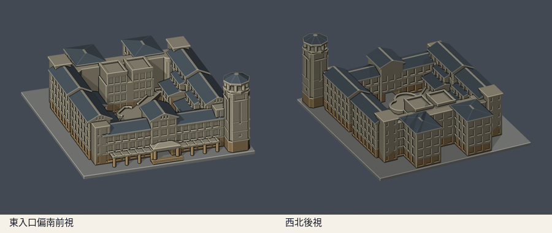
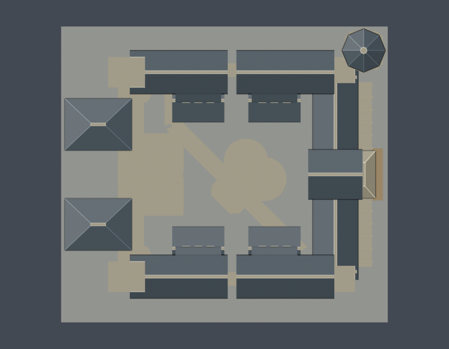

# 花師教育學院四翼院落與鐸鐘蓮花亭（2011–2021參考版）

國立東華大學壽豐校區。自寫參數式外觀近似，依官方歷年實拍、活動文件1F與3F平面辨識四翼及角塔；不擷取第三方mesh。全校及全國尚未完成。

## 模型與下載




- [毫米STL](model.stl)、[可編輯Blend網格](scene.blend)
- [參數腳本](build_model.py)、[相依版本](requirements.txt)、[actual STL渲染腳本](render_preview.py)
- [公開來源與日期](sources.json)、[逐面窗列／柱跨／屋頂退階高度](facade-observations.json)、[模型資訊](model-info.json)
- [正立面](previews/front-elevation.png)、[院徽亭與架空橋近圖](previews/courtyard.png)、[西翼三組屋頂近圖](previews/west-roof-detail.png)

含底座150 × 136 × 64mm，STL毫米，各館獨立比例。底座朝下。前視為東入口偏南，後視為西北；方位以校圖與照片推定，1F／3F原圖沒有北向及尺寸，非地理或建築測繪。

## 範圍與辨識特徵

- A東入口低長翼3主要窗列，中央3跨高玻璃及橫向高山牆；兩端窄梯間窗不混作另一整層。兩側約6主跨，各透視窗數為近似。
- B/D側翼4主要窗列，兩主段間保留窄連接／間隙；院向較低教室屋頂分別約z22.4及29.8mm，深處主脊39.4mm，同時保留水平退縮與高差。
- C西翼以1F／3F辨識兩個外凸翼及院向中段。2017空拍與2020近照確認外凸兩翼低四坡頂、院向兩個平頂女兒牆上層塊各3窗且中間留空、兩端服務核心更高平頂，三組分開。背面近照不全，窗群、進深及屋面坡度保守簡化；不把未見窗格說成實測。
- 東北削角方塔、長角玻璃凹槽、上段玻璃帶、短接廊；頂冠八角開放柱亭、完整上梁及低坡帽。塔冠柱徑2.8mm厚化。
- 中庭「鐸鐘‧蓮花」造型低餐廳，雙弧瓣與鐘柄、完整可步行實心頂板。1F確認旋轉45°、斜橋北西端折彎；亭不是空環。
- 東廊8根主要圓柱加入口2根；橋以成對圓柱承托完整梁板。入口及橋跨下為真正開放空間，原STL射線另檢。

模型涵蓋四翼整體外觀近似，不是全館各樓層實測：完整2F／4F平面尚缺，2019校務資料僅D221／225／228局部2F及文字確認D有4F。低層外輪廓依1F、上部以3F及多角度照片交叉約束；其餘遮蔽細節、柱距、窗寬、曲率及高程均為比例估計。省略地下室、室內、設備、細門片框、金屬欄杆與院徽彩色拼貼。玻璃用有背襯凹槽，非透明；屋脊截平1.4mm、護邊及柱梁厚化以減少尖細構件。

## 年代與2026現況限制

參考2011–2021歷史實拍，不是2026震後現況。2011-10-04圖只是院徽磁磚剛完成，周遭仍有施工環境，並非整館竣工證明；2013／2017／2020／2021完成外觀另核。活動1F文件日期2024／2025、3F文件2024，原底圖繪製年未知，不能當該年現況測繪。

2026-06-29校方公告「教育學院塔樓門扇增設」，原定7/7–25施工；只查得施工位置圖，未查得竣工／驗收或新門片照片。不能因預定日期已過就聲稱完成，也不把未知新門片加到歷史模型。另有幼教系室內教室改善及學院旁人行步道維護資料，沒有足以重建立面改造的圖證。未見整館拆建公告不代表可確認每個立面皆未變。

## 重建與fail-closed數位QA

Python 3.12、Blender 4.3.2以上：

```sh
python build_model.py
blender -b -t 2 -P render_preview.py
python validate_model.py
python check_contour_validity.py
python check_thin_features.py
python check_openings_and_pavilion.py
python verify_package.py
```

- [原網格／獨立重建／Blend全檢](validation.json)：原始法向／繞序、正體積、水密、每邊2面、vertex link單環、單一連通表面且無分離內腔殼、最大150mm；獨立暫存重建STL SHA與保存Blend幾何一致。
- [全部0.2mm輪廓](contour-validity-check.json)：z=0.071mm開始，共320層，每層degree2閉合、個別及合成Polygon全valid。
- [canonical v3薄特徵篩檢](thin-feature-check.json)：1mm間距採64層、0.8mm opening參考寬度，最大損失0.766%。此採樣與320層輪廓全檢不同，非全面最小壁厚。
- [canonical原檔](thin_canonical_v3.py) SHA256 059f7378c74a1400dcf010365ebf35df3027fd853f1c960462a233dc68ce8915；[wrapper](check_thin_features.py)不改算法、綁當前STL SHA、最多1%損失門檻。
- [入口／斜橋／亭體原STL射線](openings-and-pavilion-check.json)、[檢驗腳本](check_openings_and_pavilion.py)：入口及橋跨中z5.5／9.5mm真空；柱位有兩實心柱；z11.3mm連續梁；低亭中心及弧瓣從底座到z12.5mm屋頂一個實心區間。
- [包裝驗證](package-validation.json)、[逐檔SHA](SHA256SUMS)。任一invalid直接非零退出，不使用buffer(0)、make_valid或STL修復掩蓋輸入。

## 列印提醒

底座朝下、毫米匯入，先以0.2mm層高檢查支撐。長斜橋、主門廊、塔冠大開孔、屋簷需要評估橋接／支撐；確認院內及橋下支撐可拆除。細件已厚化，但任意縮小仍有風險。沒有實體試印，也沒有Cura／PrusaSlicer工具路徑驗證；數位QA不保證可印或免支撐。

原照片／PDF只作研究核對，不隨包重新散布。公開sources保留直接URL、日期與採用特徵；模型是自行編寫的近似幾何。
