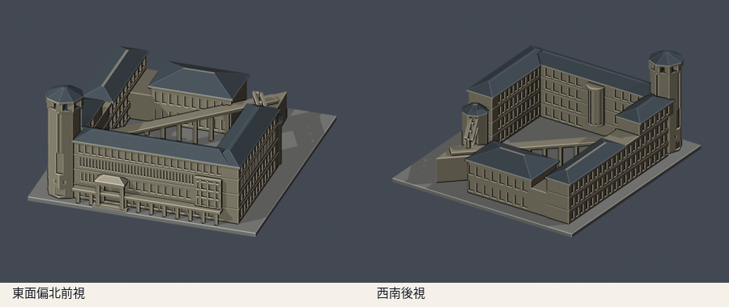
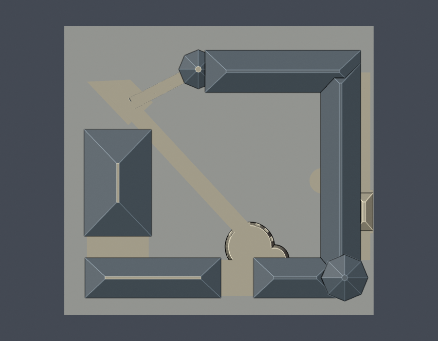
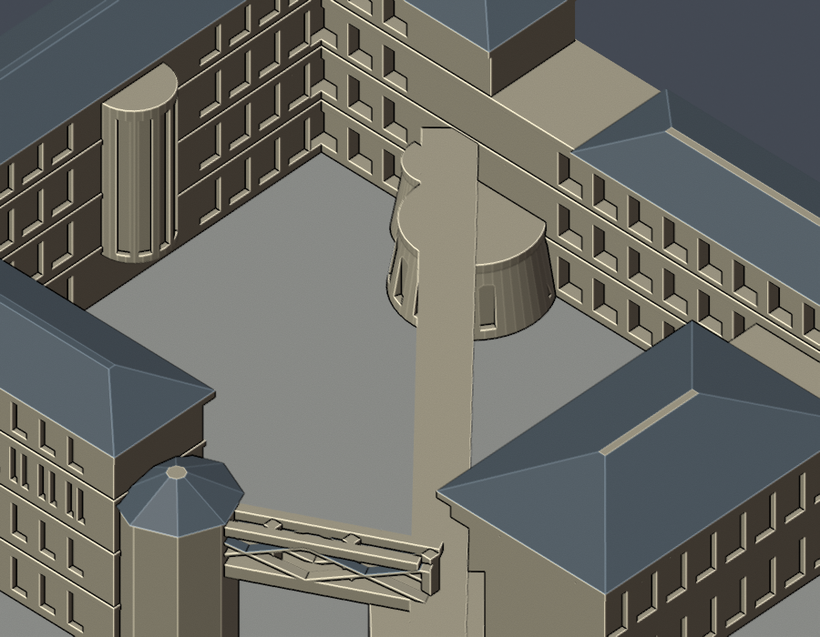

# 人社二館八角高塔與院落（2006–2017參考版）

國立東華大學壽豐校區。自行編寫參數式外觀近似模型，依官方完成實拍及各樓層平面，未擷取現成mesh。全校及全國尚未完成。

## 模型與下載




- [毫米STL](model.stl)、[可編輯Blend網格](scene.blend)
- [自建參數腳本](build_model.py)、[相依版本](requirements.txt)、[實際STL渲染腳本](render_preview.py)
- [來源／日期與採用特徵](sources.json)、[逐面窗列／主跨／退階高度核對](facade-observations.json)、[模型資訊](model-info.json)

含底座150 × 140 × 71.5mm，各件獨立比例。前視為東面偏北的入口向；後視為西南側。底座朝下，毫米匯入。方位以官方圖面為配置參考，不作精確地理測量。

## 保留與簡化

- 東面A長翼、北D翼及南B翼的高低分段，西側較低演藝廳與開放院落。
- 東南八角高塔、上部開放塔冠、窄上段／寬下段直立玻璃、低處小方孔；不混入鄰館四角塔。
- 東面四個不同窗帶：頂層約22寬跨、下一層約36狹窗，下部入口與寬窗群不同；不是四排通用窗格。數量仍受透視影響，非逐窗測繪。
- 東北凸出玻璃盒、院內半圓樓梯玻璃、S弧低玻璃壁與上方露臺。
- 院內斜跨架空廊、厚化主柱與實心頂梁；北西端橋保留加粗X桁架。真正開放通道另外以原STL射線檢驗。
- 南B翼3F與4F部分不同z高度，西演藝廳四坡大屋頂、主翼長四坡屋頂。

屋頂坡度、進深、柱距、曲率、各高程及窗格密度皆以照片比例近似；南外側、西服務面、被植栽遮蔽處保守簡化。D端低八角室依平面與屋頂關係簡化，不能與東南高塔混為一物。細欄杆、空調、天線、玻璃小框、室內房間及地下室省略。塔冠支柱粗化4mm；廊柱與桁架也較實景粗。

## 參考年代與現況

2006–2017完成外觀實拍參考版，不是2026震後現況測繪。官方現行提供B1–4F平面，PDF metadata不能證明2026每個立面皆未變。2026-06-23公告人社二館地下室第二講堂牆面改善，原定7/1–24；日期經過不作竣工證據。全校災後工程另有理工一館D拆除／異地重建及B舊山牆拆除、行政／圖書館補強等，本模型不套用他館現況。

## 重建與數位QA

Python 3.12、Blender 4.3.2以上：

```sh
python build_model.py
blender -b -t 2 -P render_preview.py
python validate_model.py
python check_contour_validity.py
python check_thin_features.py
python check_gallery_opening.py
python check_curved_glass_body.py
blender -b -t 2 -P render_courtyard.py
python verify_package.py
```

- [原STL／獨立重建／Blend全檢](validation.json)：原法向與繞序、正體積、水密、每邊2面、vertex links單環、單一連通表面、無分離內腔殼、最長150mm；獨立暫存重建SHA及保存Blend幾何一致。
- [0.2mm輪廓](contour-validity-check.json)：z=0.071mm開始，358層全部degree2閉合，個別及合成Polygon全valid。
- [canonical v3薄特徵](thin-feature-check.json)：1mm間距、0.8mm opening參考寬度，72層最大面積損失0.863%；不是全面壁厚證明。
- [canonical原檔](thin_canonical_v3.py) SHA256 059f7378c74a1400dcf010365ebf35df3027fd853f1c960462a233dc68ce8915；[wrapper](check_thin_features.py)不改演算法，增加防沿用、STL SHA綁定及1%門檻。
- [斜廊原STL射線](gallery-opening-check.json)及[腳本](check_gallery_opening.py)：跨中z8及18.5mm射線穿過±6mm全空；柱位z8有一實心區間；z20.5跨中與柱位均為連續梁板。
- [包裝驗證](package-validation.json)、[逐檔SHA](SHA256SUMS)。任何invalid直接非零退出；不以buffer(0)、make_valid或修復STL掩蓋。

## 斜弧玻璃罩專項



低玻璃罩為縮徑斜截錐近似，加上第二弧段和實心頂面；玻璃細框省略／粗化，不用空環代替罩體。[原STL射線檢查](curved-glass-body-check.json)及[重跑腳本](check_curved_glass_body.py)確認：垂直線只交z0底座和z14.9頂面；由B翼穿至罩面只交外界兩面，兩者融合。罩體前緣z5位於y=-25.47649、z12退至y=-26.65349，保留向內斜面。近圖由[渲染腳本](render_courtyard.py)讀保存STL網格產生，不改幾何。

## 列印提醒

底座朝下，先以0.2mm層高檢查。長斜廊、X桁架橋、門廊、塔冠開孔與屋簷可能需要支撐；確認內院及橋下支撐可拆除，塔頂不要任意縮小。沒有實體試印，也沒有Cura／PrusaSlicer工具路徑驗證；數位QA不保證可印或免支撐。

## 版本

2026-10-13外觀覆核通過；本機包凍結供獨立幾何審核，尚未發布GitHub。原照片及PDF不隨公開包重新散布。

[返回校區](../../README.md) · [返回學校](../../../README.md)
