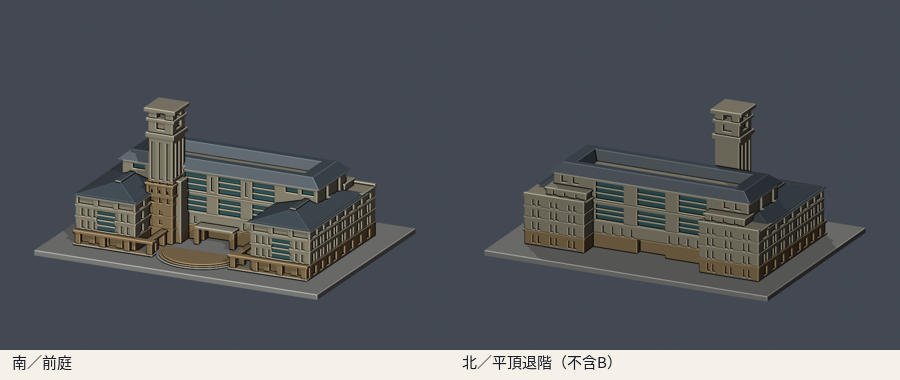
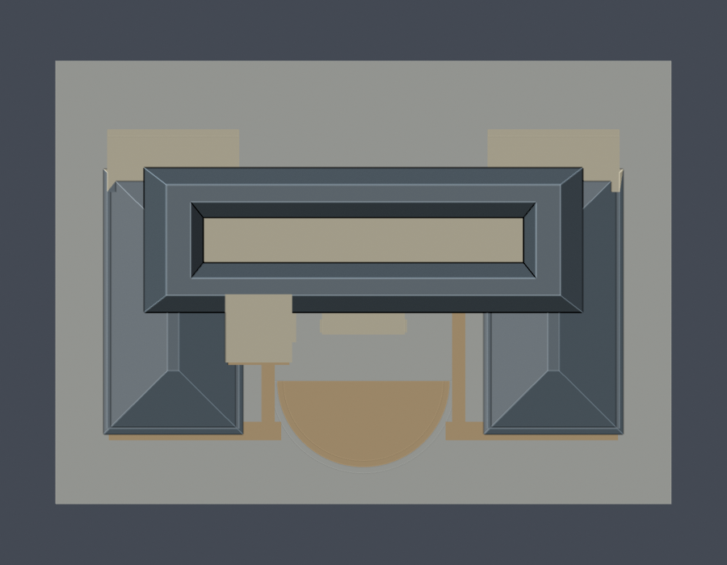
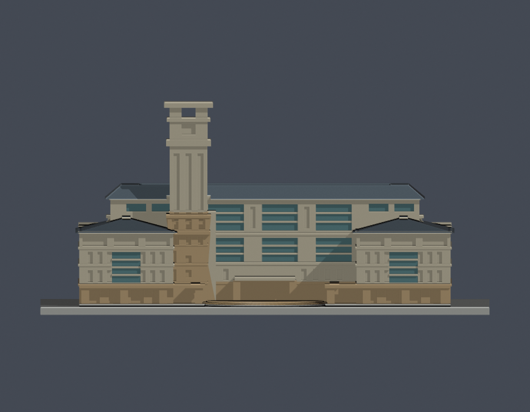

# 圖資大樓A棟與塔樓（2000–2020歷史外觀參考）

## 模型預覽

| 模型預覽 | 模型預覽 | 模型預覽 |
| :---: | :---: | :---: |
|  |  |  |

國立東華大學壽豐校區圖書館。依官方A1–6F平面及多角度實拍自建的參數化外觀近似，完整排除B棟資訊中心長條量體。沒有擷取現成3D mesh；全校及全國仍未完成。

重要年代限制：南正面以2020-01-07完成照為主，屋頂及北面參考2000年施工期影像，另以2001完成南照交叉比對；屋頂平面再核2026年公告附圖中的未註攝影日上空底圖。這不是同一年的全面竣工模型，更不是2026震後現況測繪。

## 模型與附件


- [STL模型](model.stl)，[可編輯Blender場景](scene.blend)
- [參數化重建腳本](build_model.py)，[相依版本](requirements.txt)
- [實際STL正立面](previews/front-elevation.png)
- [來源及各自支持範圍](sources.json)，[生成前逐立面觀察](facade-observations.md)
- [模型資訊](model-info.json)

| 模型預覽 | 模型預覽 | 模型預覽 |
| :---: | :---: | :---: |
| 實際STL正立面<br> |  |  |

含底座150 × 108 × 70.132 mm，最長150mm，每館獨立比例；單位毫米。座標+y為校園北、-y為行政大樓／南入口方向，校園軸與真北約有20度差異，未作測量級地理定位。scene.blend由實際STL匯入，為可編修網格；build_model.py是參數化重建來源，預覽色彩不隨STL保存。

## 保留與簡化

- A棟H形四層側翼與中央較高六層橫體；低翼屬A，不能因5F平面未畫低翼而排除
- 中央高體周邊坡頂包圍內凹平屋面，南雙低翼的坡頂向北沿高體兩側延伸；北短翼是平頂退階，沒有鏡像南面坡屋頂
- 南面中央三大玻璃跨、上下兩段高玻璃帶、較細的柱間豎槽及最上緣左右小窗群
- 南低翼中央直立玻璃帶、兩側三個窄窗的分組、頂層三組寬橫窗；玻璃以有背板凹面與加粗橫框表示
- 南偏西的狹長塔樓、豎向槽、突出腰帶、雙段觀景冠及開放頂冠
- 南入口前庭、弧形階梯與兩側開放柱廊；中央不填為實心高盒，亦沒有橫梁橫跨整個入口
- 北面三大玻璃跨及階梯狀平頂低翼；B棟的三層圓弧玻璃長條完全排除

進深、樓高、屋頂坡度、窗數、接縫均為照片和平面估算，不是施工尺寸。北面只有施工期照片，2001年後該面細部是否變動未能核實；側面遮蔽窗與服務構造保守簡化。未建內部藏書、樓板、房間、細欄杆、玻璃細框、空調與天線。各凹槽、薄簷、塔冠柱因微縮加粗；頂冠柱截面約4 × 4mm。

## 2026工程狀態

官方行政會議紀錄列2026年1/23–2/26塔樓BRB安裝及防水漆。S05「行政大樓及圖書館結構修復補強工程」官方進度頁截至本次查閱列7/21竣工確認、9/18驗收合格，所以不能概括為該補強仍施工。另一項圖書館4–6F裝修依2026-08-24公告，自2026-08-27施工、預計2027-02-25完工。S05完成不等於所有裝修或外觀恢復完成；本模型不添加未有清楚實拍支持的震後構造。

## 重建及fail-closed數位QA

Python 3.12與Blender 4.3.2以上，安裝requirements.txt後：

```sh
python build_model.py
blender -b -t 2 -P render_preview.py
python validate_model.py
python check_contour_validity.py
python check_thin_features.py
python verify_package.py
```

- [原STL／獨立重建／Blend驗證](validation.json)：原法向、繞序、正體積、水密、每邊兩面、vertex link單一環、單一連通表面、無分離內腔殼、尺寸150mm，獨立重建SHA與saved Blend幾何一致
- [0.2mm逐層輪廓](contour-validity-check.json)：z起點0.071mm，節點degree2、逐環及合成Polygon valid，遇invalid直接assert非零退出
- [薄特徵篩檢](thin-feature-check.json)：1mm取樣、0.8mm參考寬度opening，最大面積損失門檻1%；屬輔助篩檢，非全面最小壁厚
- [canonical v3原檔](thin_canonical_v3.py)保持已核SHA256 059f7378c74a1400dcf010365ebf35df3027fd853f1c960462a233dc68ce8915；[wrapper](check_thin_features.py)綁定原STL SHA、阻止舊報告沿用並執行1%門檻，未改原演算法
- [包裝驗證](package-validation.json)，[逐檔SHA256](SHA256SUMS)

不使用buffer(0)、make_valid或其他repair來掩蓋原始輪廓錯誤。

## 列印提醒及版本

STL以毫米匯入，底座朝下。屋簷、凹入口、柱廊與高塔開放頂冠的跨空頂蓋可能需要支撐；塔與屋簷易受側向碰撞，不宜任意縮小。先檢查橋接距離、支撐可移除性與實際切片結果。

未做實體試印、Cura或PrusaSlicer工具路徑，數位檢查不保證可印或免支撐。

2026-10-13外觀覆核通過，本機全部QA通過；凍結供獨立幾何審核，尚未發布GitHub。公開資料只含來源URL，不重新散布第三方原照片或PDF。

[返回壽豐校區](../../README.md) · [返回學校圖鑑](../../../README.md)
