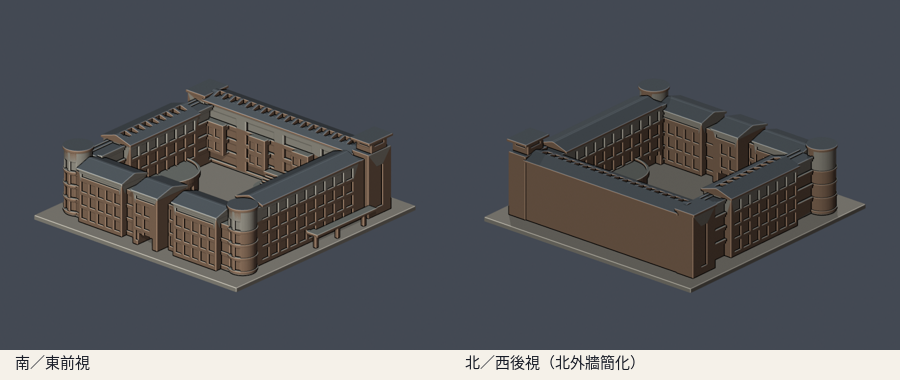
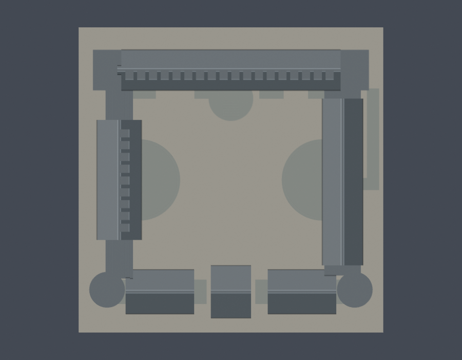

# 管理學院四翼中庭外觀（2017–2021參考版）

## 模型預覽

| 模型預覽 | 模型預覽 | 模型預覽 |
| :---: | :---: | :---: |
|  |  |  |

國立東華大學壽豐校區。手工參數化外觀近似，保留四翼、開放中庭、南側雙圓樓梯塔、北側高低方塔、分段坡屋頂與弧形講堂露臺。沒有擷取既有3D mesh。

這是2017–2021公開實拍所見的參考外觀，另以2012中庭照片與官方樓層平面輔助；不是2026年震後現況測繪。全校仍未完成。

## 模型與下載


- [STL列印模型](model.stl)
- [可編輯Blender場景](scene.blend)：匯入實際交付STL的單一網格；各色僅為預覽材質
- [參數化重建腳本](build_model.py)與[相依版本](requirements.txt)
- [公開來源、年代與各來源支持的外觀](sources.json)
- [模型資訊](model-info.json)

含底座150 × 150 × 48.4 mm，最長150mm。單位毫米，每件模型獨立縮放，與其他館舍並非同一比例。正面朝南／東，背面朝北／西，頂視北向上。

## 保留與簡化

- 四翼圍成的中庭保持開放，沒有填成實心大方塊
- 南面三段山牆屋頂、低層連接段與中央底層通道
- 兩座南側圓樓梯塔的環帶與凹窗，以及北側不同高度方塔
- 西翼兩端的開放連橋、厚化柱與樓板
- 東西側低層半圓講堂量體與露臺；北側外梯及圓形平台
- 北／西翼中庭向的屋頂採光槽，改為有底凹槽與加粗分隔，非真的玻璃構造
- 玻璃以凹窗表示，細欄杆採厚化矮牆；植栽、天線、空調、管線與微小窗框省略

北側外牆未找到可逐窗核對的清晰實拍，因此整面保守簡化，沒有複製其他立面的窗陣。樓高、進深、階梯與拱弧、部分遮蔽連接處是影像比例估算。平面為導引圖而非施工尺寸圖，沒有宣稱測量精度。此件是整體外輪廓近似，細部完整度有限。

## 年代及震後查核

總務處2026-10-06更新的災後工程表仍列理工一館、湖畔玻璃屋、行政大樓及圖書館等修繕／重建資訊。即使管理學院仍出現在現行官方平面與系所地址，本模型也不把2017–2021照片當成2026現況。日後取得震後各面實拍，應另做修訂版並保留版本差異。

## 重建與數位QA

Python 3.12及Blender 4.3.2以上，安裝requirements.txt後依序執行：

```sh
python build_model.py
blender -b -t 2 -P render_preview.py
python validate_model.py
python check_contour_validity.py
python check_thin_features.py
python verify_package.py
```

- [原STL、獨立重建與Blend檢查](validation.json)：原始法向與繞序、正體積、水密、每邊兩面、vertex link單一環、單一連通表面殼、150mm上限；獨立暫存重建SHA一致，saved Blend與STL幾何一致
- [0.2mm逐層輪廓](contour-validity-check.json)：固定z起點0.071mm，共242層；節點degree2閉合，個別及組合Polygon全部有效
- [0.8mm參考寬度篩檢](thin-feature-check.json)：canonical shared-edge交點，1mm層距，0.4mm半徑形態opening；49層最大面積損失約0.336%
- thin與輪廓腳本對無效Polygon直接assert退出，沒有buffer(0)或make_valid修復
- [包裝驗證](package-validation.json)與[逐檔SHA256](SHA256SUMS)

任何檢查失敗即非零退出；不得以修復過的STL替代原始交付證據。形態opening只作輔助篩檢，不是全面壁厚量測。

## 列印注意

STL以毫米匯入，底座朝下。建議先以0.2mm層高檢視；柱廊、連橋、中央通道、屋簷、露臺與雨棚可能需要支撐，應在實際切片器逐層檢查橋接和支撐可移除性。細部已粗化，請勿再任意縮小。

此件沒有實體試印，也沒有Cura／PrusaSlicer實際工具路徑測試。數位QA通過不代表保證可印或免支撐。

## 版本

2026-10-13首版已通過外觀覆核，完整包凍結供獨立幾何審核。公開包僅含來源URL與採用說明，原始照片與PDF未重新散布。

[返回壽豐校區](../../README.md) · [返回學校圖鑑](../../../README.md)
