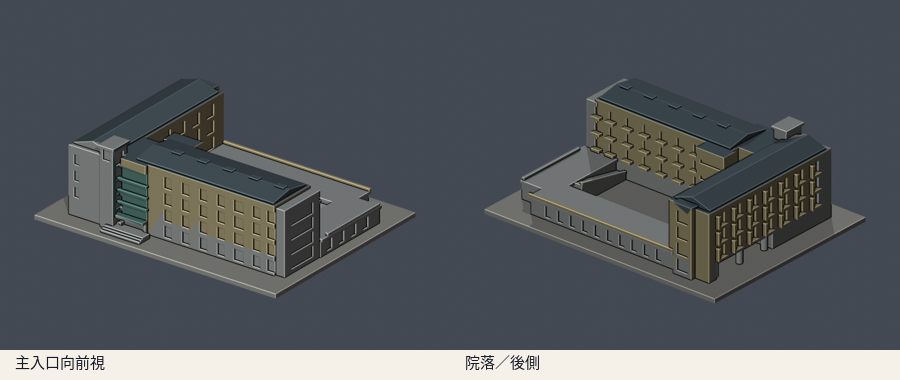
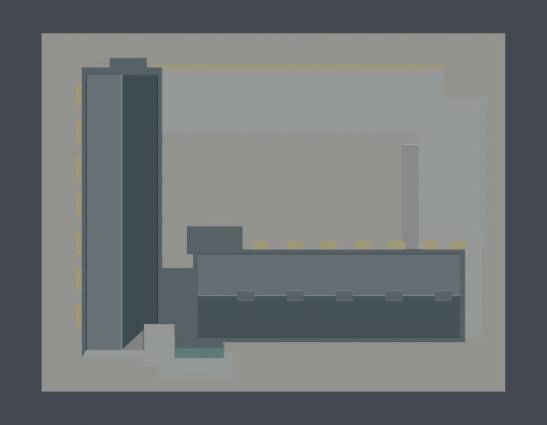
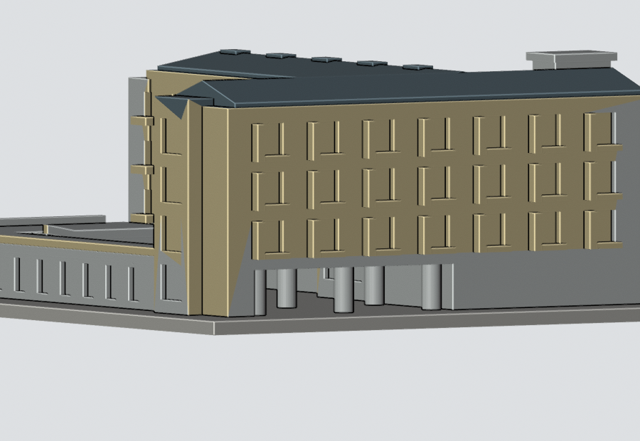

# 理工三館四翼院落外觀（2012–2017參考版）

國立東華大學壽豐校區。依公開照片及官方平面，自行編寫參數式外觀近似模型，未擷取現成3D mesh。全校及全國仍未完成。

參考年代：2012–2017完成外觀實拍；官方1–4F導引圖核對高低翼與院落。不是2026年震後現況測繪。

## 模型與下載

| 模型預覽 | 模型預覽 | 模型預覽 |
| :---: | :---: | :---: |
|  |  |  |

- [STL列印模型](model.stl)
- [可編輯Blender場景](scene.blend)：匯入實際交付STL的網格，預覽顏色不隨STL保存
- [參數化重建腳本](build_model.py)與[相依版本](requirements.txt)
- [來源與採用範圍](sources.json)
- [模型資訊](model-info.json)

含底座150.0 × 116.0 × 47.8 mm，最長150mm；單位毫米、每件獨立比例。前視為主要入口方向，後視看院落與後翼。座標跟隨官方平面表達方向，未作精確地理定向或工程測量。

## 保留與簡化

- A/B四層主翼呈L形，C/D低層附翼與開放院落
- B翼一段底層架空，兩列圓柱接連續樓板；不是深色凹槽
- 南向入口的寬玻璃面、粗化橫向分隔與突出的樓梯塔
- B翼大窗深凹及厚化遮陽側板；A翼內側窗下突出構件，未照抄正面
- 低層教室／機房側的斜坡、屋頂矮牆、階梯與主要出入口
- 淺坡屋頂、少量粗化通風凸塊與端部樓梯玻璃帶

低層屋頂、機房／服務面及被遮蔽接縫僅依實拍和導引圖作概略量體；沒有建立實驗室內部。進深、窗格數、斜坡寬度、屋頂高度與柱距是影像比例估算。細欄杆、玻璃細框、空調、管線與植栽省略。生化／分子醫學系是館內使用單位，不另計一棟。

## 年代與震後狀態

官方2026仍提供理工三館1–4F導引圖與館內空間資訊，但網頁仍存在不等於外牆未改。已查全校災後工程表，不由未列理工三館整體拆除就聲稱每個立面維持原樣；本件保留2012–2017參考標記。

## 架空通道專項證據

| 模型預覽 | 模型預覽 | 模型預覽 |
| :---: | :---: | :---: |
|  |  |  |

[直接原STL射線檢查](piloti-opening-check.json)及[重跑腳本](check_piloti_opening.py)：在y=10、z=6及10.8mm，X方向穿越B翼全寬無交點；柱列y=20、z=6mm交到兩個實心圓柱區間；z=11.2mm穿過柱列或跨中只交B翼外側兩面，證明上方連續樓板。配合單一連通表面QA，柱與樓板確實連接。這不是結構承載試驗。

[低視角渲染腳本](render_piloti.py)使用已保存場景內實際STL網格，不改交付幾何。

## 重建與數位QA

Python 3.12、Blender 4.3.2以上；安裝requirements.txt後：

```sh
python build_model.py
blender -b -t 2 -P render_preview.py
blender -b -t 2 -P render_piloti.py
python check_piloti_opening.py
python validate_model.py
python check_contour_validity.py
python check_thin_features.py
python verify_package.py
```

- [原STL、獨立重建與Blend檢查](validation.json)：原始法向及繞序、正體積、水密、每邊兩面、vertex link單一環、單一連通表面殼與無封閉內腔殼、150mm上限；獨立暫存來源重建SHA一致，saved Blend與STL幾何一致
- [0.2mm逐層輪廓](contour-validity-check.json)：z起點0.071mm，共239層，節點degree2閉合，各Polygon及組合Polygon有效
- [薄特徵篩檢](thin-feature-check.json)：canonical v3 shared-edge交點，1mm層距、0.8mm參考寬度opening，共48層；最大面積損失0.144%
- [canonical v3原檔](thin_canonical_v3.py)保持已核SHA256 059f7378c74a1400dcf010365ebf35df3027fd853f1c960462a233dc68ce8915；[wrapper](check_thin_features.py)增加報告防沿用、STL SHA綁定及1%門檻，沒有改演算法
- [包裝驗證](package-validation.json)及[逐檔SHA256](SHA256SUMS)

invalid輪廓直接assert非零退出，不以buffer(0)、make_valid或修復過的STL掩蓋。形態opening只作薄特徵輔助篩檢，不是全面壁厚或支撐分析。

## 列印提醒

STL以毫米匯入，底座朝下，先以0.2mm層高檢查。B翼架空樓板、遮陽板、入口挑簷與低層斜坡附近可能需要支撐。柱已粗化，但必須在實際切片器確認開放通道支撐能移除。

未實體試印，也未執行Cura／PrusaSlicer工具路徑驗證；數位QA不能保證可印或免支撐。

## 版本

2026-10-13外觀覆核通過，完整包凍結供獨立幾何審核。公開包只含來源URL與說明，不重新散布原照片或PDF。

[返回壽豐校區](../../README.md) · [返回學校圖鑑](../../../README.md)
