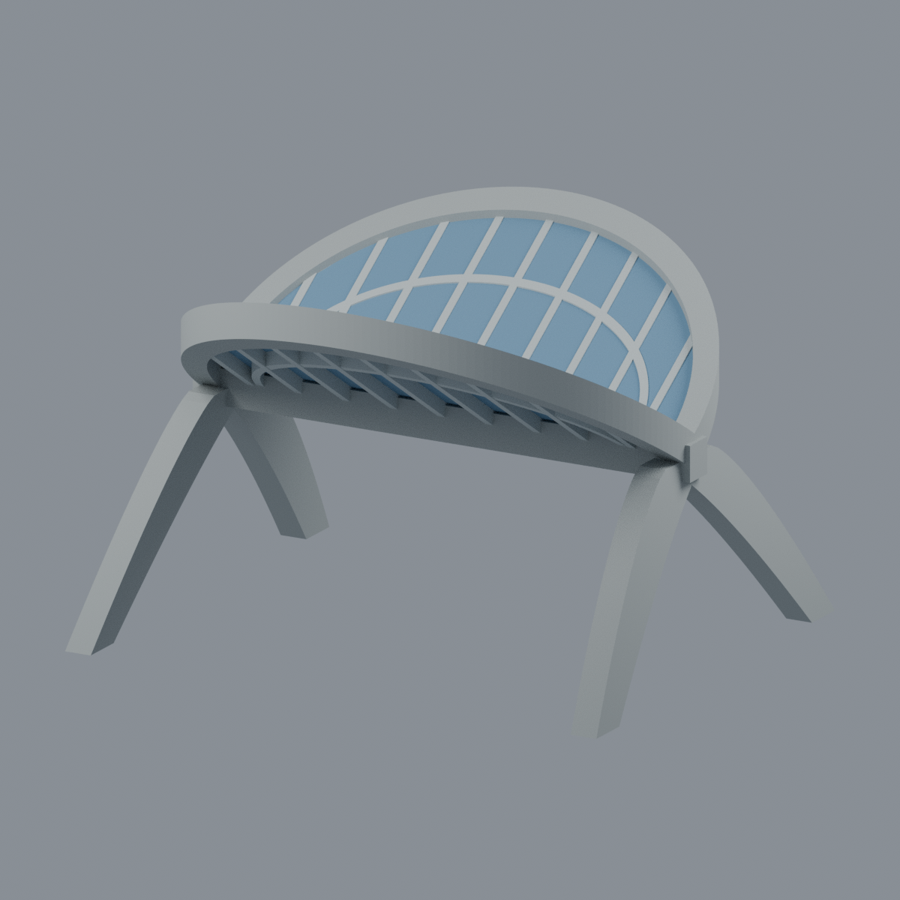
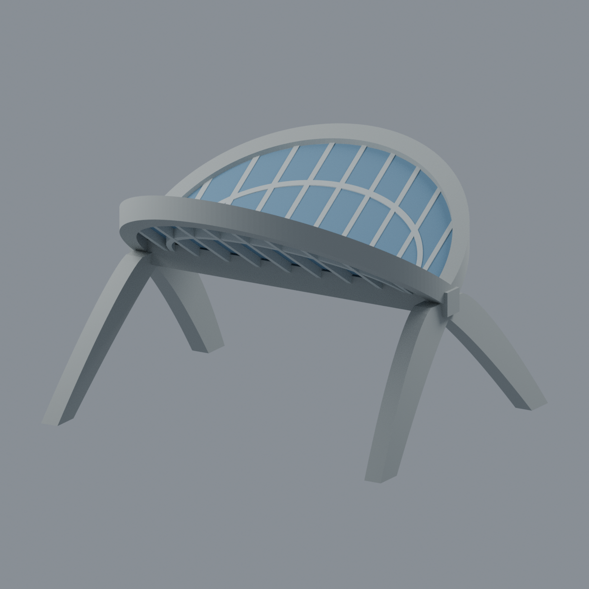
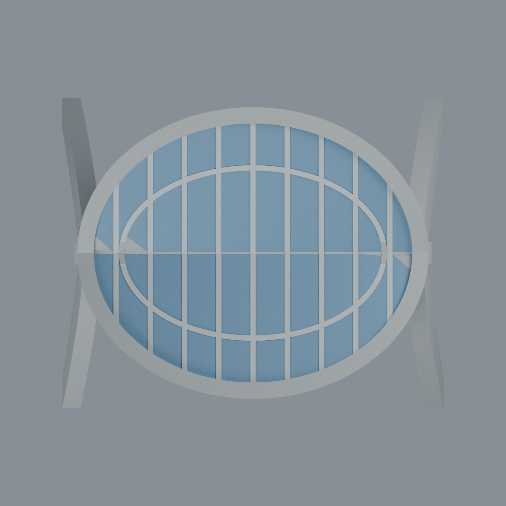
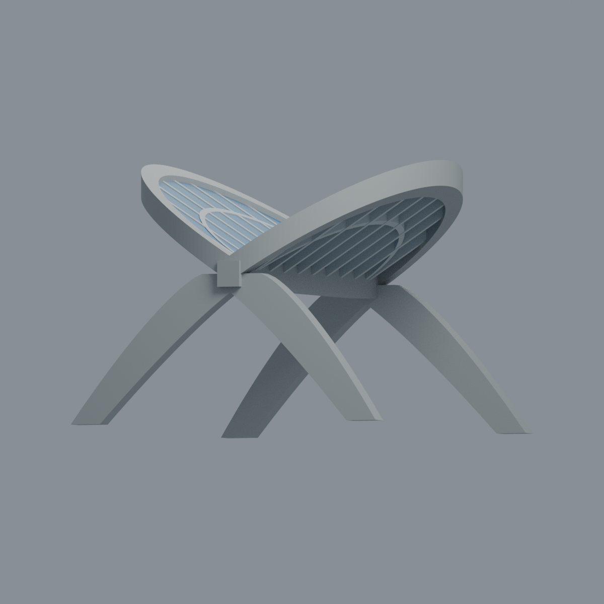

# 國立東華大學｜壽豐校區｜忠興亭有界亭架外觀近似

| 模型預覽 | 模型預覽 | 模型預覽 |
| :---: | :---: | :---: |
|  |  |  |

依校方兩張完整照片獨立建模，呈現東湖旁「忠興亭／東華之眼」的**兩片向外上揚半橢圓葉、共用直徑低梁、四支寬曲腿與開放亭下空間**。不是兩個完整橢圓盤，也不是完整景觀場地或精密測繪成果。

## 下載與編輯
- [STL](model.stl)：無色、單一連通封閉表面。
- [彩色 3MF](model.3mf)：三種逐面展示材質，非多料列印配置。
- [可編輯 Blender 場景](scene.blend)：原三角面及三種材質可編輯。
- [生成程式](build_model.py)、[實際網格渲染程式](render_model.py)。單位 mm。
- [來源與限制](SOURCES.md)、[驗證及列印限制](QA.md)。

約 128.20 × 104.00 × 83.96 mm。所有尺寸、曲率、坡度、截面、對稱性及格線都是照片透視下的展示近似，並非圖說或量測值。兩葉各九道平行肋、一道曲肋為簡化，不代表精確實際數量。屋面以藍灰色封閉薄片表示，原材質尚未確證；為清楚閱讀網格而採不透明展示色，不宣稱實物不透明。灰色粗邊框／曲腿為主要辨識特徵。

**省略被遮蔽座椅、地形、湖面、船、石刻、文字、燈具、鏈條及隱藏基礎／接頭**，不虛構室內。四曲腿沒有新增展示底板，亭下保持開放。照片不收錄於公開包，未使用他人模型或照片貼圖。

## 五個實際網格視角
| 模型預覽 | 模型預覽 | 模型預覽 |
| :---: | :---: | :---: |
| 正斜視  | 後斜視  | 正立面  |
| 俯視  |  |  |

| 模型預覽 | 模型預覽 | 模型預覽 |
| :---: | :---: | :---: |
|  |  |  |

**未實際試印，不保證免支撐或可直接列印。** 上揚薄片、曲腿及高邊緣需另行評估方向、支撐與材料；完整失敗結果見 QA。
