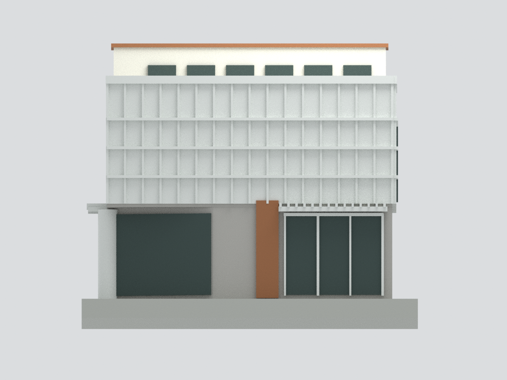
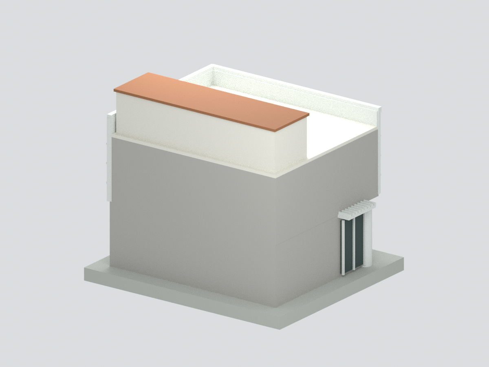
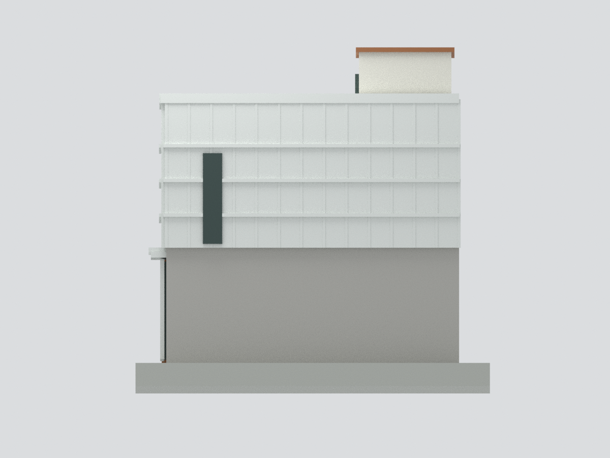
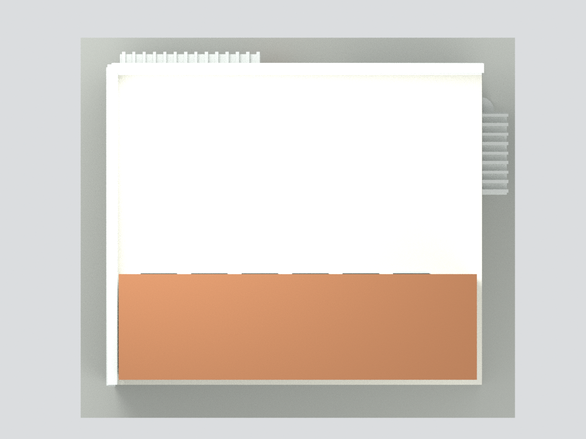
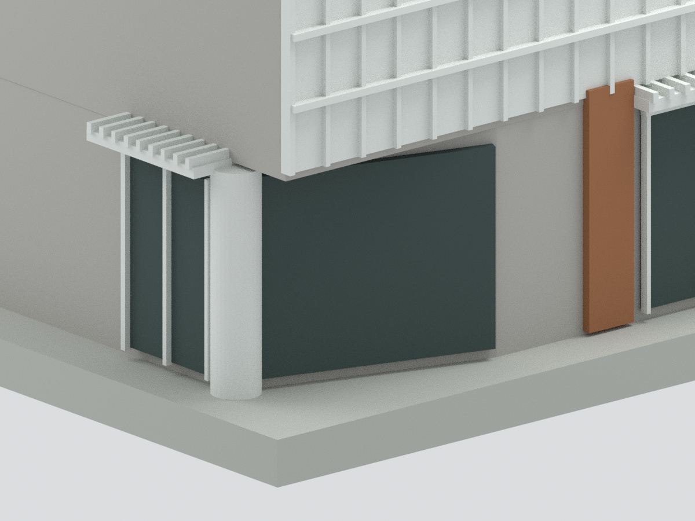

# 國立東華大學藝托邦藝文空間｜來源有限的簡化外觀研究模型

## 模型預覽

| 正面斜視 | 正立面 | 背面斜視 |
|---|---|---|
|  |  |  |
| 左側 | 俯視 | 入口細節 |
|  |  |  |

## 範圍與重要限制

依校方刊載的 2012-04-11 改造設計一、二樓平面，以及校方完工外觀照片製作。這是有證據邊界的外觀研究模型，不是測繪、竣工圖復原，也不宣稱為 2026 年現況。

- 平面軸線為 8.9 × 7.6 公尺；實際外牆尺寸不等同軸線尺寸。模型採約 1:83.3 的名義比例（12 mm / 設計圖公尺），高度、雨遮及屋頂量體深度為照片估計，所以不是全尺寸精確比例模型。
- 二層主體、斜切入口與金屬外皮依圖照；細密擴張網改為有直肋及水平分格的實心背板，**沒有逐孔複製穿孔或網目**。外皮框架、肋寬及小尺寸接合有列印加厚／取整。
- 校方實照與透視設計圖有差異；採實照可見的上方白色量體，而不直接把效果圖當落成狀態。屋頂量體的背面、深度、高度尚未有測量證據；**不把它稱作已確認的第三層樓**。
- 屋頂白色量體補上實照可見窗列，窗數與尺寸為近似。後側及右上側未有足夠落成照片：刻意留白，不捏造門窗。未建內部樓梯、衛浴、設備、屋頂機具及完整三角基地。
- 街角圓柱資訊牌及雨遮板條採粗化幾何；斜切入口大玻璃尚未細分門框，文字招牌不複製；底座純為模型支撐，不代表現場地坪。沒有試印，仍需切片檢查支撐與機器設定。

## 檔案與 QA

`model.stl`、具面材質的 `model.3mf`、`scene.blend`、可重建腳本與來源記錄。尺寸約 **126 × 110.4 × 105.6 mm**（含底座）。`QA.json` 驗證單一連通、封閉、邊鄰接、正體積、非零面積、STL 重新讀回及 3MF 幾何／材質一致性；這些不是實物試印或建築精度認證。

建置：`python build_model.py && python validate_model.py`；預覽：`blender -b --python render_model.py -- --out "$PWD"`。第三方照片與設計圖只作私人查核，**不包含於此模型包、不嵌入 Blender**。

## 來源

- [東華公共藝術：藝托邦](https://rc076.ndhu.edu.tw/p/412-1113-6923.php?Lang=zh-tw)：一、二樓平面與設計透視，古爵誌／三浦光一郎。
- [校方藝術家頁](https://rc076.ndhu.edu.tw/p/405-1113-192483,c20074.php?Lang=zh-tw)：可見完工外觀實照。
- [地方街區平台實照](https://hlcity.gjlien.com/artopiahualien/)：入口與側面近照。
- [東華總務處招租資料](https://ga.ndhu.edu.tw/p/406-1006-190992,r876.php?Lang=zh-tw)：兩層樓、總樓地板面積 150.13 平方公尺。
- [國家文化記憶庫](https://tcmb.culture.tw/zh-tw/detail?id=273681&indexCode=Culture_Object)：2013 年改造背景；本文不再散布其圖像。

## 下載與導覽

[STL](model.stl) · [3MF](model.3mf) · [Blender](scene.blend) · [重建](REBUILD.md) · [返回花蓮市區](../../README.md)
