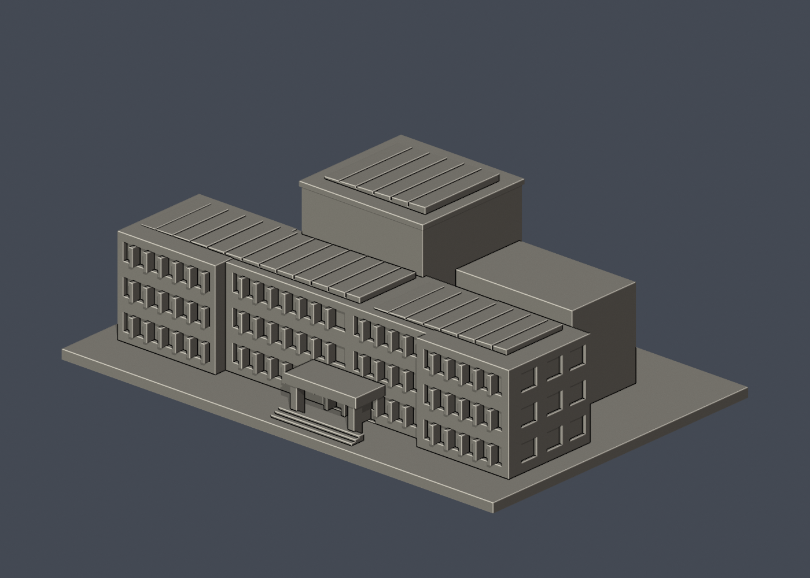
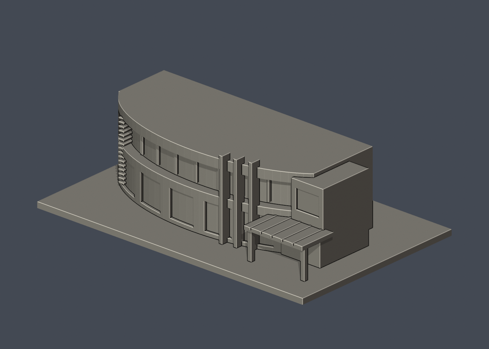
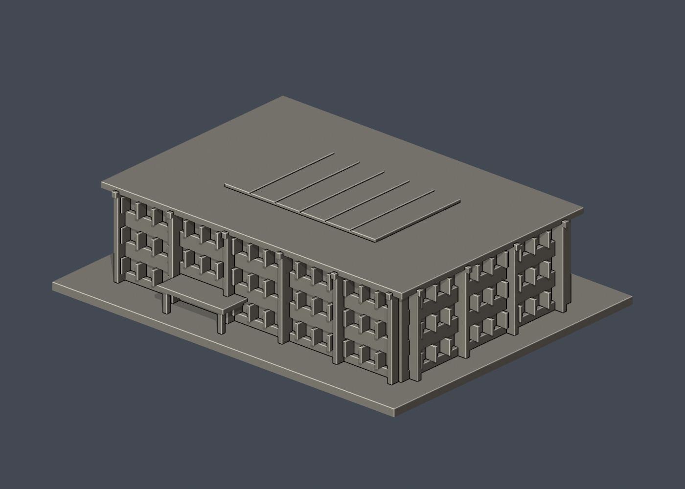
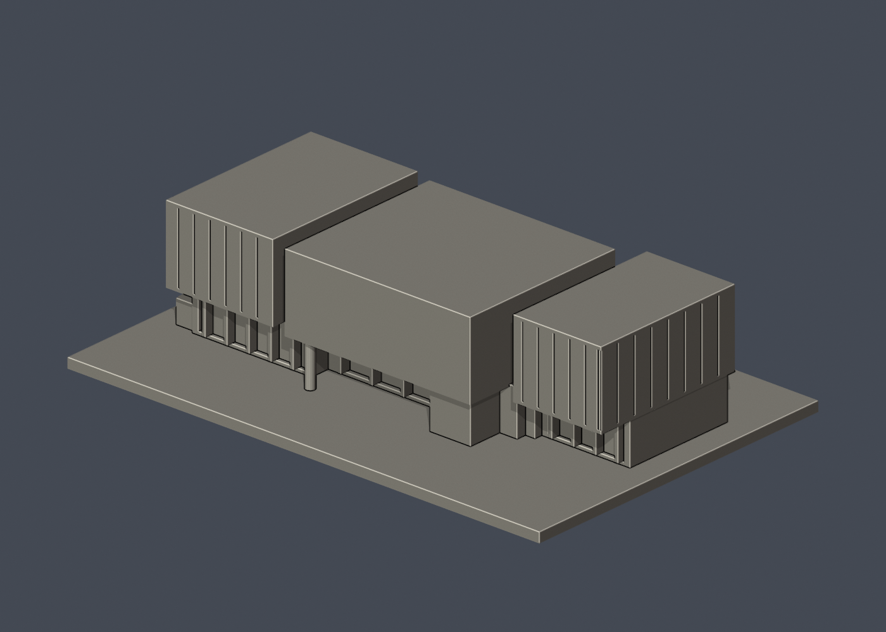
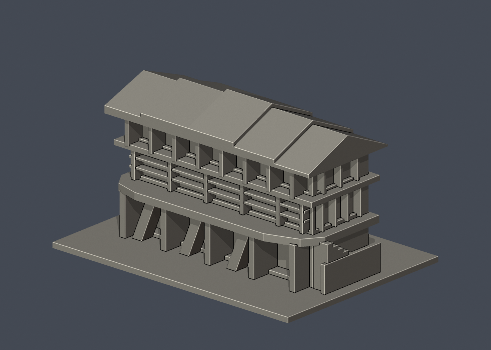
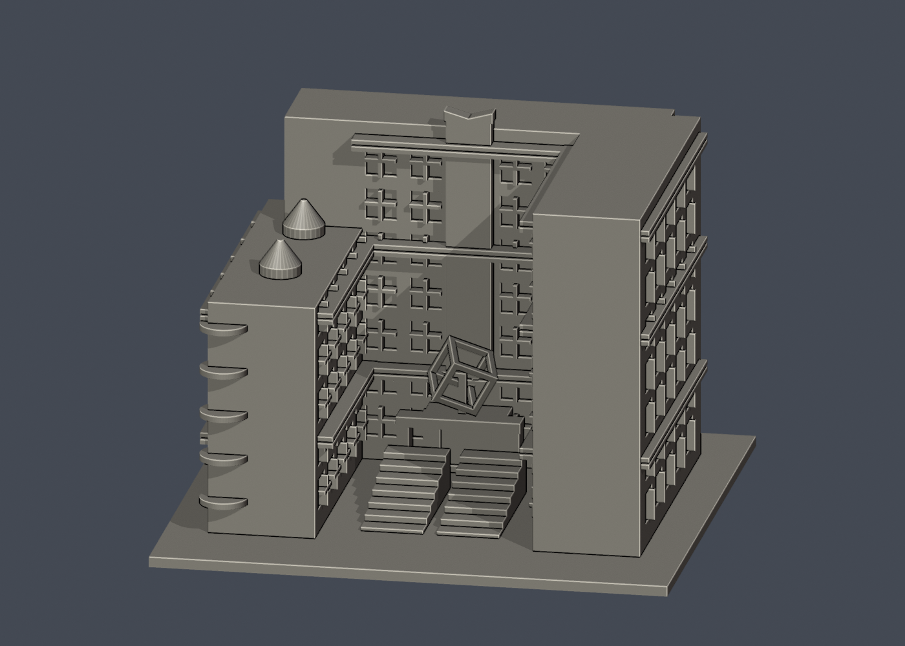
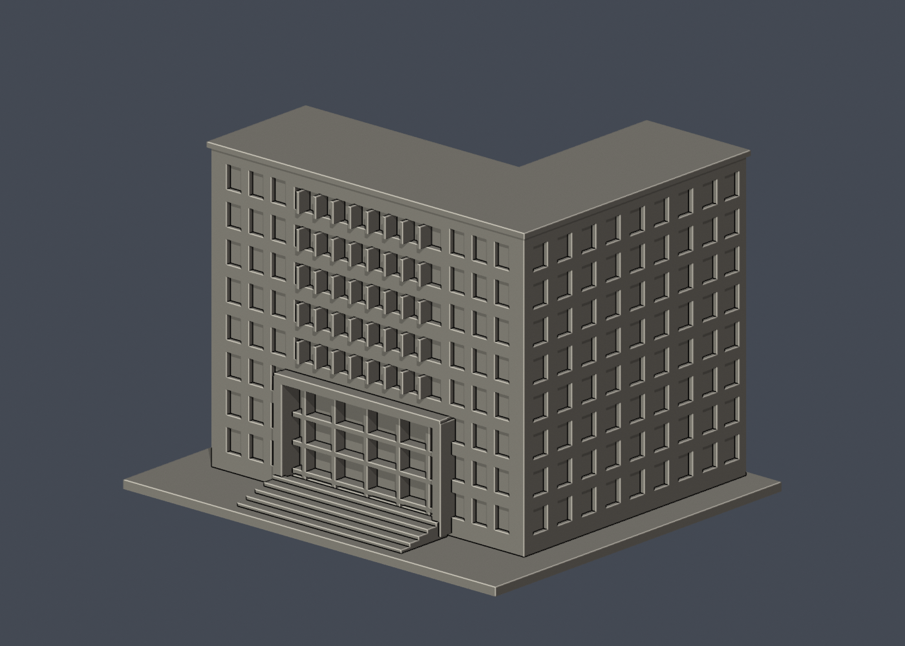

# 國立清華大學 校本部

本輪核准的外觀近似模型套件；全校尚未完成。套件可能包含相連群組、局部或歷史外觀，件數不等於完整建築棟數。未正式切片、未生成經驗證G-code、未實體試印。各件警示、來源年代、背面簡化及支撐需求請讀詳頁。只公開來源URL，不散布原照片或PDF。

| 建築／模型 | 建築／模型 | 建築／模型 |
|---|---|---|
| [校友體育館](buildings/nthu-alumni-gymnasium/README.zh-TW.md)  [資料夾](buildings/nthu-alumni-gymnasium) | [台達館](buildings/nthu-delta-hall/README.zh-TW.md)  [資料夾](buildings/nthu-delta-hall) | [學習資源中心（旺宏館）](buildings/nthu-macronix-building/README.zh-TW.md)  [資料夾](buildings/nthu-macronix-building) |
| [第一綜合大樓（行政大樓）](buildings/nthu-general-building-i/README.zh-TW.md)  [資料夾](buildings/nthu-general-building-i) | [清華名人堂](buildings/nthu-hall-of-fame/README.zh-TW.md)  [資料夾](buildings/nthu-hall-of-fame) | [台積館](buildings/nthu-tsmc-building/README.zh-TW.md)  [資料夾](buildings/nthu-tsmc-building) |
| [化工館](buildings/nthu-chemical-engineering/README.zh-TW.md)  [資料夾](buildings/nthu-chemical-engineering) | [教育館](buildings/nthu-education-building/README.zh-TW.md)  [資料夾](buildings/nthu-education-building) | [工程一館](buildings/nthu-engineering-i/README.zh-TW.md)  [資料夾](buildings/nthu-engineering-i) |
| [宏亮美術館](buildings/nthu-hong-liang-art-museum/README.zh-TW.md)  [資料夾](buildings/nthu-hong-liang-art-museum) | [王默人周安儀文學館](buildings/nthu-wang-chou-literature/README.zh-TW.md)  [資料夾](buildings/nthu-wang-chou-literature) | [第二綜合大樓](buildings/nthu-general-building-ii/README.zh-TW.md)  [資料夾](buildings/nthu-general-building-ii) |
| [清華實驗室](buildings/nthu-tsing-hua-lab/README.zh-TW.md)  [資料夾](buildings/nthu-tsing-hua-lab) | [人文社會學院大樓](buildings/nthu-humanities-social-sciences/README.zh-TW.md)  [資料夾](buildings/nthu-humanities-social-sciences) | [物理館](buildings/nthu-physics-building/README.zh-TW.md)  [資料夾](buildings/nthu-physics-building) |
| [竹師教育學院大樓](buildings/nthu-chu-shih-education/README.zh-TW.md)  [資料夾](buildings/nthu-chu-shih-education) | [創新育成中心](buildings/nthu-innovation-incubation/README.zh-TW.md)  [資料夾](buildings/nthu-innovation-incubation) | [劉炯朗館（原資電館）](buildings/nthu-cl-liu-building/README.zh-TW.md)  [資料夾](buildings/nthu-cl-liu-building) |
| [第三綜合大樓](buildings/nthu-general-building-iii/README.zh-TW.md)  [資料夾](buildings/nthu-general-building-iii) | [竹屋（原住民族科學發展中心）](buildings/nthu-bamboo-house/README.zh-TW.md)  [資料夾](buildings/nthu-bamboo-house) | [李存敏館（綠色低碳能源教學研究大樓）](buildings/nthu-lee-tsun-min/README.zh-TW.md)  [資料夾](buildings/nthu-lee-tsun-min) |
| [清齋 AB 雙翼外觀群（非整個清齋）](buildings/nthu-qing-dormitory-ab/README.zh-TW.md)  [資料夾](buildings/nthu-qing-dormitory-ab) | [新齋](buildings/nthu-xin-dormitory/README.zh-TW.md)  [資料夾](buildings/nthu-xin-dormitory) | [百齡堂前棟（2025整備前歷史外觀版）](buildings/nthu-bailing-hall-front/README.zh-TW.md)  [資料夾](buildings/nthu-bailing-hall-front) |
