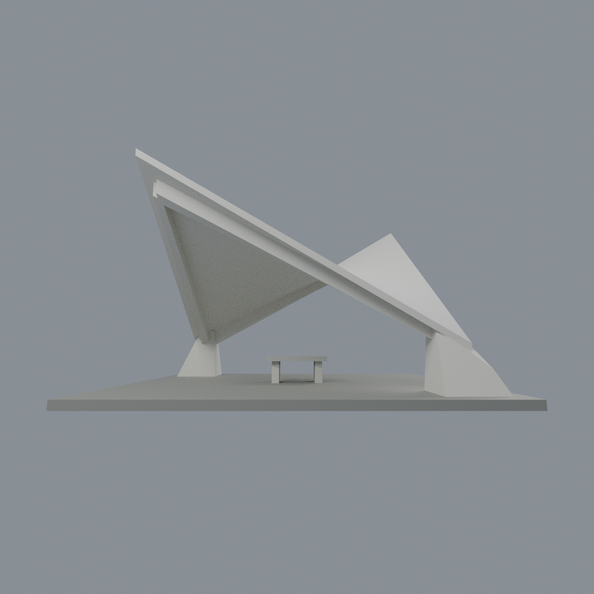
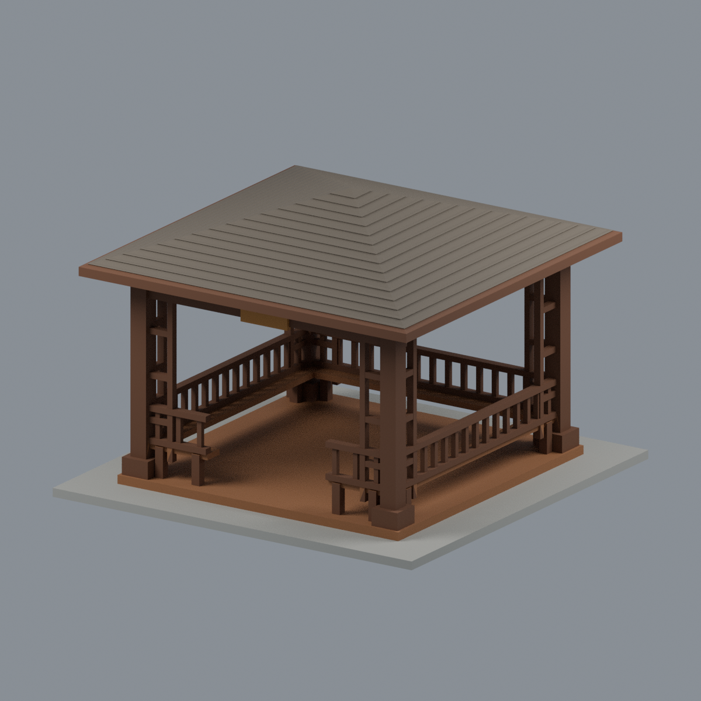

# 國立清華大學 校本部

本輪核准的外觀近似模型套件；全校尚未完成。套件可能包含相連群組、局部或歷史外觀，件數不等於完整建築棟數。旺宏館填縫版已完成一套參考切片，詳見下方卡片；其餘模型未正式切片。全校模型均未實體試印，沒有真機製造放行。各件警示、來源年代、背面簡化及支撐需求請讀詳頁。只公開來源URL，不散布原照片或PDF。

| 建築／模型 | 建築／模型 | 建築／模型 |
|---|---|---|
| [校友體育館](buildings/nthu-alumni-gymnasium/README.zh-TW.md)  [資料夾](buildings/nthu-alumni-gymnasium) | [台達館](buildings/nthu-delta-hall/README.zh-TW.md)  [資料夾](buildings/nthu-delta-hall) | [學習資源中心（旺宏館）｜前棟屋頂／露台改版](buildings/nthu-macronix-building/README.zh-TW.md)  本件填縫版已有一套參考切片；有條件GO、未試印 [填縫版STL・製造條件](buildings/nthu-macronix-building/manufacturing/README.zh-TW.md) · [原R2外觀對照](buildings/nthu-macronix-building/README.zh-TW.md) |
| [第一綜合大樓（行政大樓）](buildings/nthu-general-building-i/README.zh-TW.md)  [資料夾](buildings/nthu-general-building-i) | [清華名人堂](buildings/nthu-hall-of-fame/README.zh-TW.md)  [資料夾](buildings/nthu-hall-of-fame) | [台積館](buildings/nthu-tsmc-building/README.zh-TW.md)  [資料夾](buildings/nthu-tsmc-building) |
| [化工館](buildings/nthu-chemical-engineering/README.zh-TW.md)  [資料夾](buildings/nthu-chemical-engineering) | [教育館](buildings/nthu-education-building/README.zh-TW.md)  [資料夾](buildings/nthu-education-building) | [工程一館](buildings/nthu-engineering-i/README.zh-TW.md)  [資料夾](buildings/nthu-engineering-i) |
| [宏亮美術館](buildings/nthu-hong-liang-art-museum/README.zh-TW.md)  [資料夾](buildings/nthu-hong-liang-art-museum) | [王默人周安儀文學館](buildings/nthu-wang-chou-literature/README.zh-TW.md)  [資料夾](buildings/nthu-wang-chou-literature) | [第二綜合大樓](buildings/nthu-general-building-ii/README.zh-TW.md)  [資料夾](buildings/nthu-general-building-ii) |
| [清華實驗室](buildings/nthu-tsing-hua-lab/README.zh-TW.md)  [資料夾](buildings/nthu-tsing-hua-lab) | [人文社會學院大樓](buildings/nthu-humanities-social-sciences/README.zh-TW.md)  [資料夾](buildings/nthu-humanities-social-sciences) | [物理館](buildings/nthu-physics-building/README.zh-TW.md)  [資料夾](buildings/nthu-physics-building) |
| [竹師教育學院大樓](buildings/nthu-chu-shih-education/README.zh-TW.md)  [資料夾](buildings/nthu-chu-shih-education) | [創新育成中心](buildings/nthu-innovation-incubation/README.zh-TW.md)  [資料夾](buildings/nthu-innovation-incubation) | [劉炯朗館（原資電館）](buildings/nthu-cl-liu-building/README.zh-TW.md)  [資料夾](buildings/nthu-cl-liu-building) |
| [第三綜合大樓](buildings/nthu-general-building-iii/README.zh-TW.md)  [資料夾](buildings/nthu-general-building-iii) | [竹屋（原住民族科學發展中心）](buildings/nthu-bamboo-house/README.zh-TW.md)  [資料夾](buildings/nthu-bamboo-house) | [李存敏館（綠色低碳能源教學研究大樓）](buildings/nthu-lee-tsun-min/README.zh-TW.md)  [資料夾](buildings/nthu-lee-tsun-min) |
| [清齋 AB 雙翼外觀群（非整個清齋）](buildings/nthu-qing-dormitory-ab/README.zh-TW.md)  [資料夾](buildings/nthu-qing-dormitory-ab) | [新齋](buildings/nthu-xin-dormitory/README.zh-TW.md)  [資料夾](buildings/nthu-xin-dormitory) | [百齡堂前棟（2025整備前歷史外觀版）](buildings/nthu-bailing-hall-front/README.zh-TW.md)  [資料夾](buildings/nthu-bailing-hall-front) |

## 新增：北校門簡冊立柱本體

北校門簡冊立柱本體外觀近似：三片等高平行輪廓、兩道有背板側槽、照片所見三組雙橫飾。校名字體省略，背面簡化；非完整北校門，排除警衛亭、新光廊、天線、樹木與地下基礎。49×35×153mm含人工展示底板，非測繪縮尺。三材質Blend/3MF/STL與五張網格圖，668面單殼、765全域層通過；18局部0.8mm外唇截面警示保留，未實印，不稱免支撐。

[來源、五視圖與完整 QA](buildings/nthu-north-gate-bamboo-slip-pillar/README.md)

## 新增：月涵亭

月涵亭完整亭體之2016來源外觀近似：淺圓挑簷、十二開口多邊內環、寬柱深楣板及窄高窗。120×140×67.6mm，五材質Blend/3MF/STL、五張實際網格圖；5044面單殼、338全域層及30實體／7空氣局部測試通過。背側、頂面與規則環圈推定；高窗不透明加厚、地形座人工化，無題字／校徽假造。1476個高懸垂面保留支撐警示，未實印，非測繪及非已核實2026現況。

[來源、五視圖與完整 QA](buildings/nthu-yue-han-pavilion/README.md)

## 新增：梅亭／機亭

梅亭／機亭完整雙曲薄殼主體近似：單片連續鞍面、兩對角低支墩、兩自由高角與內縮深肋、簡化石桌。136×116×84.6mm，四材質Blend/3MF/STL及五張實際網格圖；14868面單殼、423全域層，最高尖端5層與局部6樣本0.8mm侵蝕失敗照實保留。尺寸、規則曲率與對稱高角為近似；背頂來源僅421×286且遠角貼邊，不是360測繪。人工底座，省略凳字環境；懸挑需支撐規劃，未實印，非2026現況核實。

[來源、五視圖與完整 QA](buildings/nthu-mei-pavilion/README.md)

## 最新新增：奕亭

奕亭完整簡化木亭：低四坡方屋頂、四角木柱、柱旁梯格、屋架與長凳低欄，正面中央通道開放。138×138×98mm、五材質Blend/3MF/STL與五張實際網格圖；4110面單殼，490全域層有6薄截面失敗層、局部40實體/7空氣樣本有1薄頂尖失敗及0佔據不符，保留風險不稱免支撐。2010/2012/2013/2018歷史照片；2021是展覽年，不是全景拍攝年。後欄無獨立外觀照片，後欄規律化及前欄分段/開口寬度近似；不是整座奕園、不是2026現況測繪、未實印。

[來源、五視圖與完整QA](buildings/nthu-yi-pavilion/README.md)
