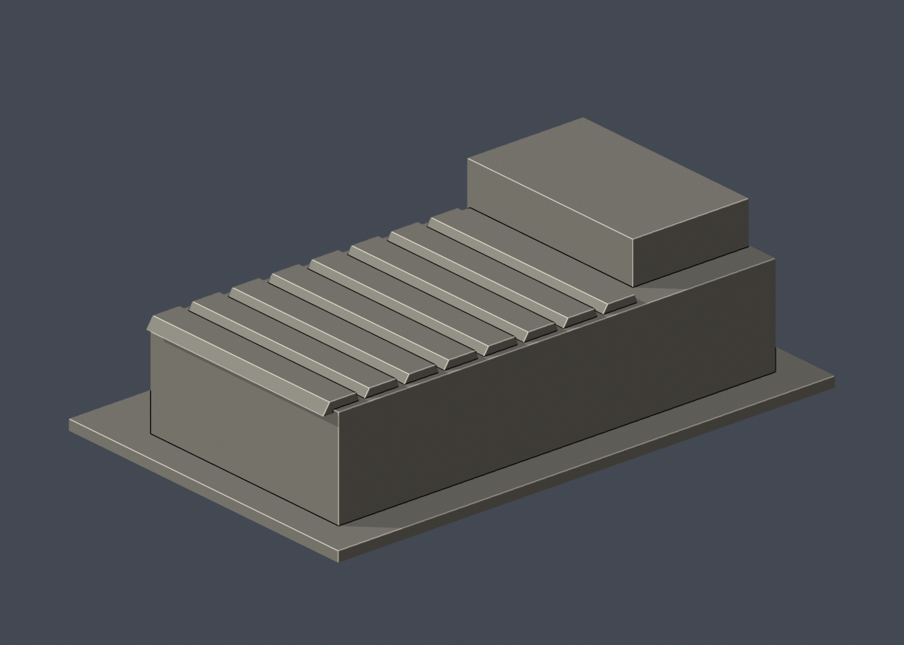

# 國立清華大學｜校友體育館

公開外觀照片導出的獨立桌上建築小模型。類別：**外觀近似，不是測繪模型**。校本部；首批的一件，不代表全校已完成。

## 檔案與尺寸
- `model.stl`：可列印單一實體，150.00 × 96.00 × 44.00 mm，含3mm底座，最長150mm。
- `scene.blend`：由實際STL匯入的Blender場景，單一三角網格，可編輯，單位mm。不是保留布林歷史的BIM；參數化重建用Python原始碼。
- `model.obj`：輔助交換網格。
- `build_model.py`：可攜原始碼；`requirements.txt`：依賴版本。
- `previews/front.png`、`rear.png`、`elevation.png`：實際STL渲染，不是參考照片或概念示意圖。正／背是模型顯示方向，非測量方位。
- `validation.json`：原檔驗證；`sources.json`：公開來源與近似紀錄。

## 來源與實際觀察
查閱日期：2026-10-13。來源頁：[校方公開介紹](https://alumni.site.nthu.edu.tw/p/405-1346-115105,c12416.php?Lang=zh-tw)。

官方長側面照片、圖書館校史展入口端照片及設計建築師外觀照片像素已檢視。可辨識低長主體、較高入口塊、圓窗、下段百葉、連續高窗及重複折面屋頂。

參考照片僅以連結列出，**未放入交付檔案、未重新發布**：
- https://alumni.site.nthu.edu.tw/var/file/346/1346/img/2899/856792075.jpg
- https://www.lib.nthu.edu.tw/events/2025/history/image/startingline_15.jpg
- https://ambi.com.tw/upload/image/project/large/iuZtbCtbKZpgSY9.jpg

## 近似與缺口
側面樹木遮擋下段；背面未見完整照片，採實心素面包絡。入口與長側面相對轉折、建物深度、折面數量、圓窗配置是近似；圓角改為直角，金屬薄浪板及字牌省略，圓窗僅淺凹而非孔洞。

所有尺寸為獨立150mm尺寸控制，三件不共同比例。沒有室內格局、地下空間、進出控制或設備系統資料。沒有擷取校方Unity、BIM或其他原始3D資產。官方3D導覽只確認公開入口與技術頁，沒有宣稱已逐面走訪其3D場景。

## 列印起點
正立、底座朝下。屋頂折面已與主體合併，沒有浮動屋板。入口凹槽約1.5mm、百葉凹槽約0.6mm；切片時檢視凹槽上缘，必要時局部支撐。

可從0.4mm噴嘴、0.2mm層高、3道外牆、15–20%填充起始評估，這些只是建議，非已驗證參數。STL是封閉實體；填充率由切片器決定，未預挖內腔。150mm含底座，請勿再用共同校園比例套用。較細凹槽可按機台調整。

## 驗證結果
`validation.json` 的 passed = true。原始二進位STL法線為單位向量且與面繞向一致；非退化三角面；封閉、邊與頂點流形；單一連通表面，沒有分離的內腔殼；正體積；底面z=0；尺寸150mm；乾淨暫存目錄重建STL的SHA-256一致；Blender與STL三角幾何一致。

尚未跑切片器、尚未實體試印，不宣稱完成支撐最佳化或全面自相交證明。模型及正背面預覽已人工檢視。

## 乾淨重建
需Python 3.12與Blender 4.3.2或較新版。先在虛擬環境安裝requirements.txt；在本資料夾依序執行：

```sh
python -m pip install -r requirements.txt
python build_model.py
blender -b -t 2 -P render_preview.py
python validate_model.py
```

原始碼只依賴同資料夾檔案；不依賴製作機器的絕對路徑。驗證會自行從乾淨暫存目錄重建STL；原檔不經自動修復。


## 列印幾何 v2（2026-10-13）

校友體育館：高牆最右圓窗凹口中心由x=-31mm移至-33mm，遠離端角2mm，消除原約0.5mm寬的局部角片。圓窗直徑2.2mm/凹深1.8mm不變，仍為外觀近似；主量體與屋頂不變。220個0.2mm截面閉合，0.8mm XY篩查零警戒。

此版另存，不覆寫製作端原版。16項網格驗證通過、乾淨重建SHA相同、Blend/STL一致；全部220個0.2mm抽樣輪廓閉合。最大0.8mm XY開運算損失面積0mm²。檢查強制輪廓度數2及多邊形有效，不默默跳過斷環。薄篩不是全面壁厚證明，未正式切片、未G-code、未實體試印。

重跑：`python check_layers.py`，結果在`layer-check.json`。原始外觀來源與未見背面限制保持。


## 實際STL正背並排

| 正面 | 背面（未見部分按詳頁明示簡化） |
|---|---|
|  |  |
