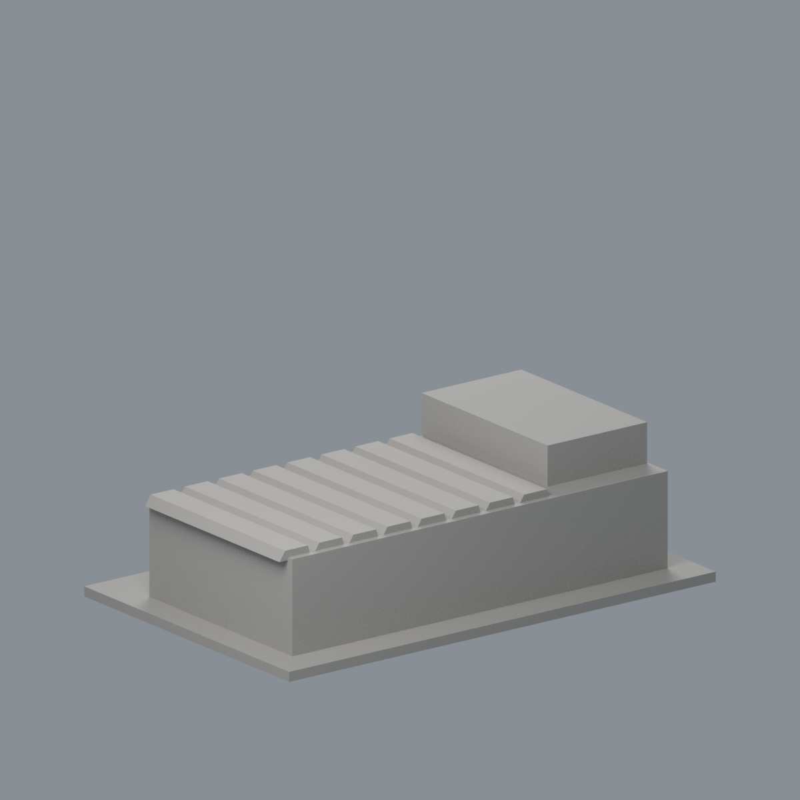
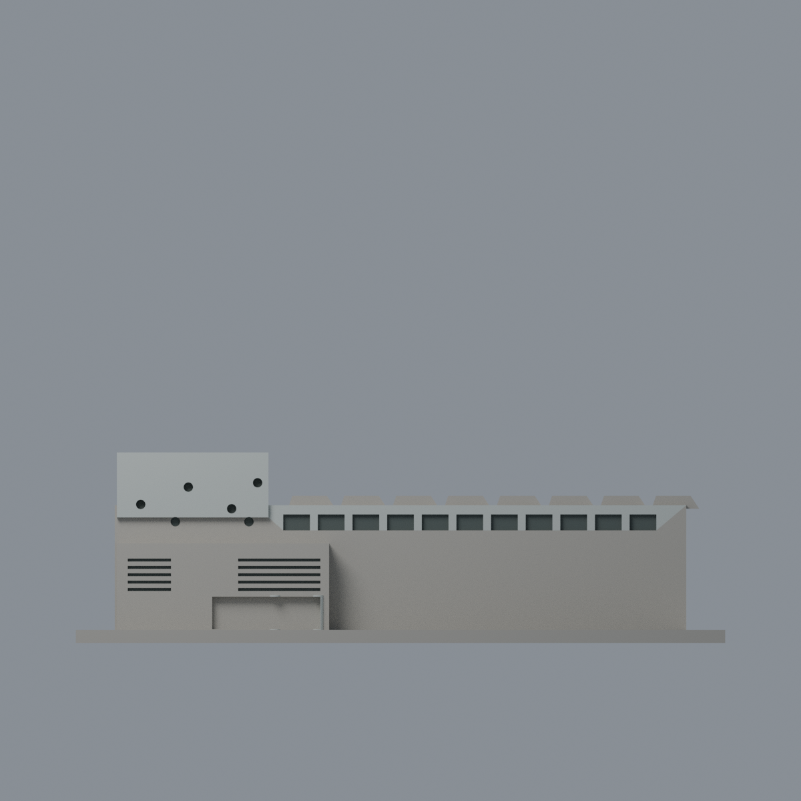
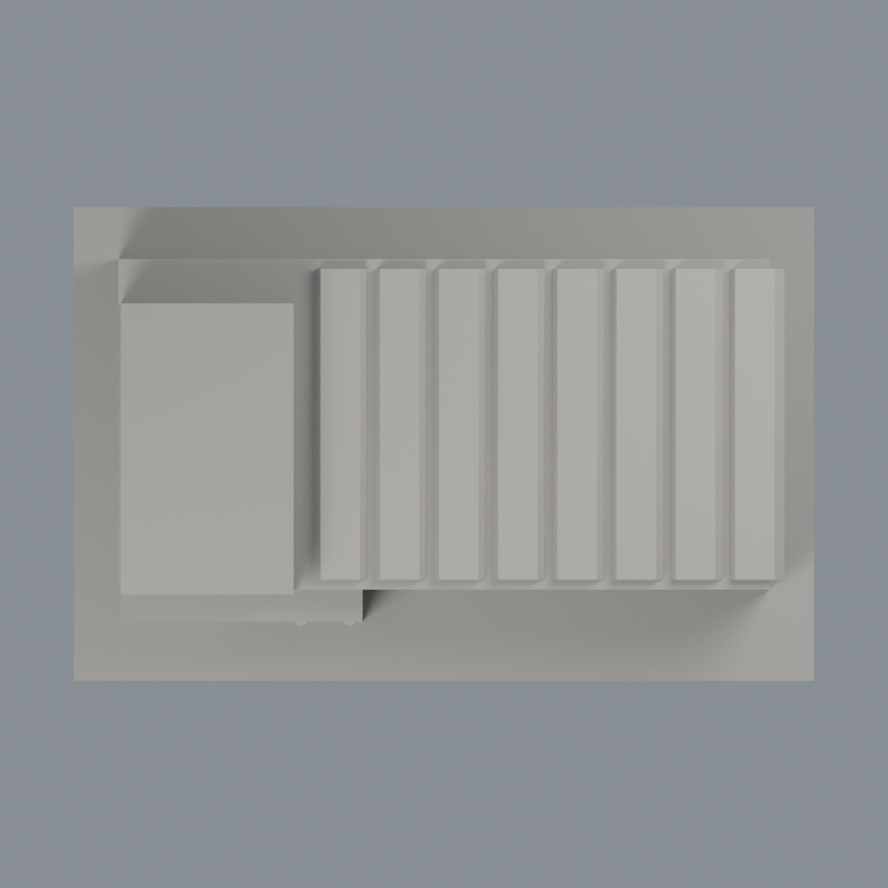

# 清華校友體育館：四材質外觀版

沿用原 **1,308 三角面／656 頂點**，不改原 STL 位元、座標、面序或幾何；這是既有模型外觀改版，不增加模型包數。

| 模型預覽 | 模型預覽 | 模型預覽 |
| :---: | :---: | :---: |
| 正面  | 未知背牆中性／屋頂同系統延伸  |  |
|  |  |  |

[表面色 3MF](nthugym-appearance.3mf) · [可編輯 Blender](scene.blend) · [材質色表](palette.json) · [逐面指派與依據](face-materials.json) · [原 STL](../model.stl)

## 來源與配色邊界

親看清華校友介紹長側照、校方圖書館校史展入口照及建築師 AMBI 斜入口照，對應原生成器與實際單色網格。[校友介紹](https://alumni.site.nthu.edu.tw/p/405-1346-115105,c12416.php?Lang=zh-tw)；[逐照來源、完整解碼與雜湊](qa/source-review.json)。圖書館入口照 EXIF 原始時間記 2013-03-12 16:44:43（相機自報、時區未核定），其餘兩照無原始拍攝欄；圖書館 2025 路徑與修改日不是拍攝日期，不稱 2026 現況。原照片不入包。

- 高入口前面銀灰金屬代理，保留素面，不加條紋、招牌或字樣。長側僅完整落在已見上部的原面採銀灰，下牆被樹遮與混合面中性。
- 原圓窗凹背與離散高窗深灰；原百葉溝槽背深色代表遮蔽而不是玻璃。不新增缺失圓窗外框或百葉微葉片。
- 原入口圓柱銀灰。下入口凸盒同一面跨實景左銀／右褐而未分界，整個混合牆保持中性，不能整塊假染褐色；入口廊背也不當全玻璃。
- 長廳重複屋頂上向面淡暖灰金屬代理，同系統有界延伸；不是 PV。高盒頂、背牆和未知端面中性。原重複屋形、圓窗排列與歷史幾何簡化照舊，不修改它們配合照片。

[原幾何與歷史來源限制](../README.zh-TW.md)

## 重建與核驗

安裝 [依賴](source/requirements.txt)，Blender 使用 4.3.2。由本資料夾上層提供原 model.stl：

1. `python appearance/source/build_appearance.py`
2. `python appearance/source/verify_exchange.py`
3. `blender -b -t 3 --python-exit-code 1 -P appearance/source/render_appearance.py`
4. `blender -b -t 3 --python-exit-code 1 -P appearance/source/verify_scene.py`

[獨立重建 ZIP](rebuild-source.zip)含原 STL、四支程式及依賴，不含第三方照片；不取代原建模腳本。[逐檔 SHA256](SHA256SUMS)

[交換／拓撲 QA](qa/exchange-validation.json)核對原座標與面序、全部面材質、單連通、有向水密邊、頂點 link 單環、正體積與零退化／重複面；lib3mf 嚴格讀取零警告，實際編輯單材質再存讀，其他材質及面指派不變。SDK 六位小數量化誤差另列。

[Blender 存讀與編輯](qa/scene-validation.json) · [渲染記錄](qa/render-manifest.json) · [獨立重建](qa/rebuild-validation.json)

## 製造限制照舊

尺寸仍為 150 × 96 × 44 mm；原 STL、建模程式、場景及歷史 QA 保留。原層檢與薄特徵檢查本次未重跑，不能由材質 QA 代替。

3MF 是同一網格的表面色，不是各材質各自封閉的分色實體、切片專案、噴頭映射或 G-code。切片 GUI、多材料路徑與實體列印未測；柱頭、屋簷、窗框及薄邊仍須評估材料、支撐及拆除風險，沒有保證可印或免支撐。
