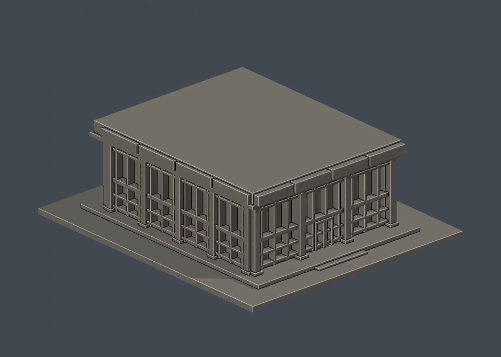
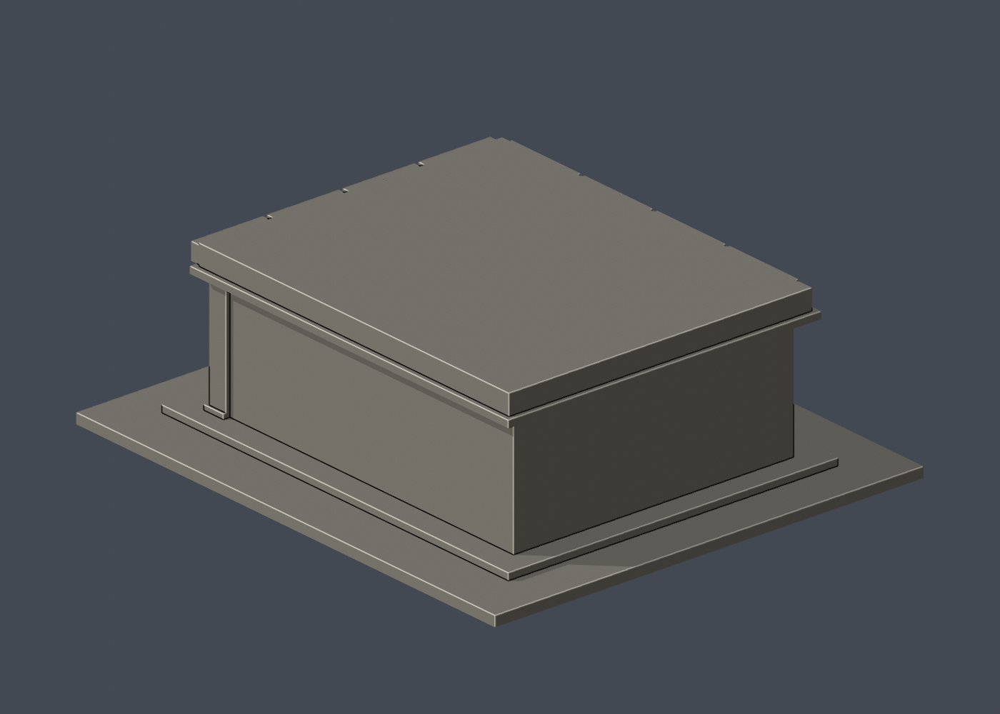

# 國立清華大學｜百齡堂前棟（2025整備前歷史外觀版）

第十一批公開外觀近似模型，並非測繪成果。每件獨立比例，130.00 × 150.00 × 47.90mm，最長150mm含底座。全校尚未完成。

## 來源與觀察
[官方建築導覽](https://www.lib.nthu.edu.tw/events/2024/history/bailing.html)；2026-10-13檢視來源實際像素。

已實看校友中心2020年餐廳介紹與圖書館2024年展覽中的前棟外觀，以及早期全景。保留低矮前棟、大片分格玻璃、細直柱/柱腳、寬深屋簷與分段凹口飾帶、入口小台階。百齡堂1965年落成，原後棟2010年拆除並另建名人堂；本件不含名人堂。

來源照片僅列連結，不放入成果、不重新發布：
- https://alumni.site.nthu.edu.tw/var/file/346/1346/img/4130/649544690.jpg
- https://www.lib.nthu.edu.tw/events/2024/history/image/bailing_08.jpg
- https://www.lib.nthu.edu.tw/events/2024/history/image/bailing_01.jpg

## 近似與缺口
本件為2020/2024公開照片所見、2025整備前前棟外觀近似，不代表2026整修後現況。校方公告水漾餐廳營業至2025年9月30日，之後重新裝修，故不宣稱餐廳仍營業。只建前棟主要玻璃廳；未見後牆與另一側牆採素面，側長、屋頂深度、玻璃格距依照片估計。背景屋頂方冠是後方名人堂，不放入百齡堂；早期後棟與現今連接部分不重建。室內、餐桌、植栽及細招牌省略。圖書館頁bailing_08與09圖片說明對調：已實看08是餐廳外觀、09是名人堂雕塑牆，模型只用08。

僅公開訪客可見外觀，無室內、地下、敏感設備或安全配置。未下載、擷取或反編譯官方Unity或任何原始3D模型。官方3D場景沒有逐面檢視，不能視為未見部位已獲證實。

## 檔案
- `build_model.py`：可攜參數化來源。
- `model.stl` / `model.obj`：單一連通、封閉實體，單位mm；不預挖內腔。
- `scene.blend`：實際STL的可編輯三角網格與相機，不是BIM或保留布林歷史的場景。
- `previews/front.png`、`rear.png`、`elevation.png`：實際STL預覽，已看像素。正背為顯示方向，不是實測方位。
- `validation.json`：原檔法線、邊與頂點流形、正體積、單一表面、重建及Blend/STL一致等16項通過。
- `check_layers.py` / `layer-check.json`：0.2mm幾何截面與0.8mm XY薄特徵篩查。

## 列印起點與支撐
底座向下，保持150mm尺寸。可從0.4mm噴嘴、0.2mm層高、3道外牆、15–20%填充起始，但不是測試完成的參數。

屋簷約5–6mm外挑、底部細肋與入口窗上沿需要局部支撐評估；前柱3.4mm寬、窗格最細1.1mm。格條與實心牆融合，不製成可透視薄殼；支撐勿黏死窄窗凹槽。

薄特徵：239個0.2mm抽樣截面均閉合，0.8mm XY薄特徵篩查零警戒；不等於免支撐或已完成正式切片。

## 驗證範圍
16項網格驗證通過；原始STL法線與繞向相符，所有邊連接兩面、頂點環流形、單一連通表面且沒有分離內腔殼，正體積、z=0底面與150mm最大尺寸通過。乾淨暫存目錄重建STL的SHA-256相符，Blender幾何與STL一致；驗證不自動修原檔。

0.2mm間距共239個抽樣高度，所有輪廓閉合。端點數值聚合容差0.0001mm；首層0.100013mm以避共面。0.8mm XY形態開運算標示0層超過0.2mm²警戒，最大差異面積0.03766mm²，含義見薄特徵說明。

**未正式切片、未生成G-code、未實體試印。** 抽樣幾何截面不等於刀路、擠出、支撐或橋接驗證，亦不能證明全面三維壁厚或自相交完全不存在。

## 重建
Python 3.12與Blender 4.3.2+；所有程式從本檔目錄讀寫，不依賴製作端絕對路徑。

```sh
python -m pip install -r requirements.txt
python build_model.py
blender -b -t 2 -P render_preview.py
python validate_model.py
python check_layers.py
```

年代補充：[2020校友中心餐廳介紹](https://alumni.site.nthu.edu.tw/p/404-1346-187651.php?Lang=zh-tw)；[水漾餐廳合約期滿結束營業公告](https://ddfm.site.nthu.edu.tw/p/406-1494-296002,r8304.php?Lang=zh-tw)。公告確認營業至2025/9/30並將重新裝修；未有充分整修後外觀，不把旧照片冒稱現況。


## 發布補充
請併讀[本輪版本與範圍](../../../audits/amendments/round-status-20261013.zh-TW.md)、[首批薄特徵警示與方法](../../../audits/amendments/layer-audit-20261013.zh-TW.md)及[化工館年代說明](../../../audits/amendments/chemical-engineering-era-clarification.zh-TW.md)。旺宏館保留原幾何；台達館及校友體育館採列印修正版，不重複計數。


## 實際STL正背並排

| 正面 | 背面（未見部分按詳頁明示簡化） |
|---|---|
|  |  |
