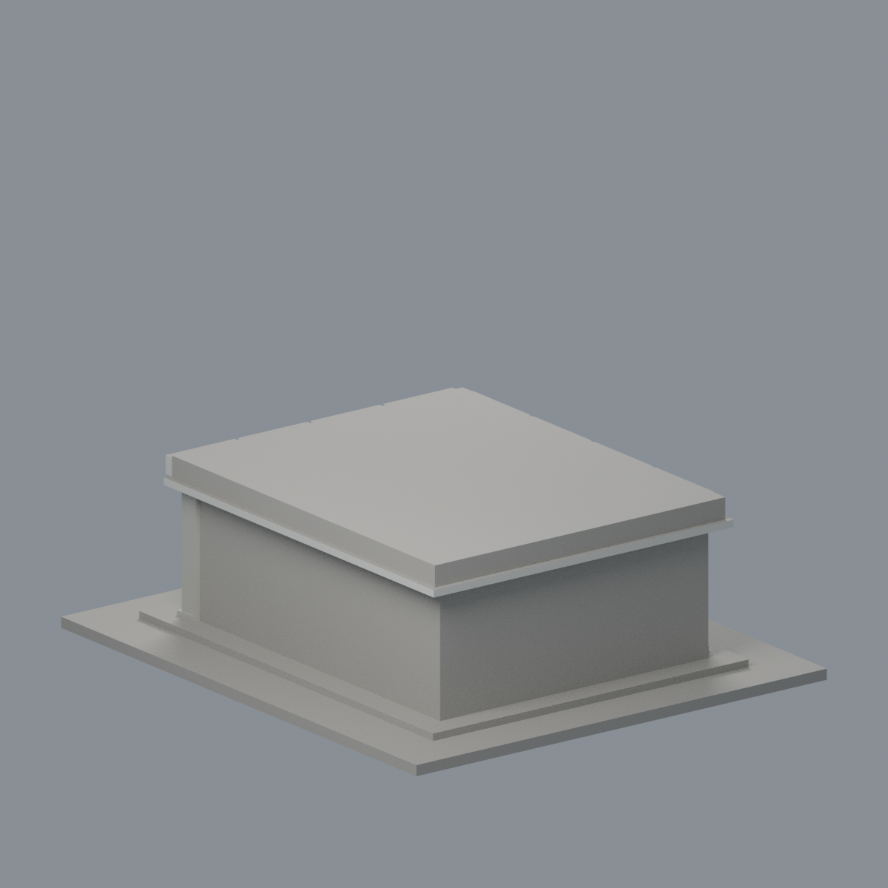
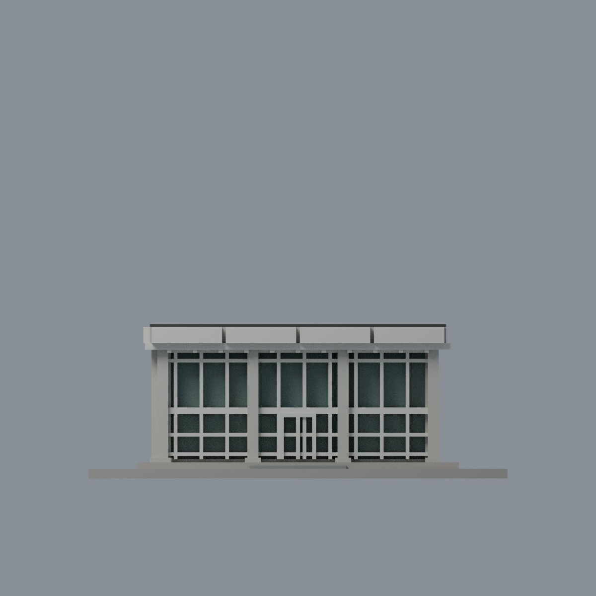
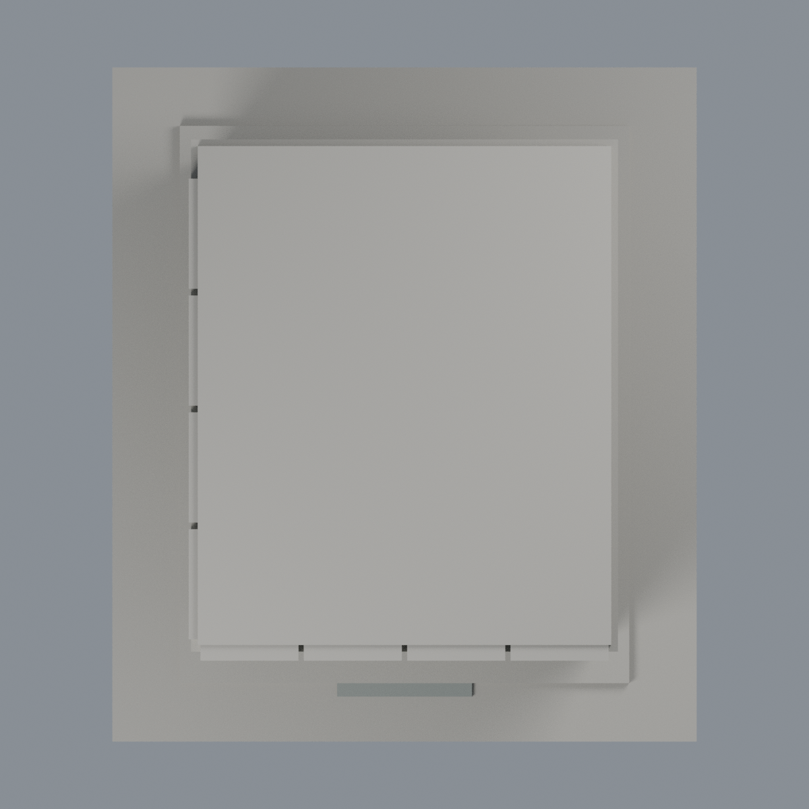

# 清華百齡堂前棟（2025 整備前歷史外觀）：六材質外觀版

沿用原 **4,066 三角面／1,751 頂點**，不改原 STL 位元、座標、面序或幾何；這是既有模型外觀改版，不增加模型包數。

| 模型預覽 | 模型預覽 | 模型預覽 |
| :---: | :---: | :---: |
| 正面  | 背面保持中性  |  |
|  |  |  |

[表面色 3MF](nthubailing-appearance.3mf) · [可編輯 Blender](scene.blend) · [材質色表](palette.json) · [逐面指派與依據](face-materials.json) · [原 STL](../model.stl)

## 來源與配色邊界

本件是**百齡堂前棟 2025 整備前歷史外觀配色**，不是 2026 現況或餐廳仍營業的聲明。親看校友中心／校史展三張完整照片及原單色網格、生成器；[來源 URL、雜湊及分列日期欄](qa/source-review.json)。三照未取得 Original 拍攝日期，修改日期不能當拍攝日；早期掃描照只辨形，不作色證。照片只供研究，不入包。

- 依清楚未降簾的第一張照片註冊前面及左側：分段白色簷面、白色窗格、淡灰磁磚柱、低飽和灰綠玻璃代理。第二張上層降下的白簾不是白色玻璃，不能據此改玻璃材質。
- 原入口門格、短縮階梯與粗化柱腳保留；已分柱腳採同系統灰色有限延伸。窗玻璃是不透明表面代理，不宣稱透明度、室內或精確格距。細磁磚縫不新增。
- 黑灰頂緣僅前／左已分垂直邊；原頂緣與突出簷面的偏移是既有簡化，不新增幾何來假裝精確。屋頂上面、右側、背面及無分界平台／底板保持中性，不代表中性色為實景還原。
- 不加入後方名人堂屋頂方冠、早期拆除後棟、內部餐桌、文字牌匾、植栽或連接段。原歷史模型範圍及日期限制保留。

[原幾何與歷史來源限制](../README.zh-TW.md)

## 重建與核驗

安裝 [依賴](source/requirements.txt)，Blender 使用 4.3.2。由本資料夾上層提供原 model.stl：

1. `python appearance/source/build_appearance.py`
2. `python appearance/source/verify_exchange.py`
3. `blender -b -t 3 --python-exit-code 1 -P appearance/source/render_appearance.py`
4. `blender -b -t 3 --python-exit-code 1 -P appearance/source/verify_scene.py`

[獨立重建 ZIP](rebuild-source.zip)含原 STL、四支程式及依賴，不含第三方照片；不取代原建模腳本。[逐檔 SHA256](SHA256SUMS)

[交換／拓撲 QA](qa/exchange-validation.json)核對原座標與面序、全部面材質、單連通、有向水密邊、頂點 link 單環、正體積與零退化／重複面；lib3mf 嚴格讀取零警告，實際編輯單材質再存讀，其他材質及面指派不變。SDK 六位小數量化誤差另列。

[Blender 存讀與編輯](qa/scene-validation.json) · [渲染記錄](qa/render-manifest.json) · [獨立重建](qa/rebuild-validation.json)

## 製造限制照舊

尺寸仍為 130 × 150 × 47.9 mm；原 STL、建模程式、場景及歷史 QA 保留。原層檢與薄特徵檢查本次未重跑，不能由材質 QA 代替。

3MF 是同一網格的表面色，不是各材質各自封閉的分色實體、切片專案、噴頭映射或 G-code。切片 GUI、多材料路徑與實體列印未測；柱頭、屋簷、窗框及薄邊仍須評估材料、支撐及拆除風險，沒有保證可印或免支撐。
