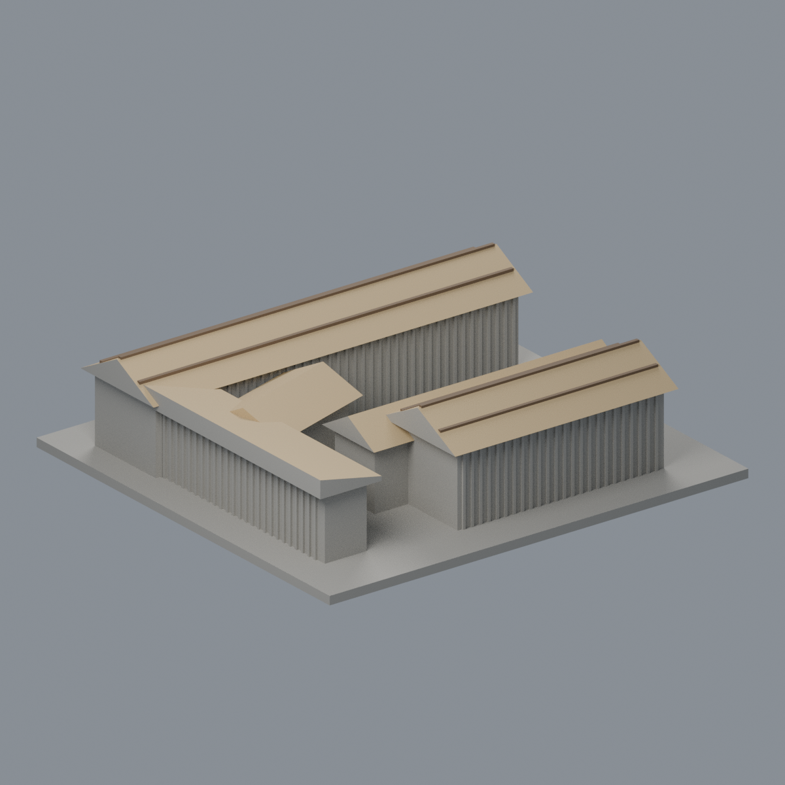
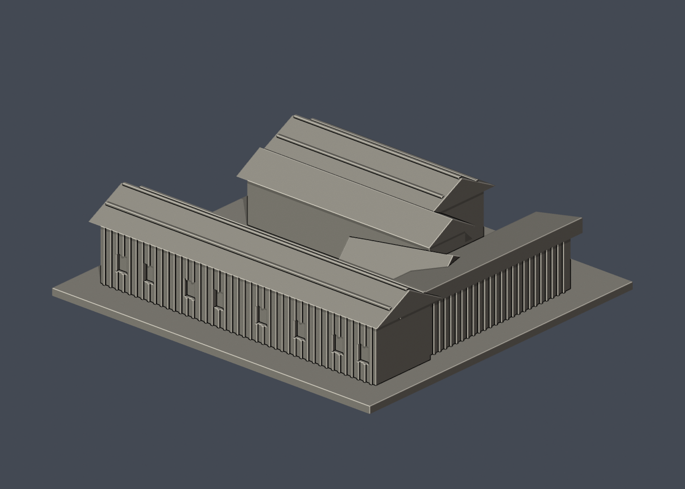
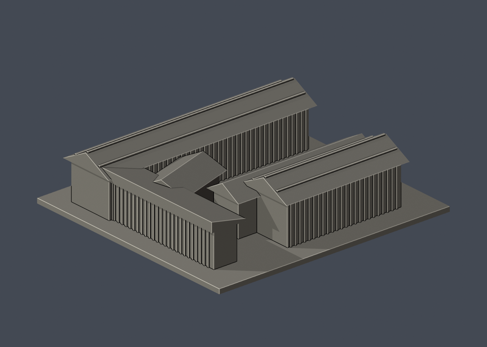

# 國立清華大學｜竹屋（原住民族科學發展中心）

## 5 材質外觀版（2026-10-21）

| 正面與來源支持區域 | 來源支持屋坡／牆面保守中性 |
|---|---|
|  |  |

[來源界線與四視角](appearance/README.md) · [表面色 3MF](appearance/nthubamboo-appearance.3mf) · [可編輯場景](appearance/scene.blend)

有限配色重點為來源支持金色竹屋坡與棕屋脊橫檁、離散窗和灰平台；牆面跨深色橫帶／院內灰腳而未分界，刻意中性，不冒充全牆實景還原。 原 STL 與歷史 QA 不變；這是外觀改善，不是新增幾何。[原單色正面](previews/front.png)／[原單色背面](previews/rear.png)


第九批公開外觀近似模型，並非測繪成果。每件獨立比例，150.00 × 140.00 × 37.50mm，最長150mm含底座。全校尚未完成。

## 來源與觀察
[官方建築導覽](https://www.nthu.edu.tw/hotNews/content/1121)；2026-10-13檢視來源實際像素。

已實看官方2023年4月14日啟用新聞的樹林入口實景及完整屋頂空拍。保留前長翼、後側錯層屋面、右側窄連廊、向院落斜出的短翼與多段坡屋頂。竹材外皮以加粗稀疏直紋提示。

來源照片僅列連結，不放入成果、不重新發布：
- https://www.nthu.edu.tw/images/hotNews_168146011675.jpg
- https://www.nthu.edu.tw/images/hotNews_168146011644.jpg

## 近似與缺口
相對屋頂高低、坡度、短翼角度及各翼深度按空拍估計；森林遮蔽的後牆/側牆只有竹紋或素面，不虛構門窗。每根桂竹及細金屬收邊大幅減量加粗，屋頂採實心坡體，不宣稱傳統工法結構模型。地形/地下一層省略，庭院整平。獨立穀倉、瞭望台、三石灶和園景均不納本件建築scope。

僅公開訪客可見外觀，無室內、地下、敏感設備或安全配置。未下載、擷取或反編譯官方Unity或任何原始3D模型。官方3D場景沒有逐面檢視，不能視為未見部位已獲證實。

## 檔案
- `build_model.py`：可攜參數化來源。
- `model.stl` / `model.obj`：單一連通、封閉實體，單位mm；不預挖內腔。
- `scene.blend`：實際STL的可編輯三角網格與相機，不是BIM或保留布林歷史的場景。
- `previews/front.png`、`rear.png`、`elevation.png`：實際STL預覽，已看像素。正背為顯示方向，不是實測方位。
- `validation.json`：原檔法線、邊與頂點流形、正體積、單一表面、重建及Blend/STL一致等16項通過。
- `check_layers.py` / `layer-check.json`：0.2mm幾何截面與0.8mm XY薄特徵篩查。

## 列印起點與支撐
底座向下，保持150mm尺寸。可從0.4mm噴嘴、0.2mm層高、3道外牆、15–20%填充起始，但不是測試完成的參數。

前後屋簷約3mm懸挑，斜向小翼屋簷交會及連廊屋簷需要局部支撐評估。竹紋名義0.9mm寬、1.2mm深並與實體牆融合；屋頂橫肋1.2mm寬、1mm高。不可抓住屋頂邊緣拆支撐。

薄特徵：187個0.2mm截面均閉合，3層屋頂尖緣警戒：z=30.90001mm的側連廊單坡最上緣（89.84018mm²），以及z=35.90001/36.90001mm坡頂與肋條交會的窄截面。均為厚坡體收尖處，最後尖端可能被切片器鈍化或省略；不表示全面三維壁厚已驗證。

## 驗證範圍
16項網格驗證通過；原始STL法線與繞向相符，所有邊連接兩面、頂點環流形、單一連通表面且沒有分離內腔殼，正體積、z=0底面與150mm最大尺寸通過。乾淨暫存目錄重建STL的SHA-256相符，Blender幾何與STL一致；驗證不自動修原檔。

0.2mm間距共187個抽樣高度，所有輪廓閉合。端點數值聚合容差0.0001mm；首層0.100013mm以避共面。0.8mm XY形態開運算標示3層超過0.2mm²警戒，最大差異面積89.84018mm²，含義見薄特徵說明。

**未正式切片、未生成G-code、未實體試印。** 抽樣幾何截面不等於刀路、擠出、支撐或橋接驗證，亦不能證明全面三維壁厚或自相交完全不存在。

## 重建
Python 3.12與Blender 4.3.2+；所有程式從本檔目錄讀寫，不依賴製作端絕對路徑。

```sh
python -m pip install -r requirements.txt
python build_model.py
blender -b -t 2 -P render_preview.py
python validate_model.py
python check_layers.py
```


## 實際STL正背並排

| 正面 | 背面（未見部分按詳頁明示簡化） |
|---|---|
|  |  |
