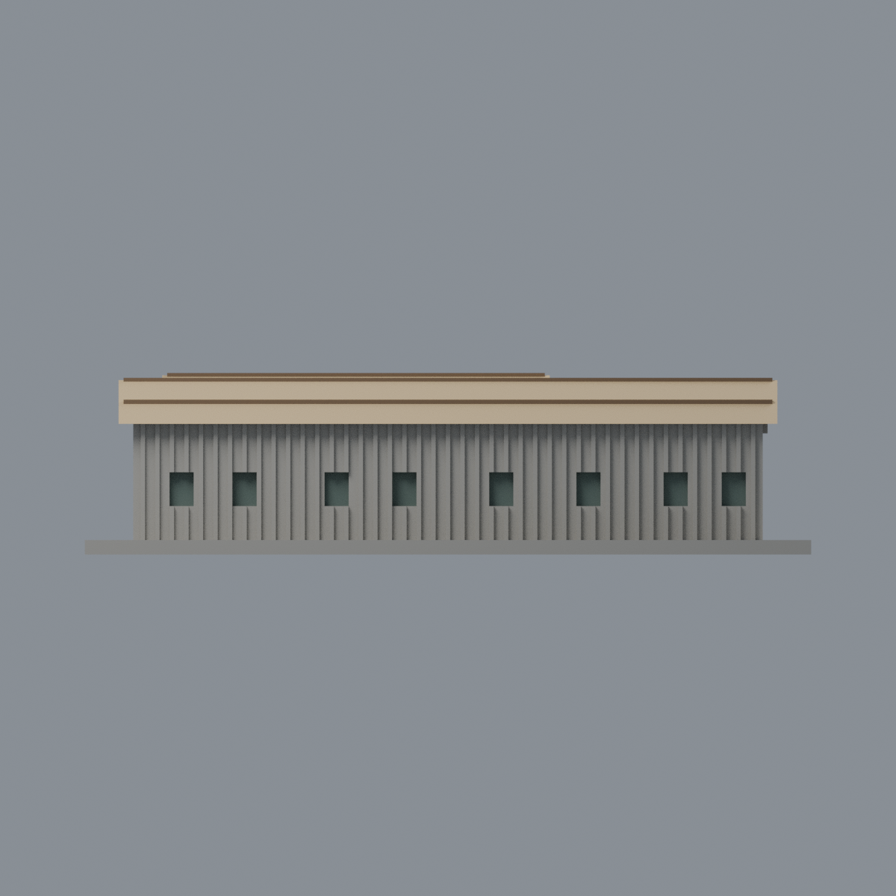
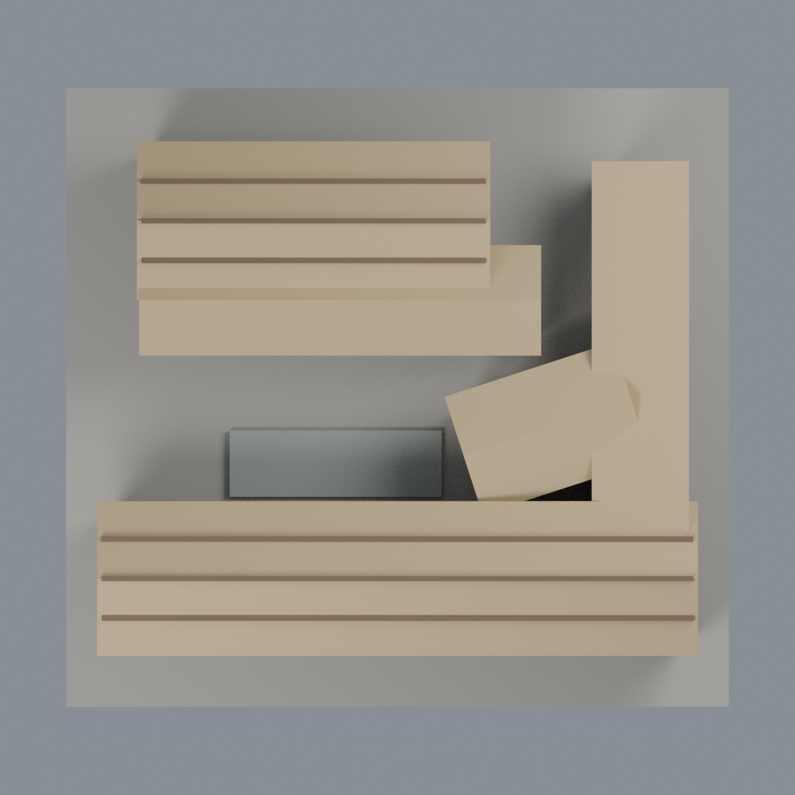

# 清華竹屋：五材質外觀版

沿用原 **2,802 三角面／1,401 頂點**，不改原 STL 位元、座標、面序或幾何；這是既有模型外觀改版，不增加模型包數。

| 模型預覽 | 模型預覽 | 模型預覽 |
| :---: | :---: | :---: |
| 正面  | 來源支持屋坡／牆面保守中性  |  |
|  |  |  |

[表面色 3MF](nthubamboo-appearance.3mf) · [可編輯 Blender](scene.blend) · [材質色表](palette.json) · [逐面指派與依據](face-materials.json) · [原 STL](../model.stl)

## 來源與配色邊界

親自核對清華官方[2023 啟用新聞](https://www.nthu.edu.tw/hotNews/content/1121)、[院內地面照](https://www.nthu.edu.tw/images/hotNews_168146011675.jpg)與[完整空拍](https://www.nthu.edu.tw/images/hotNews_168146011644.jpg)。EXIF DateTimeOriginal 分別 2023-04-12 22:02:46／2023-04-09 09:29:38；時區、相機時鐘未獨立核實，不以新聞日期或照片推斷 2026 現況。[來源覆核與雜湊](qa/source-review.json)，原照私有研究、不入包。

- **本版重點為空拍清楚支持的淡金色竹屋坡與既有棕色屋脊／橫檁**，不稱金屬屋頂或太陽能；不增加細竹紋或改原屋面輪廓。後翼與連接翼坡面也有空拍支持，而非未知面一律猜色。
- **牆面刻意保守中性**：前長翼外側雖主要竹色，但窗上／窗下深褐橫帶未在原網格分面；院內立面還有灰混凝土腳。不得把跨界的大牆或全高垂直肋全部塗成金色。中性牆不是實景牆色還原。
- 原實際存在的前外側離散窗凹背灰綠，缺細窗框就不假加；後內院模型部分預設窗切未落在真牆面，不猜造玻璃位置。原平台灰混凝土，整體無分面底板不塗草綠。
- 未見端牆、後外牆與其他未註冊面中性；獨立瞭望／穀倉亭不在模型內，不加文字、樹木或室內。
- 保持原 STL 位元、面序、原腳本／場景／歷史 QA，所有面色只賦給完整原三角形。這是有限外觀改善，不新增棟數、不宣稱實體試印成功。

[原幾何與歷史來源限制](../README.zh-TW.md)

## 重建與核驗

安裝 [依賴](source/requirements.txt)，Blender 使用 4.3.2。由本資料夾上層提供原 model.stl：

1. `python appearance/source/build_appearance.py`
2. `python appearance/source/verify_exchange.py`
3. `blender -b -t 3 --python-exit-code 1 -P appearance/source/render_appearance.py`
4. `blender -b -t 3 --python-exit-code 1 -P appearance/source/verify_scene.py`

[獨立重建 ZIP](rebuild-source.zip)含原 STL、四支程式及依賴，不含第三方照片；不取代原建模腳本。[逐檔 SHA256](SHA256SUMS)

[交換／拓撲 QA](qa/exchange-validation.json)核對原座標與面序、全部面材質、單連通、有向水密邊、頂點 link 單環、正體積與零退化／重複面；lib3mf 嚴格讀取零警告，實際編輯單材質再存讀，其他材質及面指派不變。SDK 六位小數量化誤差另列。

[Blender 存讀與編輯](qa/scene-validation.json) · [渲染記錄](qa/render-manifest.json) · [獨立重建](qa/rebuild-validation.json)

## 製造限制照舊

尺寸仍為 150 × 140 × 37.5 mm；原 STL、建模程式、場景及歷史 QA 保留。原層檢與薄特徵檢查本次未重跑，不能由材質 QA 代替。

3MF 是同一網格的表面色，不是各材質各自封閉的分色實體、切片專案、噴頭映射或 G-code。切片 GUI、多材料路徑與實體列印未測；柱頭、屋簷、窗框及薄邊仍須評估材料、支撐及拆除風險，沒有保證可印或免支撐。
