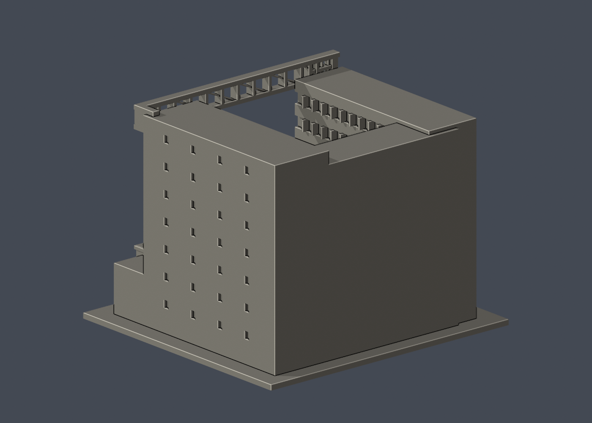

# 國立清華大學｜竹師教育學院大樓

第七批公開外觀近似模型，並非測繪成果。每件獨立比例，150.00 × 140.00 × 112.40mm，最長150mm含底座。全校尚未完成。

## 來源與觀察
[官方建築導覽](https://archives.lib.nthu.edu.tw/history/timeline/doc/20240500.pdf)；2026-10-13檢視來源實際像素。

已實看官方校史 PDF 第6頁：上半完工全景與下半公開院落。2024年5月竣工，2025年10月21日啟用，與1973年教育館為不同建築。保留U形白色院落、右磚色端核、巨型頂部桁架和左側垂直格網、錯層凸窗框、前低廳肋屋頂與直立遮陽片。官方 future 網頁是較早效果圖，紅色門架形式與實拍不同，未拿效果圖當完工外觀。

來源照片僅列連結，不放入成果、不重新發布：
- https://archives.lib.nthu.edu.tw/history/timeline/doc/20240500.pdf#page=6

## 近似與缺口
U翼夾角、深度、層高及前廳相對位置均按照片近似並正交化，不能視為精確平面。格網和桁架減少數量、加粗，透明紅網不重建；窗分格規律化。未見完整背立面採素面，屋頂設備不做；地形、園景、停車與斜坡縮減或省略。照片只有兩個外部視角，不宣稱全館完整還原。

僅公開訪客可見外觀，無室內、地下、敏感設備或安全配置。未下載、擷取或反編譯官方Unity或任何原始3D模型。官方3D場景沒有逐面檢視，不能視為未見部位已獲證實。

## 檔案
- `build_model.py`：可攜參數化來源。
- `model.stl` / `model.obj`：單一連通、封閉實體，單位mm；不預挖內腔。
- `scene.blend`：實際STL的可編輯三角網格與相機，不是BIM或保留布林歷史的場景。
- `previews/front.png`、`rear.png`、`elevation.png`：實際STL預覽，已看像素。正背為顯示方向，不是實測方位。
- `validation.json`：原檔法線、邊與頂點流形、正體積、單一表面、重建及Blend/STL一致等16項通過。
- `check_layers.py` / `layer-check.json`：0.2mm幾何截面與0.8mm XY薄特徵篩查。

## 列印起點與支撐
底座向下，保持150mm尺寸。可從0.4mm噴嘴、0.2mm層高、3道外牆、15–20%填充起始，但不是測試完成的參數。

最上方門架跨距約100mm，下弦水平橋接必須評估大量可移除支撐；細網格拆支撐易折，勿當免支撐件。主要門架柱2.4mm、細格1.1mm、橫桁1.8–2.4mm。前廳肋條1.1mm寬0.9mm高、窗口及凸框下緣亦需檢視懸垂。

薄特徵：已將格網與左端窗凹槽錯開，消除相交產生的0.25mm殘條；562個0.2mm截面閉合，0.8mm XY篩查零警戒。此結果不代表長桁架可免支撐列印。

## 驗證範圍
16項網格驗證通過；原始STL法線與繞向相符，所有邊連接兩面、頂點環流形、單一連通表面且沒有分離內腔殼，正體積、z=0底面與150mm最大尺寸通過。乾淨暫存目錄重建STL的SHA-256相符，Blender幾何與STL一致；驗證不自動修原檔。

0.2mm間距共562個抽樣高度，所有輪廓閉合。端點數值聚合容差0.0001mm；首層0.100013mm以避共面。0.8mm XY形態開運算標示0層超過0.2mm²警戒，最大差異面積0.11665mm²，含義見薄特徵說明。

**未正式切片、未生成G-code、未實體試印。** 抽樣幾何截面不等於刀路、擠出、支撐或橋接驗證，亦不能證明全面三維壁厚或自相交完全不存在。

## 重建
Python 3.12與Blender 4.3.2+；所有程式從本檔目錄讀寫，不依賴製作端絕對路徑。

```sh
python -m pip install -r requirements.txt
python build_model.py
blender -b -t 2 -P render_preview.py
python validate_model.py
python check_layers.py
```


## 實際STL正背並排

| 正面 | 背面（未見部分按詳頁明示簡化） |
|---|---|
|  |  |
