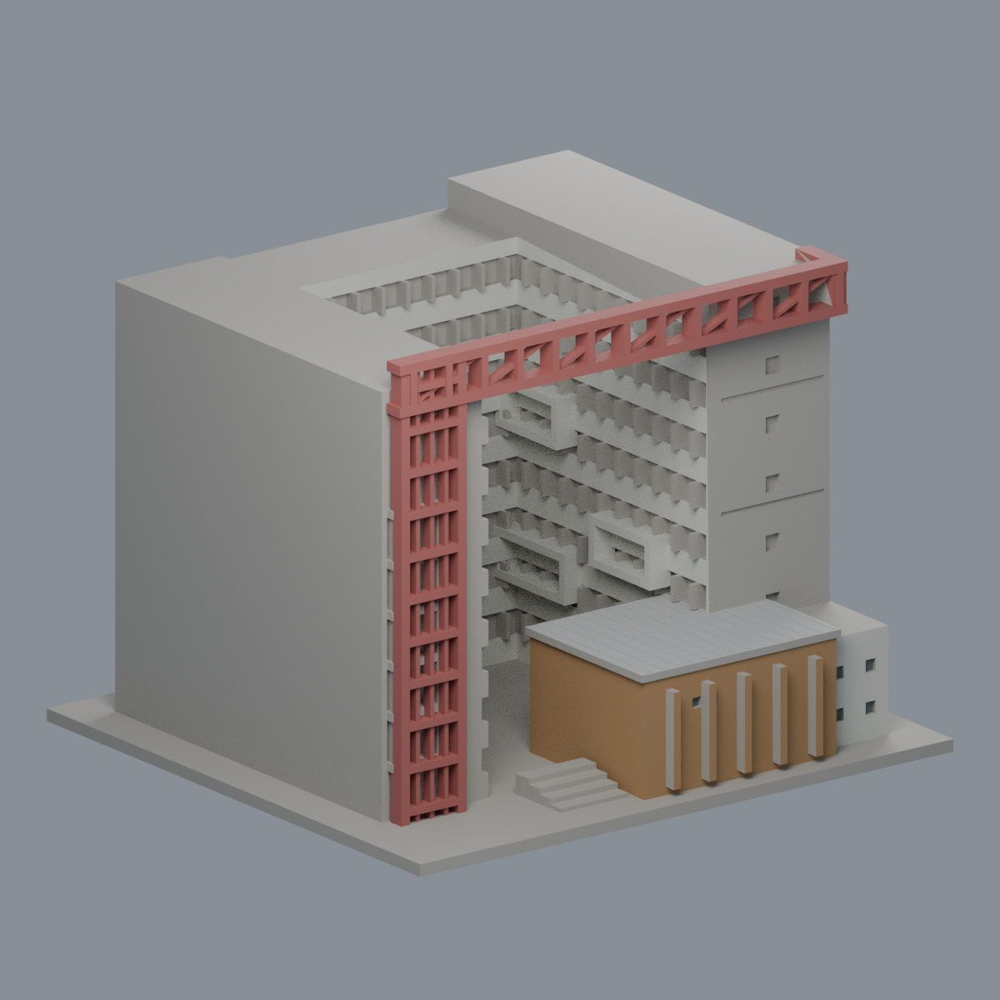
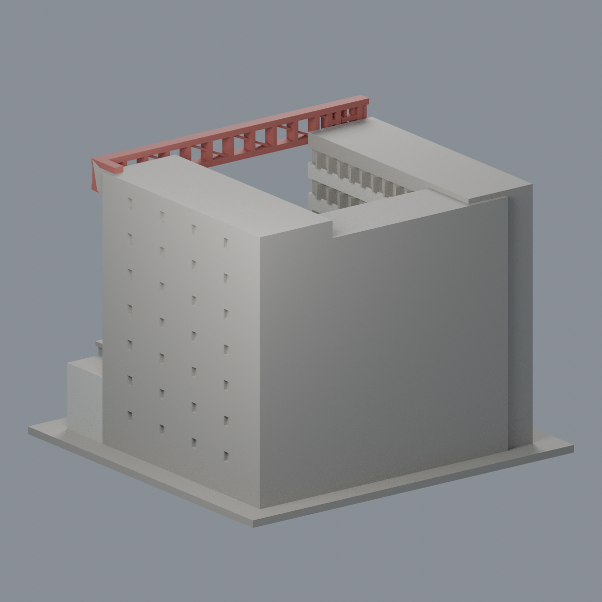
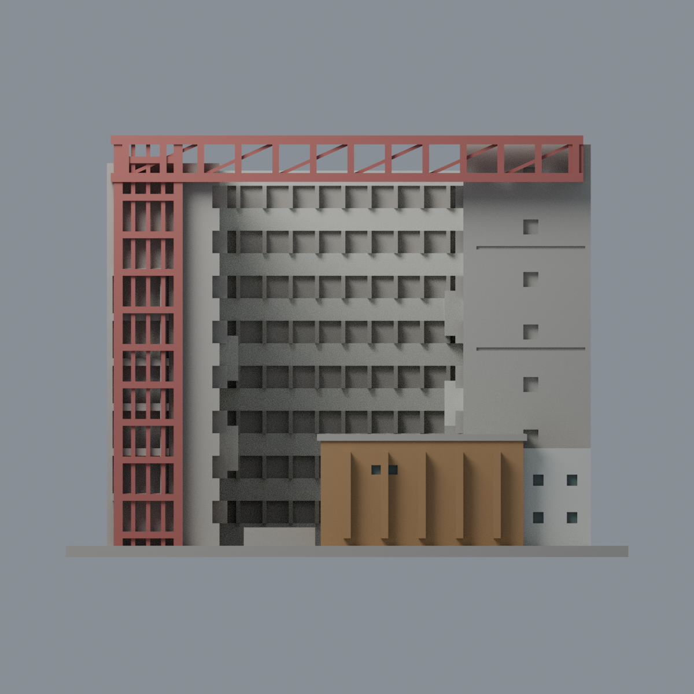
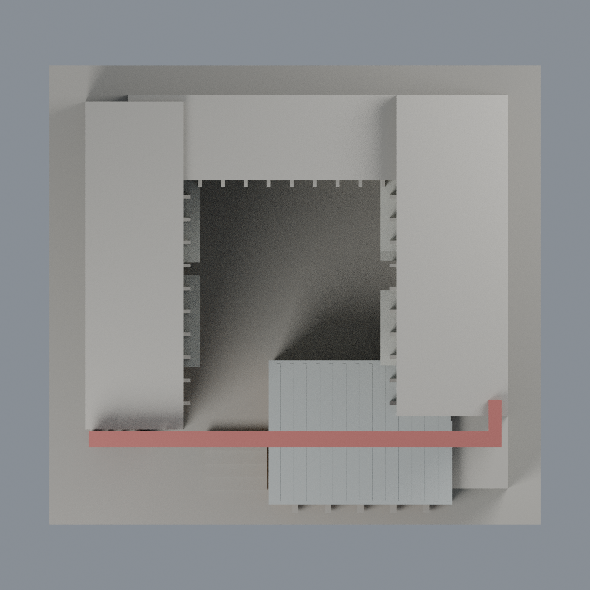

# 清華竹師教育學院大樓有限配色：六材質外觀版

沿用原 **10,606 三角面／5,103 頂點**，不改原 STL 位元、座標、面序或幾何；這是既有模型外觀改版，不增加模型包數。

| 模型預覽 | 模型預覽 | 模型預覽 |
| :---: | :---: | :---: |
| 正面  | 背牆中性／鋼桁構件有界延伸  |  |
|  |  |  |

[表面色 3MF](nthuchushi-appearance.3mf) · [可編輯 Blender](scene.blend) · [材質色表](palette.json) · [逐面指派與依據](face-materials.json) · [原 STL](../model.stl)

## 來源與配色邊界

親看清華官方校史檔案 PDF 第 6 頁兩張完工外觀（俯視、院內）及原單色網格與生成器。[來源與 PDF 雜湊](qa/source-review.json)。圖說 2024 年 5 月竣工是事件時間，文件建立／修改時間也不是照片拍攝日；拍攝日期未知，不宣稱 2026 現況。PDF 與來源照片私有研究，不放入包。

- 左端與頂部原鋼柱／橫桁／斜桁採低飽和紅鋼色，僅完整原構件，構件側背表面採同材料有界延伸；實景細穿孔網不存在原網格，留空不填。
- 低前廳可辨識的正面與左側為暖赭磚，突出肋僅可定位前面染磚，未確認側面中性；俯視直接支持其銀灰肋狀屋頂上面。右端低白附樓正／右側及離散小窗背可註冊，院內已分結構面與突出框採暖白。
- 高右塔實景磚牆含多條灰橫帶，原只少量刻線且側牆沒有分界，因此整片高塔牆保守中性，不將其一律染磚。此中性色不代表實景還原。
- 院內長窗凹背、左端高窗帶含綠色及米白不透明窗裙與玻璃，原未分界，保持中性而非全玻璃。原粗窗梃、簡化層次／比例保留，不新增玻璃隔板或設備。
- 未見屋頂／背牆及底板中性；低廳金屬屋頂是來源可見例外。不增加紅網、文字、車、人、園景或內部配置；配色不代表結構或製造驗證。

[原幾何與歷史來源限制](../README.zh-TW.md)

## 重建與核驗

安裝 [依賴](source/requirements.txt)，Blender 使用 4.3.2。由本資料夾上層提供原 model.stl：

1. `python appearance/source/build_appearance.py`
2. `python appearance/source/verify_exchange.py`
3. `blender -b -t 3 --python-exit-code 1 -P appearance/source/render_appearance.py`
4. `blender -b -t 3 --python-exit-code 1 -P appearance/source/verify_scene.py`

[獨立重建 ZIP](rebuild-source.zip)含原 STL、四支程式及依賴，不含第三方照片；不取代原建模腳本。[逐檔 SHA256](SHA256SUMS)

[交換／拓撲 QA](qa/exchange-validation.json)核對原座標與面序、全部面材質、單連通、有向水密邊、頂點 link 單環、正體積與零退化／重複面；lib3mf 嚴格讀取零警告，實際編輯單材質再存讀，其他材質及面指派不變。SDK 六位小數量化誤差另列。

[Blender 存讀與編輯](qa/scene-validation.json) · [渲染記錄](qa/render-manifest.json) · [獨立重建](qa/rebuild-validation.json)

## 製造限制照舊

尺寸仍為 150 × 140 × 112.4 mm；原 STL、建模程式、場景及歷史 QA 保留。原層檢與薄特徵檢查本次未重跑，不能由材質 QA 代替。

3MF 是同一網格的表面色，不是各材質各自封閉的分色實體、切片專案、噴頭映射或 G-code。切片 GUI、多材料路徑與實體列印未測；柱頭、屋簷、窗框及薄邊仍須評估材料、支撐及拆除風險，沒有保證可印或免支撐。
