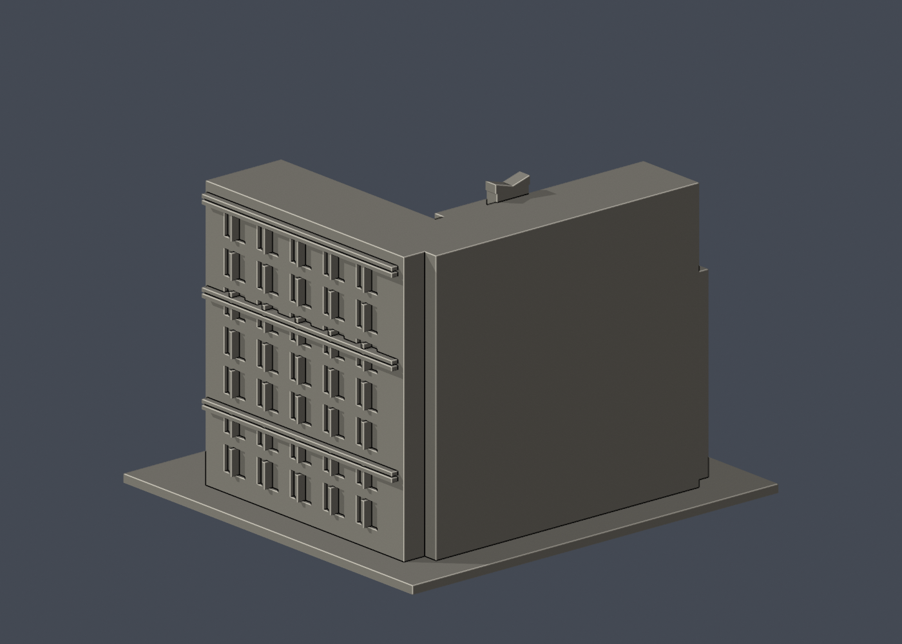

# 國立清華大學｜劉炯朗館（原資電館）

## 模型預覽

| 模型預覽 | 模型預覽 | 模型預覽 |
| :---: | :---: | :---: |
| 正面與來源支持區域<br> | 已見外翼有界／未知遠背中性<br> |  |

## 6 材質外觀版（2026-10-21）


[來源界線與四視角](appearance/README.md) · [表面色 3MF](appearance/nthuliu-appearance.3mf) · [可編輯場景](appearance/scene.blend)

依翻修後白天來源限定白牆、深灰褐遮陽肋與淺銀窗格／藝術方框，窗網混合凹背代理、未知尖帽及遠背中性。 原 STL 與歷史 QA 不變；這是外觀改善，不是新增幾何。[原單色正面](previews/front.png)／[原單色背面](previews/rear.png)


第八批公開外觀近似模型，並非測繪成果。每件獨立比例，150.00 × 140.00 × 110.00mm，最長150mm含底座。全校尚未完成。

## 來源與觀察
[官方建築導覽](https://www.nthu.edu.tw/hotNews/content/1173)；2026-10-13檢視來源實際像素。

已看校方2024年4月25日完工新聞的3張外觀，以及大岳設計/凱奕創意作品頁8張外部實景。保留高低U形院落、立面橫向遮陽、中央微折頂直條、低翼屋頂兩尖帽、端部半圓平台、入口柱框、分流台階與傾斜鏤空立方體。採翻修後外觀，沒有拿舊資電館照片直接當新館。

來源照片僅列連結，不放入成果、不重新發布：
- https://www.nthu.edu.tw/images/hotNews_171403086315.jpg
- https://www.nthu.edu.tw/images/hotNews_171403086399.jpg
- https://www.nthu.edu.tw/images/hotNews_171403091215.jpg
- https://www.keacg.com/upload/project/project_20240821153231_409.jpg
- https://www.keacg.com/upload/project/project_20240611111819_781.jpg
- https://www.keacg.com/upload/project/project_20240607205958_234.jpg
- https://www.keacg.com/upload/project/project_20240607205958_265.jpg
- https://www.keacg.com/upload/project/project_20240607205958_832.jpg
- https://www.keacg.com/upload/project/project_20240607205958_542.jpg
- https://www.keacg.com/upload/project/project_20240607205958_492.jpg
- https://www.keacg.com/upload/project/project_20240607205958_932.jpg

## 近似與缺口
整體U翼角度、長寬與深度、層高及各窗位置依公開照片概括，不是精確測繪。立面擴張網簡化成厚橫條，未複製每條網線。All in One作品的1.5萬細管與EE/CS視角文字大幅粗化成一個可連接的厚開框立方體，不能呈現原作光學效果；只有輪廓提示。低翼端部曲階只保留半圓層板與核心輪廓，省略每級踏步/欄杆。兩尖帽相對位置/形狀近似，背面未完整證實處素面，景觀整平、階梯縮短。

僅公開訪客可見外觀，無室內、地下、敏感設備或安全配置。未下載、擷取或反編譯官方Unity或任何原始3D模型。官方3D場景沒有逐面檢視，不能視為未見部位已獲證實。

## 檔案
- `build_model.py`：可攜參數化來源。
- `model.stl` / `model.obj`：單一連通、封閉實體，單位mm；不預挖內腔。
- `scene.blend`：實際STL的可編輯三角網格與相機，不是BIM或保留布林歷史的場景。
- `previews/front.png`、`rear.png`、`elevation.png`：實際STL預覽，已看像素。正背為顯示方向，不是實測方位。
- `validation.json`：原檔法線、邊與頂點流形、正體積、單一表面、重建及Blend/STL一致等16項通過。
- `check_layers.py` / `layer-check.json`：0.2mm幾何截面與0.8mm XY薄特徵篩查。

## 列印起點與支撐
底座向下，保持150mm尺寸。可從0.4mm噴嘴、0.2mm層高、3道外牆、15–20%填充起始，但不是測試完成的參數。

傾斜鏤空立方體底角與水平框邊、入口柱框和半圓懸挑層板均需支撐；支撐拆除易傷藝術框。立方框名義厚1.75mm，支柱2.2mm，窗框1.1–1.2mm、橫遮陽1.4mm高。禁止以薄篩通過推定免支撐。

薄特徵：5層警戒分別為斜立方體最低/最高尖角z=23.30001、23.50001、44.50001、44.70001mm，以及中央折頂尖緣z=109.90001mm；最大差異3.49954mm²。尖端截面可能被切片器鈍化/省略，低尖角還涉及支撐起始。550層輪廓皆閉合。

## 驗證範圍
16項網格驗證通過；原始STL法線與繞向相符，所有邊連接兩面、頂點環流形、單一連通表面且沒有分離內腔殼，正體積、z=0底面與150mm最大尺寸通過。乾淨暫存目錄重建STL的SHA-256相符，Blender幾何與STL一致；驗證不自動修原檔。

0.2mm間距共550個抽樣高度，所有輪廓閉合。端點數值聚合容差0.0001mm；首層0.100013mm以避共面。0.8mm XY形態開運算標示5層超過0.2mm²警戒，最大差異面積3.49954mm²，含義見薄特徵說明。

**未正式切片、未生成G-code、未實體試印。** 抽樣幾何截面不等於刀路、擠出、支撐或橋接驗證，亦不能證明全面三維壁厚或自相交完全不存在。

## 重建
Python 3.12與Blender 4.3.2+；所有程式從本檔目錄讀寫，不依賴製作端絕對路徑。

```sh
python -m pip install -r requirements.txt
python build_model.py
blender -b -t 2 -P render_preview.py
python validate_model.py
python check_layers.py
```

設計方作品來源：https://www.keacg.com/project/cont?pid=43 。只看公開外觀/院落，不復原館內展示配置。


## 實際STL正背並排

| 模型預覽 | 模型預覽 | 模型預覽 |
| :---: | :---: | :---: |
| 正面<br> | 背面（未見部分按詳頁明示簡化）<br> |  |
