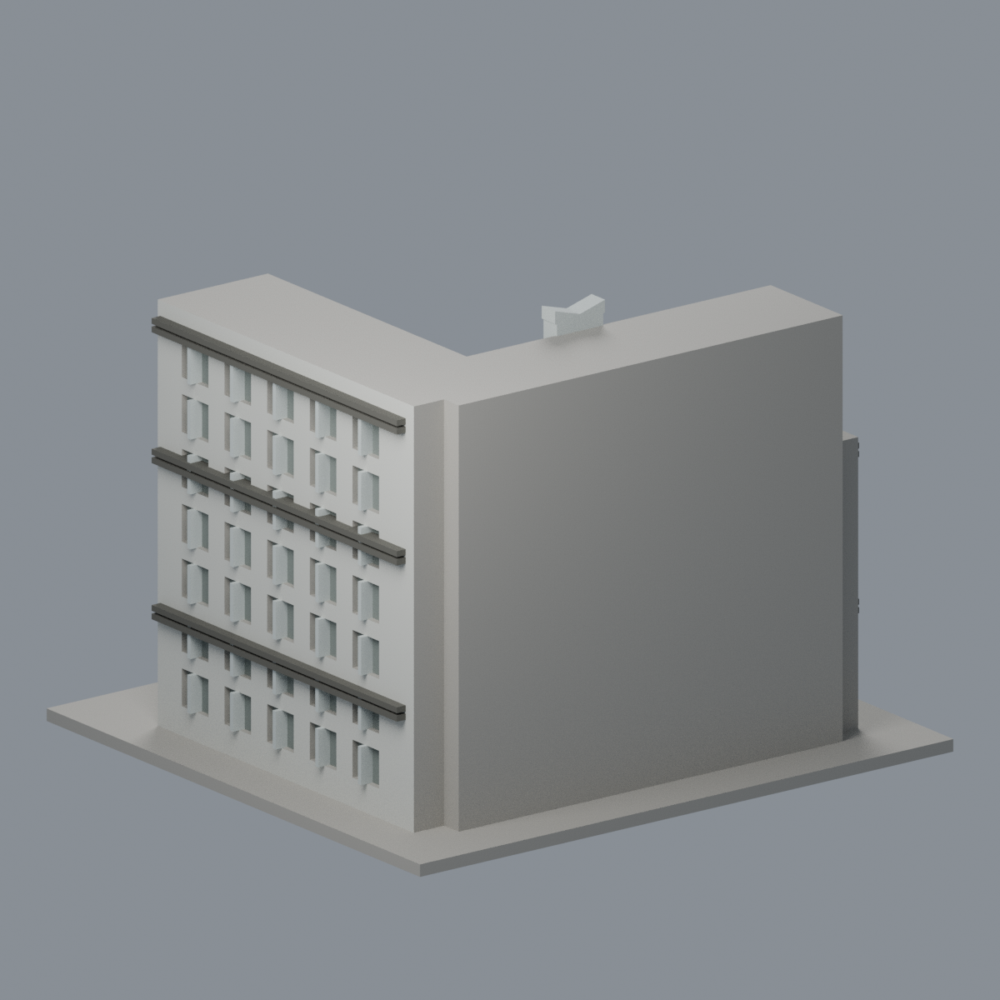
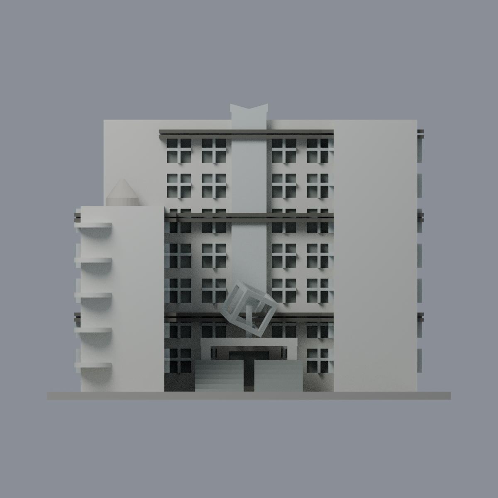
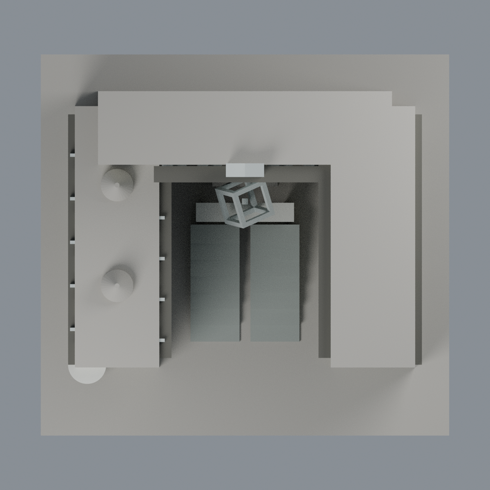

# 清華劉炯朗館：六材質外觀版

沿用原 **15,246 三角面／7,475 頂點**，不改原 STL 位元、座標、面序或幾何；這是既有模型外觀改版，不增加模型包數。

| 模型預覽 | 模型預覽 | 模型預覽 |
| :---: | :---: | :---: |
| 正面  | 已見外翼有界／未知遠背中性  |  |
|  |  |  |

[表面色 3MF](nthuliu-appearance.3mf) · [可編輯 Blender](scene.blend) · [材質色表](palette.json) · [逐面指派與依據](face-materials.json) · [原 STL](../model.stl)

## 來源與配色邊界

依清華[2024 年 4 月 25 日翻修啟用消息](https://www.nthu.edu.tw/hotNews/content/1173)之入口夜照，以及設計方大岳設計的三張白天庭院／外牆／側面照片。夜照 EXIF 原始時間記 2024-04-22、庭院白天照記 2024-04-10（相機時鐘／時區未獨立核定）；另外兩照無原始拍攝欄。四照完整解碼與來源 URL／雜湊列於[來源覆核](qa/source-review.json)；設計方照片不是校方照片。圖片修改日和上傳路徑不當拍攝日；2024 翻修背景不是每張拍攝日，也不稱 2026 現況。夜間紫光不染成真實牆色。

- 已註冊庭院與外翼主牆暖白、中央網帶與原窗格淺銀灰。細擴張網／窗玻璃原未逐片分離，窗凹背僅灰暗代理，不宣稱全部為外露玻璃，也不增加細網紋。
- 原突出水平遮陽肋深灰褐；不把肋間整條白牆染深。入口門廊白、原分列階梯灰石，沒有增中間植栽。
- 原傾斜開方框與支撐銀灰代理，不重建細管藝術品、題字或夜燈。半圓樓梯板淺色，保留原厚化比例。
- 原低翼兩個尖帽與照片可見的開放弧形樓梯冠不一致，保持中性並明示是既有近似，不把它們染成貌似確實的金屬亭頂。未知屋頂、遠背面及未註冊區中性。

[原幾何與歷史來源限制](../README.zh-TW.md)

## 重建與核驗

安裝 [依賴](source/requirements.txt)，Blender 使用 4.3.2。由本資料夾上層提供原 model.stl：

1. `python appearance/source/build_appearance.py`
2. `python appearance/source/verify_exchange.py`
3. `blender -b -t 3 --python-exit-code 1 -P appearance/source/render_appearance.py`
4. `blender -b -t 3 --python-exit-code 1 -P appearance/source/verify_scene.py`

[獨立重建 ZIP](rebuild-source.zip)含原 STL、四支程式及依賴，不含第三方照片；不取代原建模腳本。[逐檔 SHA256](SHA256SUMS)

[交換／拓撲 QA](qa/exchange-validation.json)核對原座標與面序、全部面材質、單連通、有向水密邊、頂點 link 單環、正體積與零退化／重複面；lib3mf 嚴格讀取零警告，實際編輯單材質再存讀，其他材質及面指派不變。SDK 六位小數量化誤差另列。

[Blender 存讀與編輯](qa/scene-validation.json) · [渲染記錄](qa/render-manifest.json) · [獨立重建](qa/rebuild-validation.json)

## 製造限制照舊

尺寸仍為 150 × 140 × 110 mm；原 STL、建模程式、場景及歷史 QA 保留。原層檢與薄特徵檢查本次未重跑，不能由材質 QA 代替。

3MF 是同一網格的表面色，不是各材質各自封閉的分色實體、切片專案、噴頭映射或 G-code。切片 GUI、多材料路徑與實體列印未測；柱頭、屋簷、窗框及薄邊仍須評估材料、支撐及拆除風險，沒有保證可印或免支撐。
