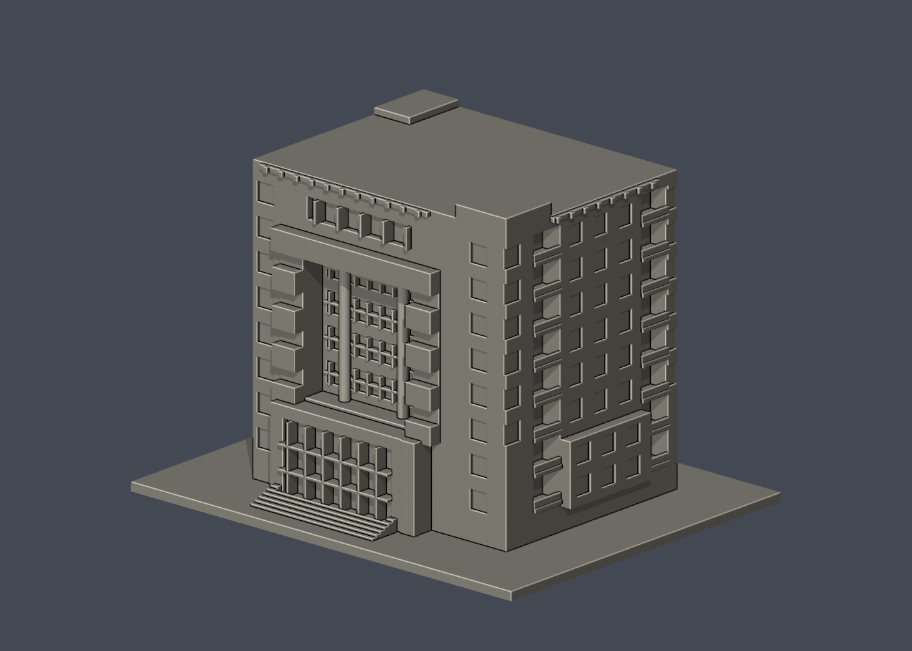
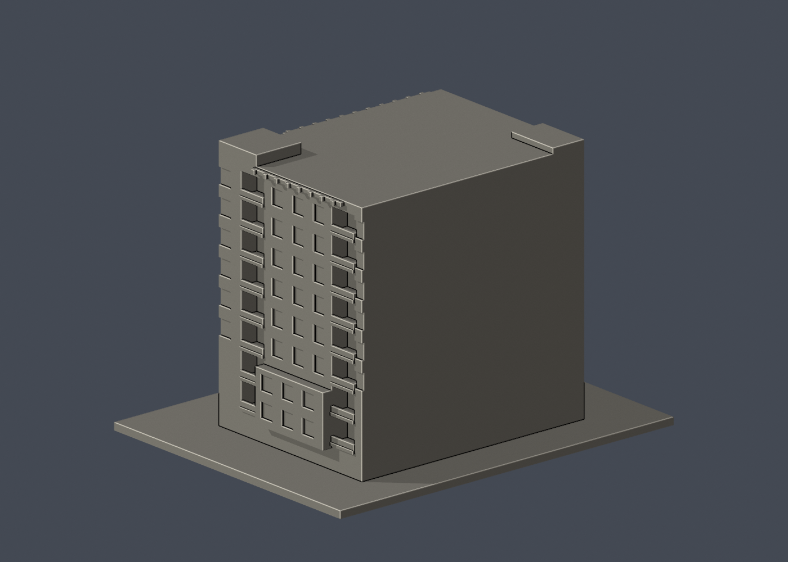

# 國立清華大學｜台達館

## 6 材質外觀版（2026-10-21）

| 正面與來源支持區域 | 未知後牆中性／來源支持右側 |
|---|---|
|  |  |

[來源界線與四視角](appearance/README.md) · [表面色 3MF](appearance/nthudelta-appearance.3mf) · [可編輯場景](appearance/scene.blend)

依官方照片限定淡桃直框、橘紅入口框與側盒、灰柱及離散窗色；混合灰帶主牆和白內門廊凹背中性，保留原薄層警戒。 原 STL 與歷史 QA 不變；這是外觀改善，不是新增幾何。[原單色正面](previews/front.png)／[原單色背面](previews/rear.png)


公開外觀照片導出的獨立桌上建築小模型。類別：**外觀近似，不是測繪模型**。校本部；首批的一件，不代表全校已完成。

## 檔案與尺寸
- `model.stl`：可列印單一實體，150.00 × 120.00 × 107.00 mm，含3mm底座，最長150mm。
- `scene.blend`：由實際STL匯入的Blender場景，單一三角網格，可編輯，單位mm。不是保留布林歷史的BIM；參數化重建用Python原始碼。
- `model.obj`：輔助交換網格。
- `build_model.py`：可攜原始碼；`requirements.txt`：依賴版本。
- `previews/front.png`、`rear.png`、`elevation.png`：實際STL渲染，不是參考照片或概念示意圖。正／背是模型顯示方向，非測量方位。
- `validation.json`：原檔驗證；`sources.json`：公開來源與近似紀錄。

## 來源與實際觀察
查閱日期：2026-10-13。來源頁：[校方公開介紹](https://alumni.site.nthu.edu.tw/p/404-1346-115103.php?Lang=zh-tw)。

校友中心近景與高視點外觀照片、電機系全景的實際像素已檢視。可辨識高層矩形量體、正面框式入口、成組凹入陽台、右側下段突出矩形及屋頂遮陽框。

參考照片僅以連結列出，**未放入交付檔案、未重新發布**：
- https://alumni.site.nthu.edu.tw/var/file/346/1346/img/2899/160333905.jpg
- https://alumni.site.nthu.edu.tw/var/file/346/1346/img/2899/131303382.jpg
- https://dee.site.nthu.edu.tw/var/file/175/1175/img/2260/252460815.jpg

## 近似與缺口
比例由照片估計，非測量。正面跨四層深凹口、兩支高柱、突出框及側面兩條全高陽台凹槽已立體化；個別窗洞仍規律化，屋頂遮陽框縮成壁附厚條，入口文字、玻璃、細欄杆及停車車道省略。左側與背面未見完整照片，使用素面封閉；背面不憑空配置門窗。

所有尺寸為獨立150mm尺寸控制，三件不共同比例。沒有室內格局、地下空間、進出控制或設備系統資料。沒有擷取校方Unity、BIM或其他原始3D資產。官方3D導覽只確認公開入口與技術頁，沒有宣稱已逐面走訪其3D場景。

## 列印起點
正立、底座朝下。中央凹口深約8mm、側面陽台槽深約7mm；跨樓層凹口上缘、陽台板及入口雨檐可能需要支撐，必須在切片器檢視；不宣称免支撐。大面積底座可考慮裙邊，避免翹曲。

可從0.4mm噴嘴、0.2mm層高、3道外牆、15–20%填充起始評估，這些只是建議，非已驗證參數。STL是封閉實體；填充率由切片器決定，未預挖內腔。150mm含底座，請勿再用共同校園比例套用。較細凹槽可按機台調整。

## 驗證結果
`validation.json` 的 passed = true。原始二進位STL法線為單位向量且與面繞向一致；非退化三角面；封閉、邊與頂點流形；單一連通表面，沒有分離的內腔殼；正體積；底面z=0；尺寸150mm；乾淨暫存目錄重建STL的SHA-256一致；Blender與STL三角幾何一致。

尚未跑切片器、尚未實體試印，不宣稱完成支撐最佳化或全面自相交證明。模型及正背面預覽已人工檢視。

## 乾淨重建
需Python 3.12與Blender 4.3.2或較新版。先在虛擬環境安裝requirements.txt；在本資料夾依序執行：

```sh
python -m pip install -r requirements.txt
python build_model.py
blender -b -t 2 -P render_preview.py
python validate_model.py
```

原始碼只依賴同資料夾檔案；不依賴製作機器的絕對路徑。驗證會自行從乾淨暫存目錄重建STL；原檔不經自動修復。


## 列印幾何 v2（2026-10-13）

台達館：將入口凹槽前緣延伸，移除原z6.5–7.1mm台階交界0.25mm深薄唇；右側最前窗口凹槽向外角延伸，移除原0.25mm窄角片。主量體、前框柱、圓柱與外觀其他部分不變。235層薄篩警戒仍來自0.7mm名義寬的大凹口附牆窗格、0.8mm入口附牆窗格；分別嵌入背牆約0.25/0.55mm，不是獨立承重柱。可因噴嘴寬度而合併/漏印，仍須實際切片預覽。

此版另存，不覆寫製作端原版。16項網格驗證通過、乾淨重建SHA相同、Blend/STL一致；全部535個0.2mm抽樣輪廓閉合。最大0.8mm XY開運算損失面積11.80619mm²。檢查強制輪廓度數2及多邊形有效，不默默跳過斷環。薄篩不是全面壁厚證明，未正式切片、未G-code、未實體試印。

重跑：`python check_layers.py`，結果在`layer-check.json`。原始外觀來源與未見背面限制保持。


## 實際STL正背並排

| 正面 | 背面（未見部分按詳頁明示簡化） |
|---|---|
|  |  |
