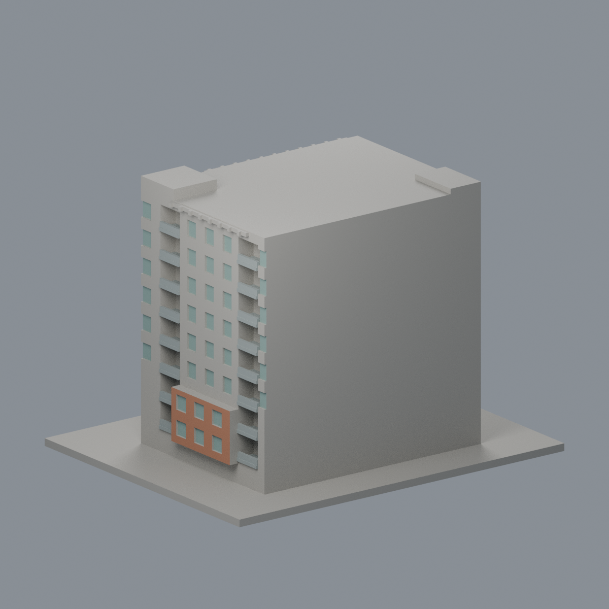
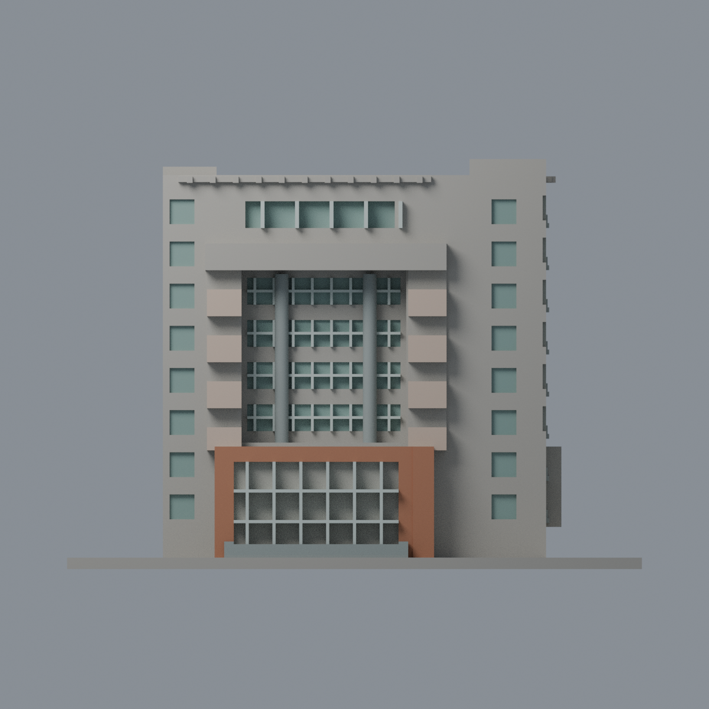
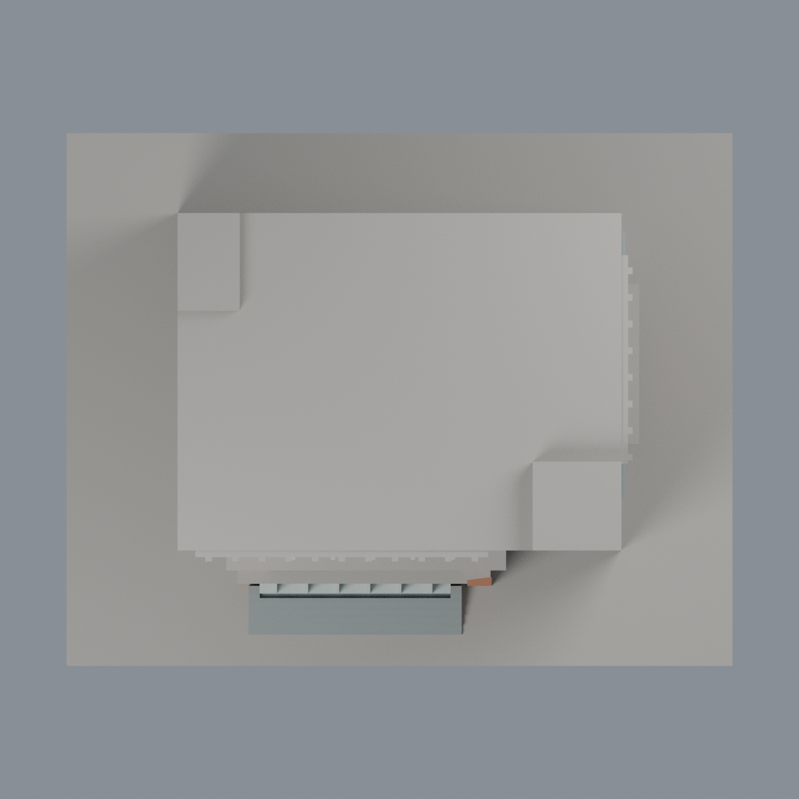

# 清華台達館：六材質外觀版

沿用原 **5,370 三角面／2,659 頂點**，不改原 STL 位元、座標、面序或幾何；這是既有模型外觀改版，不增加模型包數。

| 模型預覽 | 模型預覽 | 模型預覽 |
| :---: | :---: | :---: |
| 正面  | 未知後牆與屋頂中性  |  |
|  |  |  |

[表面色 3MF](nthudelta-appearance.3mf) · [可編輯 Blender](scene.blend) · [材質色表](palette.json) · [逐面指派與依據](face-materials.json) · [原 STL](../model.stl)

## 來源與配色邊界

親自核對清華官方[校友介紹頁](https://alumni.site.nthu.edu.tw/p/404-1346-115103.php?Lang=zh-tw)、[近照](https://alumni.site.nthu.edu.tw/var/file/346/1346/img/2899/160333905.jpg)、[完整斜照](https://alumni.site.nthu.edu.tw/var/file/346/1346/img/2899/131303382.jpg)及[電機系照](https://dee.site.nthu.edu.tw/var/file/175/1175/img/2260/252460815.jpg)。後兩張為相近角度不同檔案，不當兩個獨立立面；三照皆無 EXIF 拍攝日，不從檔名推年份，不稱 2026 現況。[來源覆核與雜湊](qa/source-review.json)，原圖不入包。

- 原突框兩直柱**完整向外正面**淡粉米磁磚色，凹入陽台背不當玻璃。頂橫框實景上緣有灰色帶但原面未分界，因此頂橫框及上接柱段保持中性，不整塊染粉。
- 入口原外紅框與右側低盒外面橘紅磚代理；空白字柱同色，不增「台達館」文字。入口大凹背包含實景另有的白門廊，但模型缺少此白構件，故整片背中性而非全玻璃。
- 原中央灰圓柱、右陽台板灰色；既有陽台欄只用灰代理，不增玻璃小片。只有離散真窗凹背灰綠，原窗格銀灰；中央橫窗間實裙及陽台深背中性，不混成玻璃帷幕。
- 主前側牆混合米白／桃色／下部灰帶而沒有完整分面，全保持中性。屋頂、背面和未註冊部分中性，頂部細構件不當 PV；原階梯灰色，不塗無分界草地。
- 原 STL 位元、面序及歷史 v2 QA 保持，**既有 235 層薄篩警戒仍存在**；0.7mm／0.8mm 附牆窗格可能合併或漏印，須實際切片。本配色不修幾何、不表示製造放行，也未實體試印。

[原幾何與歷史來源限制](../README.zh-TW.md)

## 重建與核驗

安裝 [依賴](source/requirements.txt)，Blender 使用 4.3.2。由本資料夾上層提供原 model.stl：

1. `python appearance/source/build_appearance.py`
2. `python appearance/source/verify_exchange.py`
3. `blender -b -t 3 --python-exit-code 1 -P appearance/source/render_appearance.py`
4. `blender -b -t 3 --python-exit-code 1 -P appearance/source/verify_scene.py`

[獨立重建 ZIP](rebuild-source.zip)含原 STL、四支程式及依賴，不含第三方照片；不取代原建模腳本。[逐檔 SHA256](SHA256SUMS)

[交換／拓撲 QA](qa/exchange-validation.json)核對原座標與面序、全部面材質、單連通、有向水密邊、頂點 link 單環、正體積與零退化／重複面；lib3mf 嚴格讀取零警告，實際編輯單材質再存讀，其他材質及面指派不變。SDK 六位小數量化誤差另列。

[Blender 存讀與編輯](qa/scene-validation.json) · [渲染記錄](qa/render-manifest.json) · [獨立重建](qa/rebuild-validation.json)

## 製造限制照舊

尺寸仍為 150 × 120 × 107 mm；原 STL、建模程式、場景及歷史 QA 保留。原層檢與薄特徵檢查本次未重跑，不能由材質 QA 代替。

3MF 是同一網格的表面色，不是各材質各自封閉的分色實體、切片專案、噴頭映射或 G-code。切片 GUI、多材料路徑與實體列印未測；柱頭、屋簷、窗框及薄邊仍須評估材料、支撐及拆除風險，沒有保證可印或免支撐。
