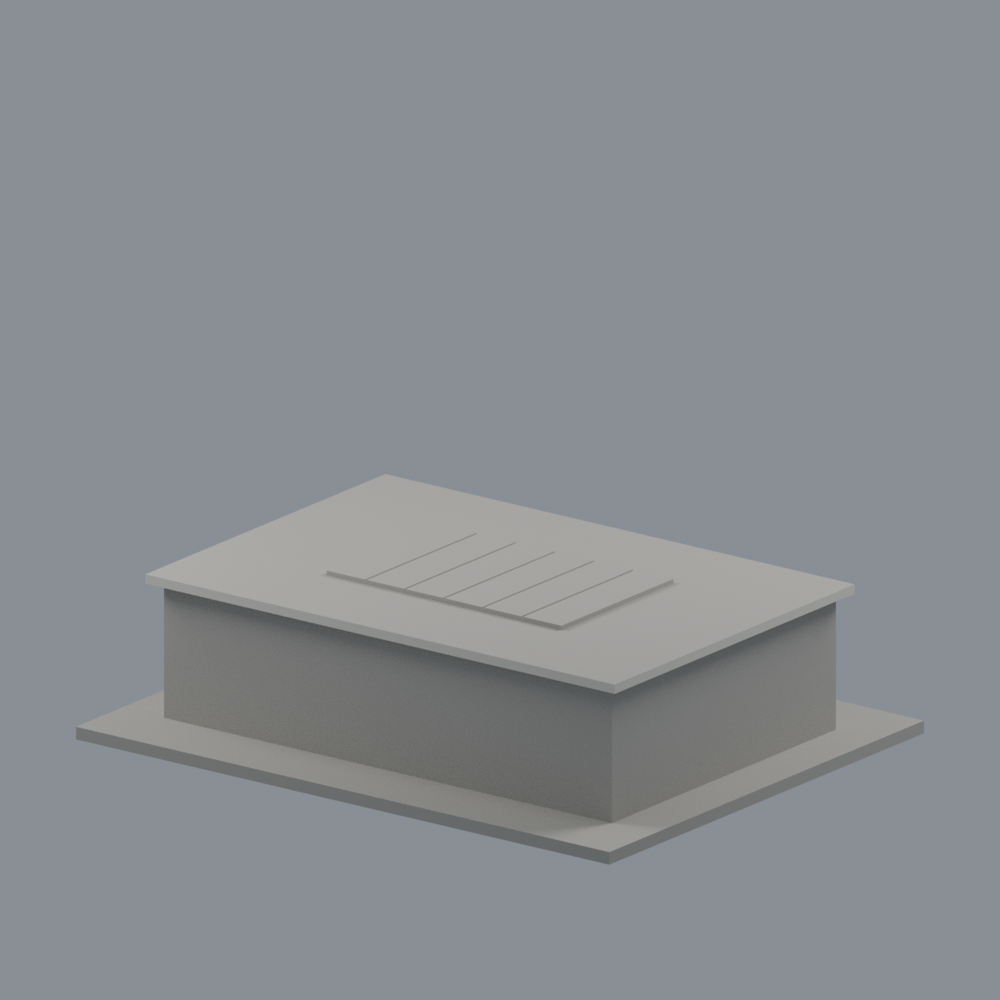
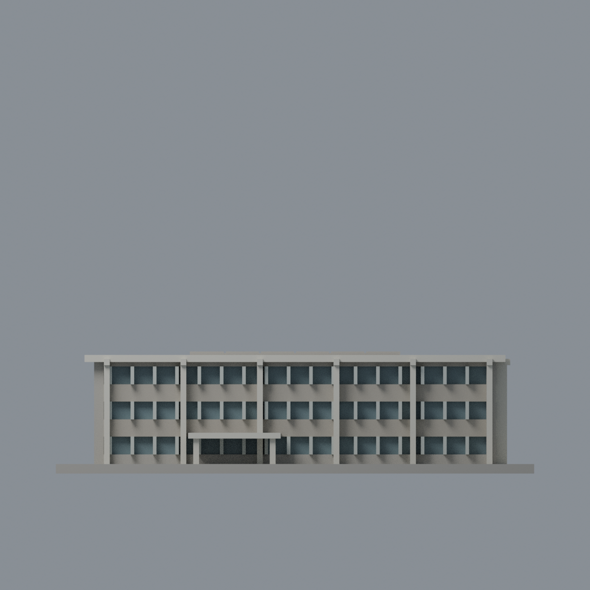
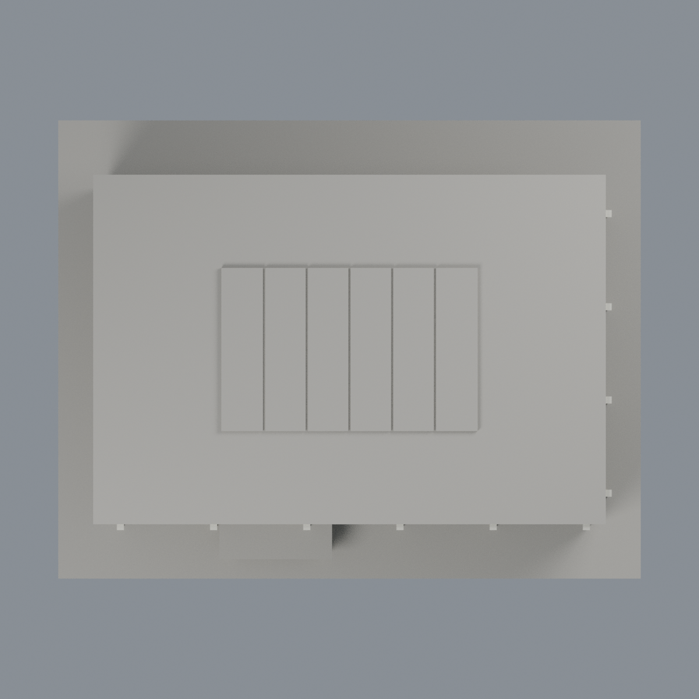

# 清華教育館舊館：五材質外觀版

沿用原 **3,222 三角面／1,579 頂點**，不改原 STL 位元、座標、面序或幾何；這是既有模型外觀改版，不增加模型包數。

| 正面 | 未知左背牆與屋頂中性 |
|---|---|
|  |  |
|  |  |

[表面色 3MF](nthueducation-appearance.3mf) · [可編輯 Blender](scene.blend) · [材質色表](palette.json) · [逐面指派與依據](face-materials.json) · [原 STL](../model.stl)

## 來源與配色邊界

親看清華教育館官方三張完整外觀照，核對原單色網格與生成器；[精確來源 URL、雜湊與日期欄](qa/source-review.json)。第一照 nested EXIF 原始時間自報 2011-10-30 11:12:31，但舊 EXIF 區塊另有 Truncated File Read 警告；JPEG 像素完整解碼與檔尾通過，不把中繼資料完整性和像素完整性混為一談。另兩照無原始日期。均不稱 2026 現況，原照不入包。

- 已見正／右側上部石粒牆灰褐，原凸柱與凸簷可見邊／底象牙白、離散窗背低飽和灰藍、既有窗梃銀灰。顏色為未校準的材質代理。
- 原網格沒有照片下層密防護格柵與細窗格，僅保留簡化窗凹與原粗梃，不新增鐵窗、空調、牌字或細節。不把窗背代理稱為逐窗精確還原。
- 底層牆腳有遮擋或混合材質，未跨界切分的整面保持中性。未知左／背、屋頂平面、凸簷頂面與底板中性；不把屋頂蓋或刻槽誤認 PV 或玻璃。
- 原柱與門廊構件的側面只作同材質有限延伸，不把未知整棟背牆染色。

[原幾何與歷史來源限制](../README.zh-TW.md)

## 重建與核驗

安裝 [依賴](source/requirements.txt)，Blender 使用 4.3.2。由本資料夾上層提供原 model.stl：

1. `python appearance/source/build_appearance.py`
2. `python appearance/source/verify_exchange.py`
3. `blender -b -t 3 --python-exit-code 1 -P appearance/source/render_appearance.py`
4. `blender -b -t 3 --python-exit-code 1 -P appearance/source/verify_scene.py`

[獨立重建 ZIP](rebuild-source.zip)含原 STL、四支程式及依賴，不含第三方照片；不取代原建模腳本。[逐檔 SHA256](SHA256SUMS)

[交換／拓撲 QA](qa/exchange-validation.json)核對原座標與面序、全部面材質、單連通、有向水密邊、頂點 link 單環、正體積與零退化／重複面；lib3mf 嚴格讀取零警告，實際編輯單材質再存讀，其他材質及面指派不變。SDK 六位小數量化誤差另列。

[Blender 存讀與編輯](qa/scene-validation.json) · [渲染記錄](qa/render-manifest.json) · [獨立重建](qa/rebuild-validation.json)

## 製造限制照舊

尺寸仍為 150 × 118 × 38.3 mm；原 STL、建模程式、場景及歷史 QA 保留。原層檢與薄特徵檢查本次未重跑，不能由材質 QA 代替。

3MF 是同一網格的表面色，不是各材質各自封閉的分色實體、切片專案、噴頭映射或 G-code。切片 GUI、多材料路徑與實體列印未測；柱頭、屋簷、窗框及薄邊仍須評估材料、支撐及拆除風險，沒有保證可印或免支撐。
