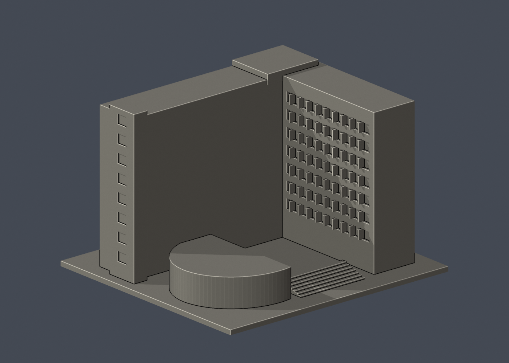

# 國立清華大學｜工程一館

## 模型預覽

| 模型預覽 | 模型預覽 | 模型預覽 |
| :---: | :---: | :---: |
| 正面<br> | 背面（未見部分按詳頁明示簡化）<br> |  |

第三批公開外觀近似模型，並非測繪成果。每件獨立比例，150.00 × 138.00 × 98.00mm，最長150mm含底座。全校尚未完成。

## 來源與觀察
[官方建築導覽](https://attractions.site.nthu.edu.tw/p/406-1515-187020,r8697.php?Lang=zh-tw)；2026-10-13檢視來源實際像素。

已實看官方正面、公開院落、轉角及另一端外觀照片。可辨識L形高棟/回翼、端部高起窄塔、兩層入口柱框、上層框帶與院落低弧形量體。

來源照片僅列連結，不放入成果、不重新發布：
- https://attractions.site.nthu.edu.tw/var/file/515/1515/pictures/197/m/mczh-tw700x700_large38200_943879477235.jpg
- https://attractions.site.nthu.edu.tw/var/file/515/1515/pictures/197/m/mczh-tw700x700_large38201_293491477235.jpg
- https://attractions.site.nthu.edu.tw/var/file/515/1515/pictures/197/m/mczh-tw700x700_large38202_818257977236.jpg
- https://attractions.site.nthu.edu.tw/var/file/515/1515/pictures/197/m/mczh-tw700x700_large38203_417958777236.jpg

## 近似與缺口
L形兩翼深度、院落及低弧翼的完整邊界僅依外觀估計；不以照片中的室內配置建模。公開院落立面可見的窗帶有保留，未見外後立面則素面。小屋、雨棚薄架、玻璃及細設備省略；窗帶分格適度規律化。

僅公開訪客可見外觀，無室內、地下、敏感設備或安全配置。未下載、擷取或反編譯官方Unity或任何原始3D模型。官方3D場景沒有逐面檢視，不能視為未見部位已獲證實。

## 檔案
- `build_model.py`：可攜參數化來源。
- `model.stl` / `model.obj`：單一連通、封閉實體，單位mm；不預挖內腔。
- `scene.blend`：實際STL的可編輯三角網格與相機，不是BIM或保留布林歷史的場景。
- `previews/front.png`、`rear.png`、`elevation.png`：實際STL預覽，已看像素。正背為顯示方向，不是實測方位。
- `validation.json`：原檔法線、邊與頂點流形、正體積、單一表面、重建及Blend/STL一致等18項通過。
- `check_layers.py` / `layer-check.json`：0.2mm幾何截面與0.8mm XY薄特徵篩查。

## 列印起點與支撐
底座向下，保持150mm尺寸。可從0.4mm噴嘴、0.2mm層高、3道外牆、15–20%填充起始，但不是測試完成的參數。

雙層入口凹口、頂層凹帶與檐下可能需要局部支撐；窗口為有背襯的淺凹。階梯已縮短，低弧翼藉共同底座接成一件。

薄特徵：原左側窗框交會處0.75mm薄條已修成完整2.5mm立柱。0.8mm XY篩查無>0.2mm²警戒面積；窗框1.1mm、入口立柱1.8mm，並不等於全面三維最小壁厚證明。

## 驗證範圍
18項網格驗證通過；原始STL法線與繞向相符，所有邊連接兩面、頂點環流形、單一連通表面且沒有分離內腔殼，正體積、z=0底面與150mm最大尺寸通過。乾淨暫存目錄重建STL的SHA-256相符，Blender幾何與STL一致；驗證不自動修原檔。

0.2mm間距共490個抽樣高度，所有輪廓閉合。端點數值聚合容差0.0001mm；首層0.100013mm以避共面。0.8mm XY形態開運算標示0層超過0.2mm²警戒，最大差異面積0.00024mm²，含義見薄特徵說明。

**未正式切片、未生成G-code、未實體試印。** 抽樣幾何截面不等於刀路、擠出、支撐或橋接驗證，亦不能證明全面三維壁厚或自相交完全不存在。

## 重建
Python 3.12與Blender 4.3.2+；所有程式從本檔目錄讀寫，不依賴製作端絕對路徑。

```sh
python -m pip install -r requirements.txt
python build_model.py
blender -b -t 2 -P render_preview.py
python validate_model.py
python check_layers.py
```


